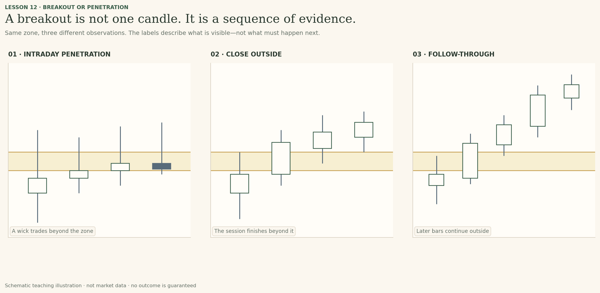
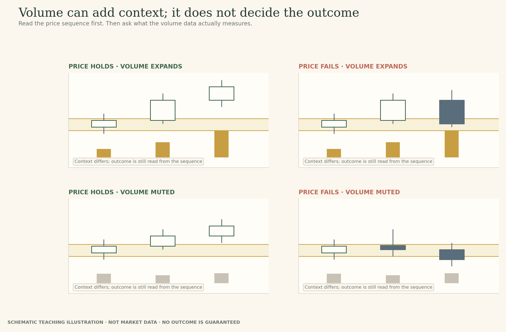
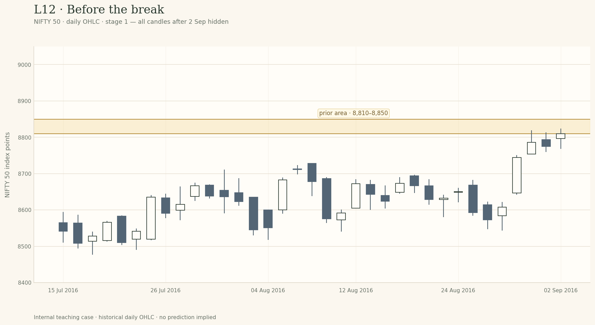

# Lesson 12 — Breakout or Temporary Penetration?

**Module:** 5 — Breakouts & Failures  
**Estimated time:** 25–30 min  
**Hook:** *A close beyond a line is evidence. It is not a verdict.*  
**Audience:** Learner-facing original teaching copy; instructor references remain in the source note.  

## What you will learn

- Define the prior zone using evidence visible before the move.
- Distinguish an intraday excursion from a close outside the zone.
- Explain the trade-offs of close, distance, time and volume filters.
- Describe alternatives without turning the chart into a buy/sell instruction.

## Start with the question

Learn to describe the break precisely, compare confirmation choices and keep their limitations visible.

> A close beyond a line is evidence. It is not a verdict.

## First name the boundary

A breakout begins with a claim about a boundary. Before price moves through it, identify the previous highs, lows or range edge that make the area relevant. Keep the zone fixed while you inspect what happens next. If the zone needs to change, record the revision rather than pretending you drew it that way originally.
A move outside a zone can be a transition from a range into a directional phase. It can also be a temporary excursion or an unresolved transition. The label breakout should describe what price has done—not quietly predict what it must do next.

## Four kinds of evidence

A wick beyond the area shows that price traded there; it does not show that the session finished there. A close outside the area adds a different piece of evidence. Distance beyond the zone and time spent outside it can provide further information, while follow-through shows whether the move continues to hold up. These are related but distinct observations.
Volume may provide context when the instrument and data source make it meaningful. Some analysts use it as a central confirmation tool; others do not require a volume surge before they interpret a price move. In this course, volume is supporting evidence—not a universal pass/fail switch. The example chart deliberately isolates price behaviour and does not plot volume.

## Every filter has a cost

Waiting for a close can filter out some intraday penetrations, but a close just outside the zone may still fail. Requiring a larger percentage distance can reduce borderline cases, but the market may already have moved far by the time the condition is met. Requiring two closes can avoid some one-bar excursions, but it can also recognise a move late—and it still cannot guarantee continuation.
A filter is valuable when it makes your observation repeatable and its trade-off is understood. It becomes dangerous when it is taught as a law. Choose a convention appropriate to the chart and timeframe, apply it consistently, and keep the alternative open.

## The market state still matters

A breakout attempt is a transition between structures. A move above a nearby high on a short chart may remain inside a much broader range. Conversely, a boundary that caps a long period of overlapping price may be more consequential than a tiny local swing. Change the viewing scale and ask what remains true. The local break is not automatically the larger story.
Your task here is not to trade the break. It is to state exactly what the chart has established, what it has not established, and what future evidence would change your view.

## The range is a market state, not just a shape

A range is not merely a rectangle drawn around candles. It is a period in which price has repeatedly traded within a broad boundary without establishing a lasting direction beyond it. The upper edge matters because earlier attempts to move above it did not remain there; the lower edge matters for the same reason. That history gives the next crossing context, but it does not tell us in advance which side will win.
The transition is the important part. A price sequence can move from overlap to sustained directional travel, or it can leave the range briefly and return. Those two paths may begin with candles that look almost identical. The analyst’s job is not to name the transition too early; it is to keep track of the evidence that supports a change in market state and the evidence that argues against it.
This is why context belongs before the pattern name. A short-term break above a small local high may still sit inside a broader range. A move through a long-tested boundary may be more consequential, but still needs to be evaluated in its own timeframe and market conditions. The same candle shape can mean different things depending on what came before it and where it sits within the broader structure.

*Figure 1. Changing the viewing scale changes the question. A local break is an observation; its importance depends on the surrounding structure.*

## The evidence ladder: wick, close, acceptance, follow-through

It helps to separate four observations that are often collapsed into one word. First, a wick may pass through the zone. That tells you price visited the area during the bar. Second, the close may finish outside the selected edge. That tells you where the period ended, not how the next one must behave. Third, price may spend more time or distance outside the range. Fourth, later bars may continue to hold outside it or may return through it. These are stages of evidence, not a mandatory four-step signal.
A close outside a band is often more useful than the intrabar high alone because the close records a different part of the session’s path. But the difference is descriptive, not magical. A close a few ticks beyond the edge can be followed by another move back through the band. Several closes outside can also be followed by failure. The correct sentence is not “the close confirms the breakout forever”; it is “the close adds evidence that price ended this period beyond the boundary”.
The illustration keeps the same zone across three small sequences. Notice how the first chart records an excursion without a close outside, the second records a close outside, and the third adds follow-through. Each state justifies a different description. None, in isolation, allows us to promise continuation.

*Figure 2. These are not three interchangeable labels. The evidence grows, but certainty does not.*

## Confirmation filters move the decision point; they do not remove risk

Analysts sometimes require a minimum distance beyond the zone, two closes outside, a bar close rather than a wick, a return that holds, or some combination. A written convention makes the analysis easier to repeat and compare. Without a convention, a trader can unconsciously change the definition every time the chart becomes uncomfortable.
Yet each filter has a cost. A distance buffer can reject marginal penetrations while recognising a genuine move later. Waiting for an additional close can reduce dependence on one bar while moving the decision point farther from the original boundary. A retest condition may provide a cleaner question when price returns, but some moves never return. The filter that reduces one kind of ambiguity can create another kind of delay or exclusion.
The practical question is not “Which filter never fails?” No such filter can be inferred from a chart-reading principle. Ask instead: what ambiguity is this rule intended to reduce, what evidence does it require, and what types of move might it cause me to recognise late or not at all? Apply the same rule consistently, then assess it across enough examples before treating it as a useful personal convention.

*Figure 3. A rule changes the information threshold you act on. It does not control what happens afterwards.*

## Volume: confirmation, context, and disagreement between practitioners

Murphy’s technical-analysis teaching gives volume a meaningful role in evaluating the resolution of price patterns: a break accompanied by stronger participation can carry more weight than one occurring without it. That is useful as a question to ask, particularly when the instrument has reliable, consolidated volume data. It is not permission to turn volume into a universal pass/fail switch.
Brian Shannon has described the cost of waiting for volume to confirm every move: in his own practice, waiting sometimes meant recognising momentum later and chasing a price that had already travelled. The disagreement is instructive. One practitioner may use volume as an important confirming input; another may give price action greater priority. Neither perspective lets us state that low volume proves a fakeout or that high volume guarantees follow-through.
Volume also depends on what the chart actually measures. Exchange-traded futures and equities may have traded volume; some spot FX and CFD feeds show broker-specific tick volume or differently aggregated data. A comparison is only meaningful if the source, instrument, session and baseline are understood. In this lesson’s price-only case, volume is deliberately not plotted; the learner is not allowed to smuggle in evidence the chart does not display.

*Figure 4. Price and volume can support or complicate a reading. They do not reveal hidden motive or guarantee the next move.*

## What the historical case can teach—and what it cannot

The staged NIFTY 50 case shows several closes above a candidate upper-area band before the price later closes back below it. Before the final reveal, the evidence supports describing a breakout attempt under the stated daily-close convention. The later close back below the band contradicts the idea that price was sustaining itself above that area in the selected window.
That ending does not make the first-stage judgement foolish. The later candles were not available yet. It also does not prove that the band caused the move, that every similar breakout will fail, or that an opposite-side trade was automatically justified. The example is useful because it makes one narrow point visible: a filter can be applied consistently and the move can still fail.
When you inspect the actual stages, record your view before each reveal. After the final view, compare your first statement with your revised one. Did you describe the close accurately? Did you overstate what was established? Did you keep an alternative alive? This review of reasoning is the learning task; predicting the particular ending is not the assessment.

*Figure 5. Preserve what you thought before the later evidence arrived. That is how you can audit hindsight.*

## Examine the historical evidence

The chart-stage images below are shown in the interactive preview one at a time. Do not inspect later stages before you have recorded your current read. The charts use historical NIFTY 50 daily OHLC as temporary internal examples; selected zones are teaching choices, not official levels.

### Stage 1 — Stage 1 · Before the break

**Prompt:** What makes this a plausible prior upper area, and what would count as a break on this daily chart?

*NIFTY 50 daily candles through 2 September 2016. The prior upper zone is highlighted; subsequent candles are hidden.*

**Response prompt:** Name the prior evidence, your breakout convention, and one thing that would remain uncertain.

### Stage 2 — Stage 2 · The move closes outside

**Prompt:** Price has now closed above the zone for several sessions. What is better supported now—and what is still not guaranteed?

*The same NIFTY 50 chart through 8 September 2016, now showing several closes above the highlighted zone.*

**Response prompt:** State your revised view, the evidence for it, and a specific condition that would weaken it.

### Stage 3 — Stage 3 · Later evidence

**Prompt:** How should you revise your earlier view now that price has moved back below the original zone?

*The complete teaching window through 16 September 2016, showing price later returning below the original zone.*

**Response prompt:** Explain which earlier evidence still mattered, what changed, and what you would avoid claiming in hindsight.

### Worked recap — reveal only after the learner has submitted

The sequence is intentionally uncomfortable: multiple closes beyond the chosen band did not prevent a later failure. A closing-price or time filter can make a rule more consistent; it cannot make the next move certain. The defensible summary is that a breakout attempt occurred and later lost support from the subsequent evidence. The ending was not knowable at Stage 1.

## Field notes

The interactive preview includes four named fields. Preserve the first response rather than overwriting it after the reveal. Export is browser-local only; it is not connected to a member account.

1. **Observation:** what price did relative to the original zone, including wick and close.
2. **Interpretation:** what the current evidence makes more plausible, with uncertainty.
3. **Alternative:** a second path that still fits the visible evidence.
4. **Revision condition:** the specific event that would weaken or change the view.

## Takeaway

**Describe the break using an explicit convention, then keep judging what happens afterwards.**

## Knowledge check

### 1. A wick crosses above resistance but the candle closes back inside the zone. What is the most precise description?

- A. The breakout is confirmed.
- B. Price penetrated the area intraday but did not close beyond the chosen boundary.
- C. The level has become support.

**Instructor feedback (after submission):** The high records an excursion; the close records where the session finished. They are not identical observations.

### 2. Two closes beyond a zone guarantee continuation.

- A. True
- B. False

**Instructor feedback (after submission):** A time filter is a convention, not a guarantee. The historical example later closes back below its zone.

### 3. No volume surge appears on the chart. Does that alone prove the breakout is false?

- A. Yes, volume is mandatory in every market.
- B. No. Volume is one possible contextual input; assess the price sequence and chart context too.
- C. Yes, unless the next candle gaps.

**Instructor feedback (after submission):** Practitioners differ on how volume should be used. The course should not turn it into a universal pass/fail rule.

## Teaching references — internal production note

These lessons use original TradeThesis explanations informed by established sources. Do not reproduce book prose or textbook figures.

- John J. Murphy, *Technical Analysis of the Financial Markets*: closing prices, gaps, volume, price patterns and deviations from ideal patterns.
- Adam Grimes, *The Art and Science of Technical Analysis*: transitions between trends and ranges, failure tests and failed breakouts.
- Jack D. Schwager and Mark Etzkorn, *A Complete Guide to the Futures Market*: role reversal and the dedicated chapter on failed signals.
- Brian Shannon, *Technical Analysis Using Multiple Timeframes*: larger context and the danger of changing scales without noticing.
- Carol Osler, “Support for Resistance: Technical Analysis and Intraday Exchange Rates”: bounded empirical study of supplied FX levels; it does not validate every manually drawn zone or every asset class.

See `BREAKOUTS_FAILURES_AUTHOR_RESEARCH.md` for source links and qualification.
