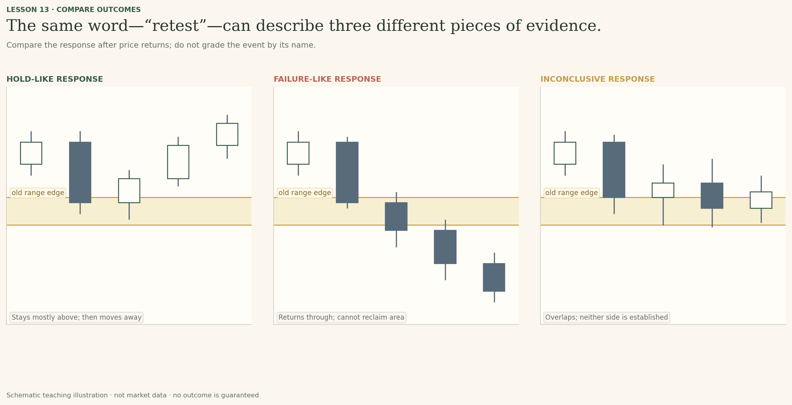
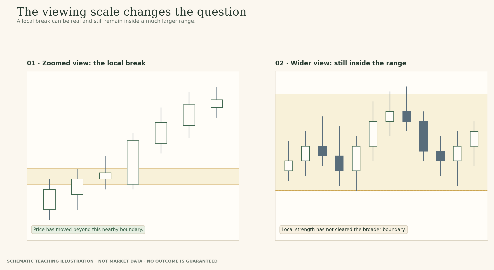
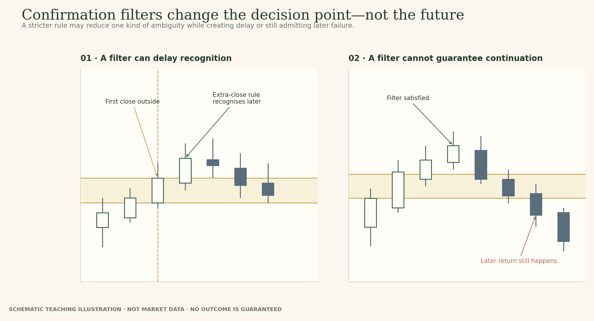

# Lesson 13 — Retests and Role Reversal

**Module:** 5 — Breakouts & Failures  
**Estimated time:** 25–30 min  
**Hook:** *A retest is not confirmation. It is the next test of a claim.*  
**Audience:** Learner-facing original teaching copy; instructor references remain in the source note.  

## What you will learn

- Distinguish the break from a later return.
- Describe whether the return touches, enters, crosses or stays outside the band.
- Explain why former resistance may become support without treating that as a rule.
- State what would strengthen or weaken the role-reversal hypothesis.

## Start with the question

Separate the original zone, the move beyond it and the response after a return.

> A retest is not confirmation. It is the next test of a claim.

## Three events, not one pattern name

First ask what happened at the break. Did price close beyond the area or only wick through it? Next, ask what happened on the return. Did price enter the zone, touch its edge, stop just short, or never return? Finally, examine the later response. Did price remain on the new side, pass through the band or leave mixed evidence?
When all of this is called simply “a retest”, the label hides the information needed for analysis. A retest describes a return to an area after a break; it does not tell you whether that return succeeded.

## Role reversal is a hypothesis

A previous resistance area may become relevant as support after price moves above it. The reverse may occur after a break below support. This is a way to describe a possible change in how the area behaves—not a switch that turns on automatically when price crosses the line.
Keep the original zone fixed while you assess the return. If the old boundaries no longer describe the behaviour, record a revision and the evidence that prompted it. Do not move the band after the outcome merely to make the chart look like a perfect test.

## The market does not owe you a retest

Some moves continue without returning to the old zone. The absence of a tidy pullback does not invalidate the breakout. It also does not create an obligation to chase a move that has already travelled a long distance. This lesson is about interpreting price, not prescribing a universal entry trigger.
A return that initially holds above the area may still fail later. Conversely, a brief penetration of the area may be followed by a recovery. Record the timeframe, where the candles closed, and what subsequent evidence would change your view.

## Read the historical example without hindsight

The chart stages use NIFTY 50 daily data and a candidate former-resistance band around 7,795–7,865. In Stage 1, inspect the prior upper reactions and decide whether the band is defensible. In Stage 2, the move beyond the area and the first return become visible. Stage 3 reveals the later sequence only after you have recorded a view.
Do not grade yourself by whether you predicted the final path. The task is to describe exactly where price traded and closed relative to the band, what that makes more plausible, and what remains unproven. The final stage is evidence to evaluate—not proof that the zone caused the behaviour.

## A retest is a sequence of three different events

The word retest can hide three separate questions. The break asks whether price moved beyond the original area and how. The return asks how price approached the area later: did it touch the near edge, enter the band, cross it, stop short, or never come back? The response asks what price did after that return: did it remain on the new side, reclaim the area, or continue to overlap around it?
These details matter because a chart can satisfy the everyday description “price came back to test the level” while offering very different evidence about the original breakout. A quick reaction away from the zone is not identical to a close back inside the old range. A wick that enters the band but closes above it is not identical to a sequence of closes through it. Keep the language precise enough that another person could reconstruct what you saw.

*Figure 6. Break, return and response are separate observations. Name them separately before interpreting the whole sequence.*

## Three returns that share a name but not a meaning

In a hold-like response, price returns towards the old resistance area, trades near or partly into it, and then moves away while remaining mostly on the new side. That behaviour is consistent with a possible role reversal in this selected window. It does not prove that the band caused the move or that the next return will hold.
In a failure-like response, price returns through the band and subsequent candles cannot reclaim it. That weakens the idea that the old resistance is holding as support. The alternative may become more relevant, but price can still range or recover. In the third case, candles overlap around the band and neither side establishes a clear separation. The most disciplined label may remain “inconclusive”.
Do not force every chart into a success/failure binary. The amount of penetration, the closing locations, the time spent around the zone and the following behaviour all add context. They do not create one fixed threshold that works across every asset and timeframe. Your job is to state which features actually occurred, not select a label and then explain the candles to fit it.

*Figure 7. Same event name, different response. The response—not the retest label—does the analytical work.*

## Role reversal is a hypothesis about behaviour, not a switch

The traditional explanation is straightforward: an area that previously capped price may become relevant from above after price breaks through it; an old support area may become relevant from below after a breakdown. The useful insight is not that a line changes identity automatically. The useful question is whether later interactions are consistent with the area playing a different role.
Treat the original zone as a hypothesis with a history. Keep the original boundaries visible when the price returns. If price holds on the new side and then moves away, record that evidence. If it cuts through and remains in the prior range, record that too. If you decide the zone should be adjusted, state why and when the new boundary became justified. Moving a band after the outcome can make a weak explanation look convincing.
The context still matters. A former resistance area inside a broad, choppy range may be less decisive than a boundary that defines a larger established range. When the local chart looks bullish but the broader view still shows price inside a larger range, describe both facts rather than silently promoting the local event into a full trend change.

*Figure 8. The old boundary is evaluated within the structure you are actually analysing.*

## No retest is an outcome too

Many chart illustrations make a breakout rise above a line, return perfectly to it and then move away. That is visually tidy and pedagogically easy, but the market does not owe the learner that path. Some moves continue without a return; others return after a long delay; some never sustain beyond the original area.
The absence of a retest does not invalidate the prior break, and it does not create an obligation to chase a price that has already moved far from the area. If your process waits for a return, understand that the process is choosing selectivity over capturing every move. That may be reasonable; it is not a universal rule about what a real breakout must do.
The lesson is deliberately narrower than a strategy. We are not selecting an entry point or prescribing a stop. We are practising the description of a boundary crossing and the evidence that arrives afterwards, including the possibility that the clean setup never appears.

*Figure 9. Waiting for a particular return or extra confirmation selects which situations you will study; it does not make those situations certain.*

## Keep the timeline in your notes

The August 2014 NIFTY 50 example is useful because the selected window contains an approach to the prior upper area, a close above it and a return that moves near the band while the close remains above. Later price remains above the candidate area in that window. It supports a hold-like description for that slice of history, but it does not establish causation or prove how a later retest would behave.
Write the note in stages, not as one final paragraph. First explain why the prior boundary was worth watching. Next record what changed at the break. Then describe the return, including whether it touched, entered or crossed the band and where price closed. Only after the later bars appear should you state whether the evidence strengthened or weakened the role-reversal idea.
When you compare your early note with the final note, look for a specific revision. Did you overstate the certainty of the original break? Did you mistake a return for a successful test? Can you explain what remains unknown? Those questions make notes useful for a later chart instead of a record of a conclusion you already know.

*Figure 10. Your notes should retain the earlier reasoning, not just overwrite it with the final label.*

## Examine the historical evidence

The chart-stage images below are shown in the interactive preview one at a time. Do not inspect later stages before you have recorded your current read. The charts use historical NIFTY 50 daily OHLC as temporary internal examples; selected zones are teaching choices, not official levels.

### Stage 1 — Stage 1 · The old upper area

**Prompt:** Which visible reactions support this candidate band, and what alternative boundary could another careful analyst defend?

*NIFTY 50 daily candles through 14 August 2014, with the candidate former-resistance zone highlighted.*

**Response prompt:** Record the reactions you rely on and what your band excludes.

### Stage 2 — Stage 2 · The return approaches

**Prompt:** Did price enter the chosen band, touch its edge or just approach it? What does the close add?

*The same chart through 22 August 2014, showing the break and a later candle whose low approaches the zone edge.*

**Response prompt:** Describe the low and close relative to the zone; do not call the outcome confirmed yet.

### Stage 3 — Stage 3 · Later evidence

**Prompt:** What does the later sequence support, and what claim would go beyond the evidence?

*The full selected NIFTY 50 window through 18 September 2014, with later price remaining above the candidate area.*

**Response prompt:** Explain how your interpretation changed and what remains unproven.

### Worked recap — reveal only after the learner has submitted

In this selected window, price remains above the candidate area following the return. That supports, but does not prove, the role-reversal hypothesis. The close and later follow-through matter; neither the label “retest” nor the zone itself supplies a guaranteed outcome.

## Field notes

The interactive preview includes four named fields. Preserve the first response rather than overwriting it after the reveal. Export is browser-local only; it is not connected to a member account.

1. **Observation:** what price did relative to the original zone, including wick and close.
2. **Interpretation:** what the current evidence makes more plausible, with uncertainty.
3. **Alternative:** a second path that still fits the visible evidence.
4. **Revision condition:** the specific event that would weaken or change the view.

## Takeaway

**A retest is a situation to evaluate, not an event the market owes you.**

## Knowledge check

### 1. Does every breakout need to return to its origin?

- A. Yes, a retest is required.
- B. No. Price may continue without returning.
- C. Only if the first candle closes outside the zone.

**Instructor feedback (after submission):** A retest can offer additional evidence, but it is not mandatory.

### 2. Former resistance definitely becomes support after price returns from above.

- A. True
- B. False

**Instructor feedback (after submission):** Role reversal is a hypothesis; price can hold, cross through or remain ambiguous.

### 3. What should you do if the zone seems to need a new boundary after later candles appear?

- A. Move it silently to fit the outcome.
- B. Record the revision and the new evidence that justified it.
- C. Pretend the original boundary always included the new candles.

**Instructor feedback (after submission):** Revising a zone is possible, but the revision should be explicit to avoid hindsight-fitting.

## Teaching references — internal production note

These lessons use original TradeThesis explanations informed by established sources. Do not reproduce book prose or textbook figures.

- John J. Murphy, *Technical Analysis of the Financial Markets*: closing prices, gaps, volume, price patterns and deviations from ideal patterns.
- Adam Grimes, *The Art and Science of Technical Analysis*: transitions between trends and ranges, failure tests and failed breakouts.
- Jack D. Schwager and Mark Etzkorn, *A Complete Guide to the Futures Market*: role reversal and the dedicated chapter on failed signals.
- Brian Shannon, *Technical Analysis Using Multiple Timeframes*: larger context and the danger of changing scales without noticing.
- Carol Osler, “Support for Resistance: Technical Analysis and Intraday Exchange Rates”: bounded empirical study of supplied FX levels; it does not validate every manually drawn zone or every asset class.

See `BREAKOUTS_FAILURES_AUTHOR_RESEARCH.md` for source links and qualification.
