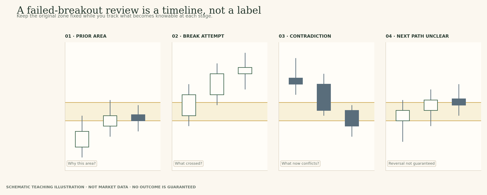
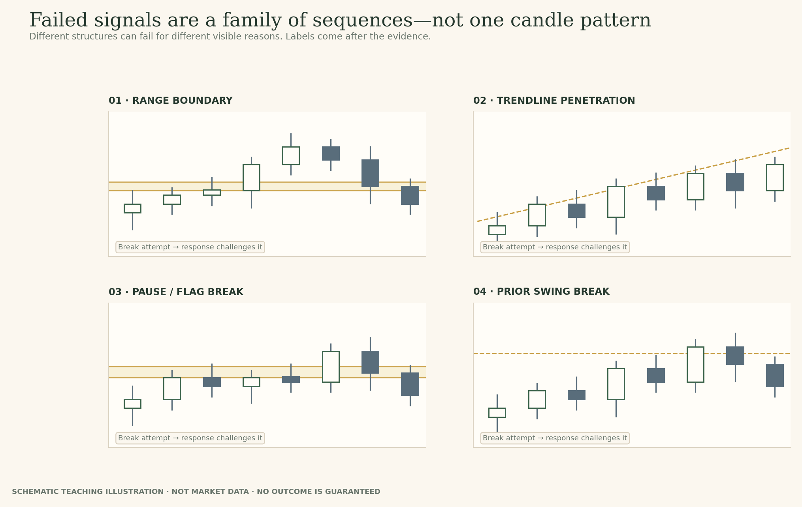
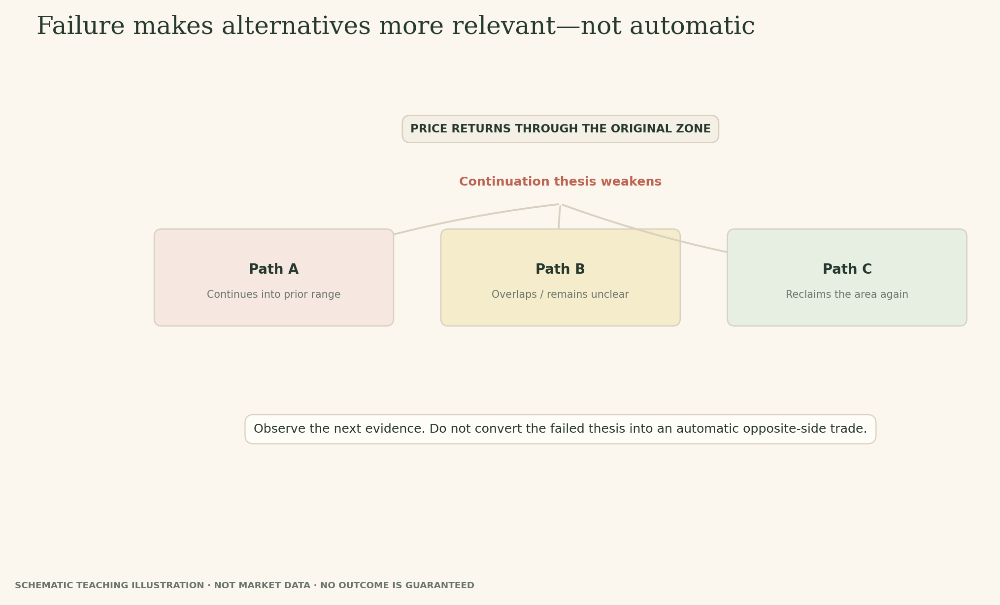
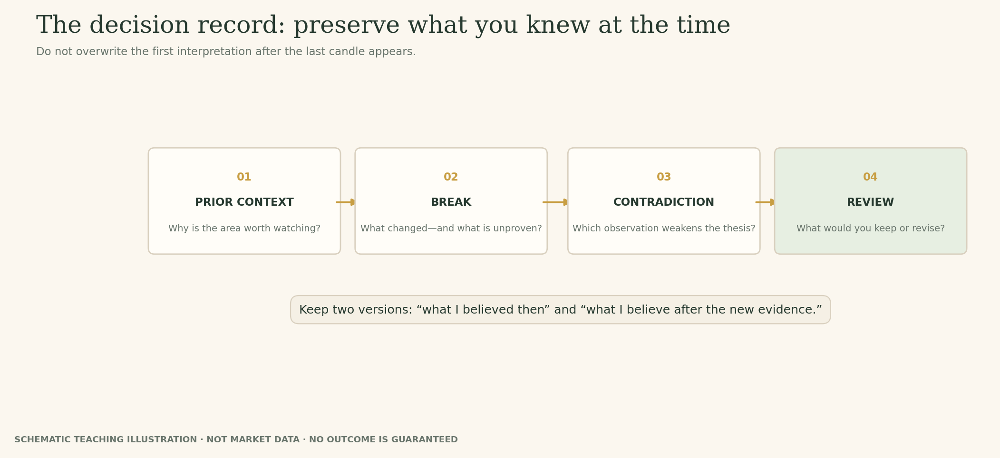

# Lesson 14 — Failed Breakouts and Alternate Outcomes

**Module:** 5 — Breakouts & Failures  
**Estimated time:** 30–38 min including Wider Neckline  
**Hook:** *A failed breakout can tell you more than the breakout attempt—but it is not an automatic reverse signal.*  
**Audience:** Learner-facing original teaching copy; instructor references remain in the source note.  

## What you will learn

- Identify a move beyond the zone followed by contradictory evidence.
- Distinguish a setback from a sustained return into the prior range.
- Explain why a failure may increase the relevance of an opposite scenario without guaranteeing it.
- Use the Wider Neckline ChartLab to defend reasoning, not a perfect drawing.

## Start with the question

Treat a failed signal as new evidence, not an excuse to predict the opposite with certainty.

> A failed breakout can tell you more than the breakout attempt—but it is not an automatic reverse signal.

## The anatomy of a failure

A useful review separates four parts: the prior boundary, the breakout attempt, the contradiction, and any follow-through after the contradiction. What was the area before the move? How did price get beyond it? Which exact candle or sequence weakened the continuation thesis? Did price continue in the opposite direction, chop, or recover again?
A failed breakout is not merely a pattern that looks ugly in hindsight. It is evidence that the move did not sustain itself in the expected direction. The stronger the contradiction and the more persistent the return into the previous range, the harder it becomes to defend the original continuation thesis unchanged.

## Failure is information, not a command

Adam Grimes describes a failure test as price moving beyond a prior pivot or support/resistance area and quickly reversing. Schwager and Etzkorn give failed signals a prominent role in chart analysis: the lack of follow-through challenges the original signal and can make a move in the opposite direction more relevant.
But “more relevant” is not “guaranteed”. After a failed upside break, price may move down, settle into a range, or recover and try again. A failed downside break may recover, but it can also fail again. The appropriate update is to weaken or invalidate a thesis whose conditions no longer hold—not to reverse automatically into a new trade.

## What counts as contradiction?

An intraday dip into the zone is different from a close back inside it. A single close back inside can weaken the claim without completing a full reversal. A return through the boundary followed by further closes in the old range adds more contradictory evidence. There is no single percentage or candle count that is correct in every market and timeframe.
Ask whether the move through the zone has been rejected by later price behaviour, not whether the last candle resembles a named pattern. Do not infer that institutions or stop hunters caused it. OHLC candles show prices and ranges; they do not reveal hidden intent.

## Read the historical case without hindsight

The staged NIFTY 50 example begins with a candidate former-resistance band and a move beyond it. The next view includes a return that still leaves the close above the band. This is the point at which many learners become attached to the continuation idea.
Write what you believe before asking for later candles. Then examine the final stage and identify the exact evidence that supports or weakens your hypothesis. Do not use the ending to claim the failure was obvious at Stage 1; your earlier read should be judged by whether it used the evidence available at that time.

## Keep the existing Wider Neckline ChartLab

This is the third and final ChartLab in the course; it remains in Lesson 14. Use the existing clean Wider Neckline chart from the course asset set. Ask the learner to choose and defend a useful zone, explain which nearby reactions it includes or excludes, then name two possible outcomes after a break. The reference is one defensible approach—not the only pixel-perfect answer.
This expanded module adds more explanation and counterexamples around the existing lab. It does not add another ChartLab or move Clear W from Lesson 5 and Uneven Lows from Lesson 8.

## The disciplined response

Write down the original thesis, the evidence available at the time, the contradiction, and the condition that changed your view. If an alternative becomes more relevant, state what evidence would still be needed. “Failed breakout” is not a complete note unless you explain which part of the sequence failed and what that means for your interpretation.
This course does not provide a universal entry, stop or position-size rule. Those would require a separate trading plan and risk-control framework. Here, the learning outcome is a more honest reading of the chart.

## The anatomy of a failed breakout

Adam Grimes describes a failure test as a market moving beyond a prior pivot or support/resistance area and then reversing quickly. That is a useful starting description because it specifies an event and a response rather than asking the learner to recognise a single candle. The key is the order: the boundary existed first, price moved beyond it, and subsequent behaviour challenged the direction implied by the break.
A disciplined review therefore preserves four states. First, identify the boundary using earlier evidence. Second, record the break attempt as it appeared at the time. Third, identify the contradiction: for example, price returns through the band or the move loses the ability to remain outside it. Fourth, inspect what followed. The market may extend into the prior range, chop around the boundary, or reclaim the area and try again.
The word failure should not be placed on the first candle merely because the lesson title tells us how the story ends. Before contradictory evidence appears, the student is looking at an attempted break. After the new evidence arrives, the continuation interpretation may become weaker. Keeping those two moments separate is the difference between genuine analysis and hindsight narration.

*Figure 11. A failed breakout is evaluated across time. Do not reveal the final label before the contradictory evidence is visible.*

## Why failed signals deserve study—and why that does not make them infallible

Schwager and Etzkorn devote a full chapter to failed signals and examples across different chart structures: bull and bear traps, false trendline breaks, returns to wide-ranging-day extremes, and breakouts that do not behave as expected after flags or other formations. The breadth of that treatment makes an important teaching point: failure is not a curiosity limited to horizontal support and resistance. A chart signal can appear and then lose support from subsequent price behaviour.
Grimes approaches failure through specific structures as well, including the failure test and failed breakouts. These ideas are related, but not every method uses the same definition, timing or risk rule. The course should not pretend they are one identical setup. It borrows the disciplined question behind them: what did the signal suggest, what did price do instead, and what evidence is now more important?
Some authors discuss failed signals as potentially powerful because a failed attempt can make the opposite-side interpretation more relevant. That is a practitioner framework, not a guarantee that a large reverse move follows every failed break. The failed move may turn into a range, recover beyond the boundary, or remain messy. We will grade accurate reasoning and revision, not whether a learner guesses a strong reversal.

*Figure 12. Different chart structures can fail in similar ways: the signal appears, then follow-through does not match the original implication. These are schematic families, not trading setups.*

## A failed signal makes an alternative more relevant—not automatic

After an upside attempt returns through the old boundary, a move lower may become more relevant to consider than it was before. That is a change in the menu of plausible scenarios, not a trade instruction. Whether the price decline continues, pauses, or reverses again depends on evidence that has not yet appeared. The mirror image applies to a failed downside break.
A common mistake is to replace one rigid rule with another: first “every breakout continues”, then “every failed breakout must reverse”. Both statements turn a conditional interpretation into a prediction. Instead ask: what did the failed attempt invalidate? What remains plausible? What would I need to see before making a stronger claim? And what would show that even the alternative is no longer a good description?
This matters because identifying a market event and making a trade are separate skills. The chart alone does not provide a complete entry, position size, stop placement or exit decision. This course focuses on reading the sequence and keeping an interpretation revisable. It does not give a universal reversal signal.

*Figure 13. A failure opens questions. It does not choose the next path for you.*

## Do not invent the cause of a failure

Terms such as bull trap, bear trap, spring and upthrust are used by different authors and traders for related types of failed moves. They can be useful shorthand after the sequence is identified, but they can also encourage a story that the chart does not prove. The OHLC record shows where price traded and closed. It does not identify the trader who placed the order, whether stops were triggered, or whether a large participant intended to trap anyone.
Grimes discusses stop orders and the possible behaviour around prior pivots when explaining failure tests; Schwager and Etzkorn also use trap language in their failed-signal chapter. We can teach those as proposed mechanisms or practitioner interpretations, provided the language remains conditional. We should not tell learners that a specific historical failure was caused by stop-hunting unless independent evidence supports that claim.
A stronger student response often sounds less dramatic: “Price traded above the band, then closed back below it and continued into the previous range. That weakens the idea that the move was being sustained beyond the boundary.” This says more about the evidence than “smart money trapped breakout traders.”

*Figure 14. Describe the sequence you can see; do not claim hidden motives from candles alone.*

## A thesis can fail even when the first read was reasonable

A chart-reading lesson should not teach students to judge every earlier decision by the eventual outcome. If the initial move closed above a reasonable area and later candles returned through it, the later evidence may invalidate the continuation thesis. It does not follow that the initial observation was fabricated or irrational. At the time of the first close, the later candle had not occurred.
Separate process from outcome. Process asks whether the learner defined the area in advance, stated a consistent convention, described the available evidence accurately, kept an alternative alive and named what would change their view. Outcome asks where price eventually went. A disciplined process can end in a losing trade or a failed thesis; a lucky outcome can follow weak reasoning. The review should assess what was knowable at the time.
Use the decision record to make hindsight visible. Preserve the first response. After the final reveal, highlight the exact sentence that must be revised and explain the evidence that prompted the revision. Do not replace the original note with a polished summary of the ending.

*Figure 15. The original view and revised view should both remain visible so the learning is auditable.*

## Examine the historical evidence

The chart-stage images below are shown in the interactive preview one at a time. Do not inspect later stages before you have recorded your current read. The charts use historical NIFTY 50 daily OHLC as temporary internal examples; selected zones are teaching choices, not official levels.

### Stage 1 — Stage 1 · Before the breakout attempt

**Prompt:** Which visible reactions define your candidate area? What would count as contradictory evidence later?

*NIFTY 50 daily candles through 19 January 2018, showing the candidate former-resistance band before the breakout.*

**Response prompt:** State the initial hypothesis, prior evidence, and a specific invalidation condition.

### Stage 2 — Stage 2 · The return looks acceptable

**Prompt:** At this point, what interpretation is plausible? What evidence is still missing?

*The same NIFTY 50 chart through 1 February 2018, showing a move above the band and a return that still closes above it.*

**Response prompt:** Write the provisional view before you see the next sessions.

### Stage 3 — Stage 3 · The thesis is challenged

**Prompt:** Which specific new evidence weakens the continuation thesis? Does it guarantee an opposite trade?

*The same NIFTY 50 series through 20 February 2018, showing the close below the band and later weakness.*

**Response prompt:** Record the contradiction, your revised view, and what remains uncertain.

### Worked recap — reveal only after the learner has submitted

The return on 1 February did not establish a durable change of role. The 2 February close back below the prior band was a clear contradiction to the continuation thesis, and subsequent weakness added context. This makes the original bullish interpretation weaker; it does not by itself prescribe a short trade or prove hidden trader intent.

## Field notes

The interactive preview includes four named fields. Preserve the first response rather than overwriting it after the reveal. Export is browser-local only; it is not connected to a member account.

1. **Observation:** what price did relative to the original zone, including wick and close.
2. **Interpretation:** what the current evidence makes more plausible, with uncertainty.
3. **Alternative:** a second path that still fits the visible evidence.
4. **Revision condition:** the specific event that would weaken or change the view.

## Takeaway

**When the chart contradicts your idea, update the idea before inventing an excuse for it.**

## Knowledge check

### 1. Price breaks above a zone and later closes back inside the prior range. What is the most careful conclusion?

- A. The next move must be lower.
- B. The return is contradictory evidence against sustained continuation; assess the later sequence.
- C. The original area was drawn incorrectly.

**Instructor feedback (after submission):** The failure weakens the original thesis. It does not guarantee direction or prove that the original zone was invalid.

### 2. A failed breakout automatically means you should trade in the opposite direction.

- A. True
- B. False

**Instructor feedback (after submission):** Failure is information, not a complete trade plan. Risk, context and further evidence still matter.

### 3. Which note is most useful?

- A. False breakout.
- B. Price moved outside the area, then the 2 Feb close returned below it; this weakened my continuation view.
- C. Institutions hunted stops.

**Instructor feedback (after submission):** Record observable events and their effect on your hypothesis. Do not infer hidden intent from OHLC bars alone.

## Teaching references — internal production note

These lessons use original TradeThesis explanations informed by established sources. Do not reproduce book prose or textbook figures.

- John J. Murphy, *Technical Analysis of the Financial Markets*: closing prices, gaps, volume, price patterns and deviations from ideal patterns.
- Adam Grimes, *The Art and Science of Technical Analysis*: transitions between trends and ranges, failure tests and failed breakouts.
- Jack D. Schwager and Mark Etzkorn, *A Complete Guide to the Futures Market*: role reversal and the dedicated chapter on failed signals.
- Brian Shannon, *Technical Analysis Using Multiple Timeframes*: larger context and the danger of changing scales without noticing.
- Carol Osler, “Support for Resistance: Technical Analysis and Intraday Exchange Rates”: bounded empirical study of supplied FX levels; it does not validate every manually drawn zone or every asset class.

See `BREAKOUTS_FAILURES_AUTHOR_RESEARCH.md` for source links and qualification.
