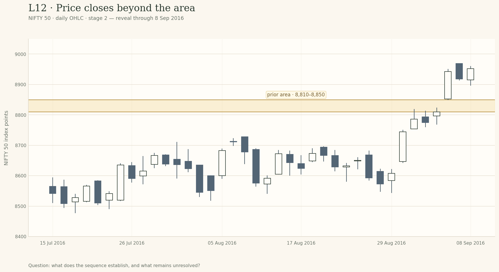
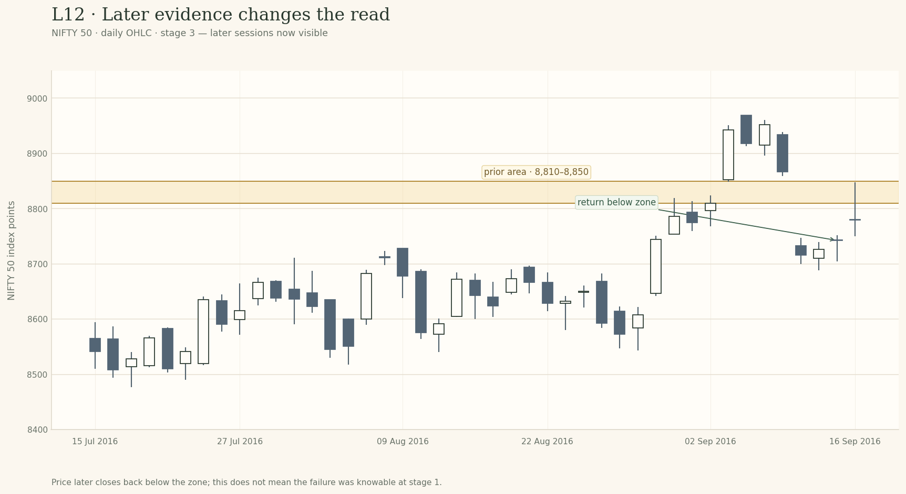

# Lesson 12 — Breakout or Temporary Penetration?

**Module:** 5 — Breakouts & Failures  
**Estimated time:** 30–35 min  
**Teaching hook:** *A close beyond a line is evidence. It is not a verdict.*

Learn to define the structure, state a confirmation convention, and assess what later evidence adds or contradicts.

## What you will learn

- Define the prior zone using evidence visible before the move.
- Distinguish an intraday excursion from a close outside the zone.
- Explain the trade-offs of close, distance, time and volume filters.
- Describe alternatives without turning the chart into a buy/sell instruction.

## Read the idea

### Start with the question

Learn to describe the break precisely, compare confirmation choices and keep their limitations visible.

> A close beyond a line is evidence. It is not a verdict.

### First name the boundary

A breakout begins with a claim about a boundary. Before price moves through it, identify the previous highs, lows or range edge that make the area relevant. Keep the zone fixed while you inspect what happens next. If the zone needs to change, record the revision rather than pretending you drew it that way originally. A move outside a zone can be a transition from a range into a directional phase. It can also be a temporary excursion or an unresolved transition. The label breakout should describe what price has done—not quietly predict what it must do next.

### Four kinds of evidence

A wick beyond the area shows that price traded there; it does not show that the session finished there. A close outside the area adds a different piece of evidence. Distance beyond the zone and time spent outside it can provide further information, while follow-through shows whether the move continues to hold up. These are related but distinct observations. Volume may provide context when the instrument and data source make it meaningful. Some analysts use it as a central confirmation tool; others do not require a volume surge before they interpret a price move. In this course, volume is supporting evidence—not a universal pass/fail switch. The example chart deliberately isolates price behaviour and does not plot volume.

### Every filter has a cost

Waiting for a close can filter out some intraday penetrations, but a close just outside the zone may still fail. Requiring a larger percentage distance can reduce borderline cases, but the market may already have moved far by the time the condition is met. Requiring two closes can avoid some one-bar excursions, but it can also recognise a move late—and it still cannot guarantee continuation. A filter is valuable when it makes your observation repeatable and its trade-off is understood. It becomes dangerous when it is taught as a law. Choose a convention appropriate to the chart and timeframe, apply it consistently, and keep the alternative open.

### The market state still matters

A breakout attempt is a transition between structures. A move above a nearby high on a short chart may remain inside a much broader range. Conversely, a boundary that caps a long period of overlapping price may be more consequential than a tiny local swing. Change the viewing scale and ask what remains true. The local break is not automatically the larger story. Your task here is not to trade the break. It is to state exactly what the chart has established, what it has not established, and what future evidence would change your view.

### The range is a market state, not just a shape

A range is not merely a rectangle drawn around candles. It is a period in which price has repeatedly traded within a broad boundary without establishing a lasting direction beyond it. The upper edge matters because earlier attempts to move above it did not remain there; the lower edge matters for the same reason. That history gives the next crossing context, but it does not tell us in advance which side will win. The transition is the important part. A price sequence can move from overlap to sustained directional travel, or it can leave the range briefly and return. Those two paths may begin with candles that look almost identical. The analyst’s job is not to name the transition too early; it is to keep track of the evidence that supports a change in market state and the evidence that argues against it. This is why context belongs before the pattern name. A short-term break above a small local high may still sit inside a broader range. A move through a long-tested boundary may be more consequential, but still needs to be evaluated in its own timeframe and market conditions. The same candle shape can mean different things depending on what came before it and where it sits within the broader structure.

*Figure 1. Changing the viewing scale changes the question. A local break is an observation; its importance depends on the surrounding structure.*

### The evidence ladder: wick, close, acceptance, follow-through

It helps to separate four observations that are often collapsed into one word. First, a wick may pass through the zone. That tells you price visited the area during the bar. Second, the close may finish outside the selected edge. That tells you where the period ended, not how the next one must behave. Third, price may spend more time or distance outside the range. Fourth, later bars may continue to hold outside it or may return through it. These are stages of evidence, not a mandatory four-step signal. A close outside a band is often more useful than the intrabar high alone because the close records a different part of the session’s path. But the difference is descriptive, not magical. A close a few ticks beyond the edge can be followed by another move back through the band. Several closes outside can also be followed by failure. The correct sentence is not “the close confirms the breakout forever”; it is “the close adds evidence that price ended this period beyond the boundary”. The illustration keeps the same zone across three small sequences. Notice how the first chart records an excursion without a close outside, the second records a close outside, and the third adds follow-through. Each state justifies a different description. None, in isolation, allows us to promise continuation.

*Figure 2. These are not three interchangeable labels. The evidence grows, but certainty does not.*

### Confirmation filters move the decision point; they do not remove risk

Analysts sometimes require a minimum distance beyond the zone, two closes outside, a bar close rather than a wick, a return that holds, or some combination. A written convention makes the analysis easier to repeat and compare. Without a convention, a trader can unconsciously change the definition every time the chart becomes uncomfortable. Yet each filter has a cost. A distance buffer can reject marginal penetrations while recognising a genuine move later. Waiting for an additional close can reduce dependence on one bar while moving the decision point farther from the original boundary. A retest condition may provide a cleaner question when price returns, but some moves never return. The filter that reduces one kind of ambiguity can create another kind of delay or exclusion. The practical question is not “Which filter never fails?” No such filter can be inferred from a chart-reading principle. Ask instead: what ambiguity is this rule intended to reduce, what evidence does it require, and what types of move might it cause me to recognise late or not at all? Apply the same rule consistently, then assess it across enough examples before treating it as a useful personal convention.

*Figure 3. A rule changes the information threshold you act on. It does not control what happens afterwards.*

### Volume: useful context, not a verdict

Now that you have separated the wick, close and later follow-through, let’s ask a different question: does volume add useful context? It sometimes does. But volume is not a referee that declares a breakout valid or false.

In the figure, compare price behaviour first. Two sequences move away from the zone and two return through it. Then compare the volume panels. Expanding activity appears in a holding sequence and in a failing one; muted activity also appears in both. That does not make volume useless. It means volume and price outcome are different observations, and one cannot substitute for the other.

Before you call activity ‘high’, check the feed. Listed equities and exchange-traded futures commonly report traded volume, but the aggregation still depends on the data source. Spot FX and some CFDs may show tick volume or broker-specific activity rather than one consolidated exchange tape. Compare like with like: the same instrument, comparable sessions and an explicit baseline. If that information is absent, say so instead of inventing certainty.

*Read price outcome and volume context as separate dimensions.*

Here is the discipline I want you to practise: describe what price did, then state what volume adds to that description. Do not infer who traded, why they traded, or whether a deliberate trap was set. The staged historical case in this lesson does not include volume, so volume is not evidence you may use to explain its ending.

### What the historical case can teach—and what it cannot

The staged NIFTY 50 case shows several closes above a candidate upper-area band before the price later closes back below it. Before the final reveal, the evidence supports describing a breakout attempt under the stated daily-close convention. The later close back below the band contradicts the idea that price was sustaining itself above that area in the selected window. That ending does not make the first-stage judgement foolish. The later candles were not available yet. It also does not prove that the band caused the move, that every similar breakout will fail, or that an opposite-side trade was automatically justified. The example is useful because it makes one narrow point visible: a filter can be applied consistently and the move can still fail. When you inspect the actual stages, record your view before each reveal. After the final view, compare your first statement with your revised one. Did you describe the close accurately? Did you overstate what was established? Did you keep an alternative alive? This review of reasoning is the learning task; predicting the particular ending is not the assessment.

*Figure 5. Preserve what you thought before the later evidence arrived. That is how you can audit hindsight.*

### Which boundary is being broken? The label depends on the structure

Before you call a move a breakout, name the object price is moving through. Four common cases are often treated as if they were the same:

- **A range boundary** is the upper or lower edge of a stretch of overlapping price. The question is whether price is beginning to establish itself outside that prior range or has only visited the outside and returned.
- **A prior swing high or low** is a specific pivot. Price can cross it while remaining inside a larger range; that is still a real event, but it may be a local break rather than a broad market transition.
- **A trendline or channel boundary** is a sloping reference drawn from prior pivots. A brief move through that line can be followed by a reclaim. The relevant evidence is not the line crossing alone, but whether the surrounding swing structure changes in a sustained way.
- **A chart-pattern boundary** belongs to a structure such as a flag or a top/bottom formation. Its interpretation depends on the validity of that pattern and on the price action that follows. A pattern label does not replace the need to observe the breakout and its response.

This distinction matters because a failure is always a failure **of a stated claim**. “Price crossed the old range ceiling and returned inside” is more precise than “the breakout failed”. “Price broke a rising trendline but later reclaimed it” is a different description. The two may both challenge an earlier interpretation, but they do not tell the same story. The original boundary should be defensible from the candles visible before the crossing, not drawn around the future candles after the event has happened.

*Figure 6. State the structure first. A line break and a range break are not interchangeable labels.*

### Acceptance is a useful description, not a secret confirmation rule

Traders sometimes use the word *acceptance* to describe a period in which price appears to remain beyond a prior area instead of immediately returning through it. Used carefully, the word can summarise a sequence: multiple closes outside the zone, time spent there, pullbacks that remain on the new side, or subsequent movement that does not immediately erase the crossing. It should not be treated as a universal mathematical condition unless the analyst has explicitly defined one.

For this course, use the word only after identifying the observable details. For example: “Three daily closes remained above the selected band; the following session closed back inside it.” That sentence can be checked. “The market accepted the level” is a summary, and it should not hide the sequence that supports it. Also remember that the chosen bar interval controls what you can say. A daily close hides intraday movement; a five-minute close describes a different part of the market's path. Neither is automatically the correct timeframe for every question.

The surprising point is that stronger evidence can make a statement **more specific without making the future certain**. A single close outside the band is more information than a wick alone. Several closes outside are more information about persistence. But even a persistent move may later fail. Good analysis becomes more precise as evidence accumulates; it does not need to become absolute.

### Three questions to ask before keeping a breakout interpretation

Use these questions instead of an automatic checklist that mechanically issues a verdict:

1. **What exactly crossed?** The wick, the close, both, or a sequence of closes? State the boundary and timeframe.
2. **What happened after the crossing?** Did the price remain beyond the area, move farther away, return to the band, close back inside or oscillate around it?
3. **What would make your current wording too strong?** A quick return, a close back inside the prior range, a reclaim of the old area, or simply too little evidence in the excerpt may require a weaker description.

You are not required to turn those observations into a trading decision. The work here is to make your chart-reading claim reproducible: another person should be able to see the same candles and understand why you chose your wording.

### A filter is a personal convention that must be audited

A close beyond the zone, a two-close rule, a distance buffer or a requirement for a return test can each make the analyst's decisions more consistent. They also choose which situations will be recognised and when. A fixed point buffer means different things on instruments with different prices; a percentage buffer normalises by price but does not adjust for current volatility; an ATR-scaled buffer responds to recent range but can expand after volatility spikes. These are alternative conventions, not a ranking of universal best practices.

The test is not whether a filter can be narrated convincingly after one chart has finished. Ask what ambiguity it was designed to reduce and what type of case it might reject, delay or admit. Apply it consistently across a sufficiently varied set of examples. Do not infer a filter's reliability from the one winning or losing chart chosen for a lesson.

The three panels below intentionally show different decision costs. One rule recognises the close earlier but does not prevent a failure; a stricter rule acts later and still does not remove uncertainty; a rule that waits for a retest may never be triggered on a clean move that keeps going.

The comparison earlier in this lesson shows the three costs side by side. Return to it after the example: identify which rule would have recognised the move earlier, which waited for an additional close, and which would have waited for a return that might not arrive. The point is not to pick a universal winner but to state the convention and its cost before the outcome is known.

### The note should preserve the rule you actually used

Before the historical outcome is shown, write the exact boundary, timeframe and confirmation convention you are applying. Include what the rule helps you avoid and the price you pay for it. After the later candles appear, do not change the wording of your first note. Add a second note explaining what new evidence changed the interpretation. The comparison is the exercise: a precise early statement can be reasonable even when later price contradicts it.

## Examine the evidence

The chart stages below are meant to be opened in order. Record what you can observe before you reveal the next stage. The NIFTY 50 material is temporary internal teaching data; the candidate bands are instructional choices, not official levels.

### Stage 1 · Before the break

**Instructor prompt:** What makes this a plausible prior upper area, and what would count as a break on this daily chart?

**Write before revealing:** Name the prior evidence, your breakout convention, and one thing that would remain uncertain.

### Stage 2 · The move closes outside

**Instructor prompt:** Price has now closed above the zone for several sessions. What is better supported now—and what is still not guaranteed?

**Write before revealing:** State your revised view, the evidence for it, and a specific condition that would weaken it.

### Stage 3 · Later evidence

**Instructor prompt:** How should you revise your earlier view now that price has moved back below the original zone?

**Write before revealing:** Explain which earlier evidence still mattered, what changed, and what you would avoid claiming in hindsight.

## Field notes

Use the four prompts below to preserve the development of your reasoning. Keep the first response; add a revision rather than rewriting history.

### 1 · What was crossed?

Name the prior zone, timeframe, and whether the wick or close moved beyond it. Describe only the candles visible at this stage.

### 2 · The convention I used

Which confirmation convention are you applying—close, distance, time outside, or a combination? What does the current evidence support so far?

### 3 · Cost and alternative

Could the move hold, return into the band, or remain unclear? What could your chosen filter make you recognise late or miss?

### 4 · What would change my reading?

State an observable event—such as a close back inside or a failed reclaim—that would weaken the continuation interpretation.

## Knowledge check

Answer before reading the feedback. In the interactive preview, explanations remain hidden until the answers are submitted.

### 1. A wick crosses above resistance but the candle closes back inside the zone. What is the most precise description?

- A. The breakout is confirmed.
- **B. Price penetrated the area intraday but did not close beyond the chosen boundary.**
- C. The level has become support.

**Instructor feedback:** The high records an excursion; the close records where the session finished. They are not identical observations.

### 2. Two closes beyond a zone guarantee continuation.

- A. True
- **B. False**

**Instructor feedback:** A time filter is a convention, not a guarantee. The historical example later closes back below its zone.

### 3. No volume surge appears on the chart. Does that alone prove the breakout is false?

- A. Yes, volume is mandatory in every market.
- **B. No. Volume is one possible contextual input; assess the price sequence and chart context too.**
- C. Yes, unless the next candle gaps.

**Instructor feedback:** Practitioners differ on how volume should be used. The course should not turn it into a universal pass/fail rule.

### 4. A fixed 20-point buffer means the same thing on every instrument and volatility regime.

- A. True; points always have the same significance.
- **B. False; its meaning depends on instrument scale and current movement.**
- C. True, if the zone is drawn horizontally.

**Instructor feedback:** Fixed-distance, percentage and volatility-scaled conventions have different trade-offs. None is universal.

### 5. After two closes beyond the zone, price later returns inside it. What is the best review?

- A. The earlier closes were not real observations.
- **B. The rule was consistent, but later evidence weakened the continuation interpretation.**
- C. A short trade is automatically required.

**Instructor feedback:** Later evidence changes the current interpretation; it does not erase what was observable at the earlier stage.

## Instructor close

Describe the crossing with an explicit convention; keep judging what happens afterwards.

The historical chart extracts in this internal review package are temporary teaching examples. Replace them with user-owned or rights-cleared data before public release.
