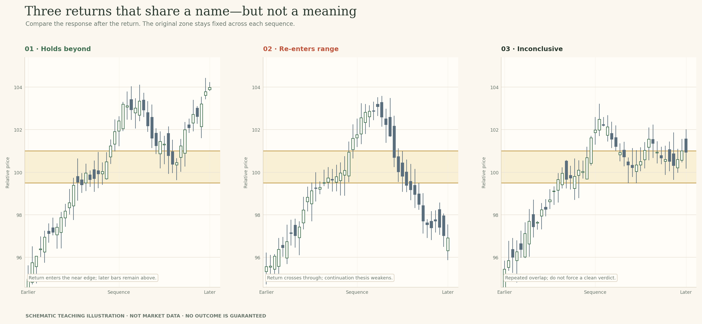
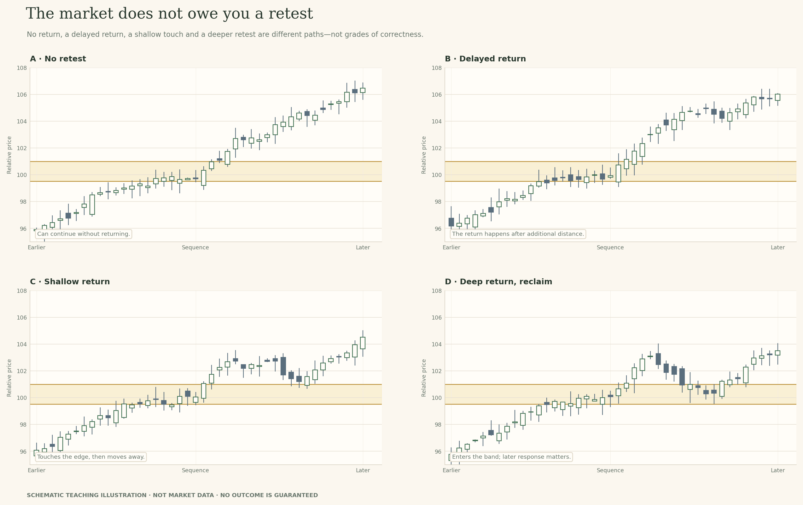
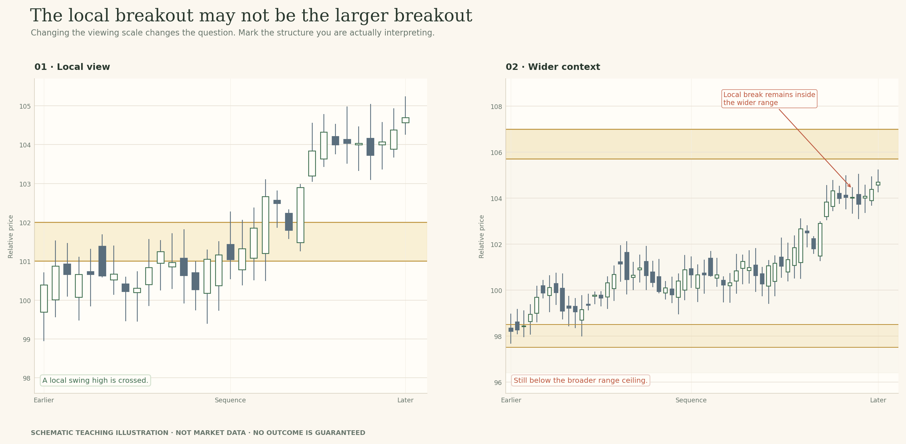
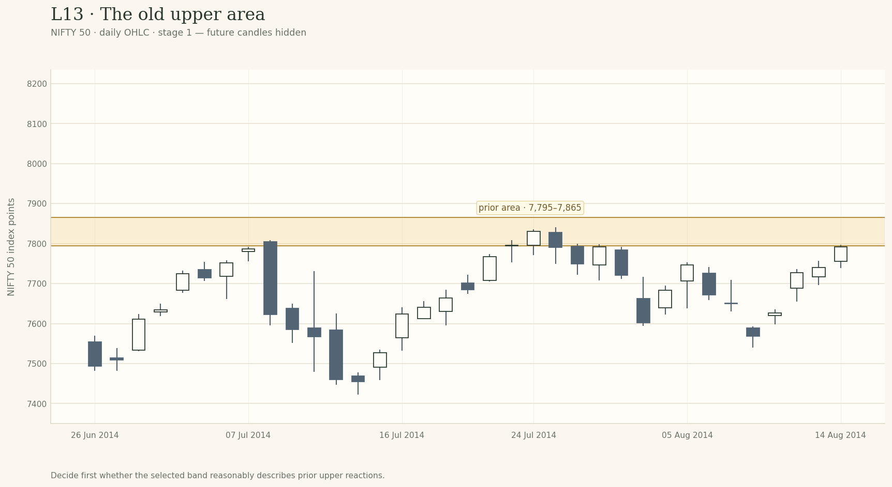
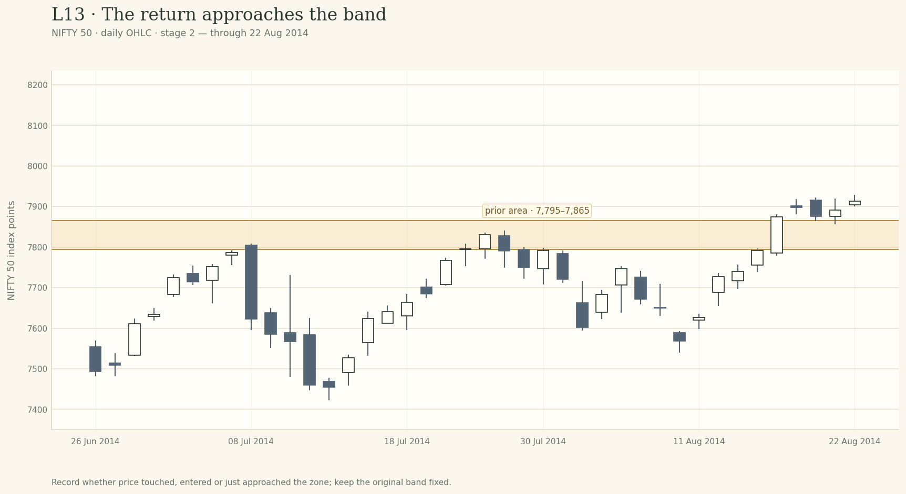

# Lesson 13 — Retests and Role Reversal

**Module:** 5 — Breakouts & Failures  
**Estimated time:** 38–45 min  
**Teaching hook:** *A retest is not confirmation. It is the next test of a claim.*

Separate the break, the return and the response; describe how price revisits an area before deciding what the sequence supports.

## What you will learn

- Separate the initial break from the later return towards the area.
- Describe return depth, closing location and the response after the return.
- Distinguish hold-like, failure-like and inconclusive sequences.
- Explain why a role reversal is a hypothesis to test, not an automatic switch.
- Keep the first interpretation intact so later evidence can be compared with it.

## Read the idea

### Start with the question

Let’s slow the sequence down. Price has moved beyond an area that mattered before. Later, price comes back towards it. What do we know now? We know a break occurred under the convention we chose, and that price has returned towards the old area. We do not yet know whether the old area will matter from the new side.

> A retest is not confirmation. It is the next test of a claim.

### Three observations: break, return, response

Let’s slow the sequence down. Price has moved beyond an area that mattered before. Later, price comes back towards it. What do we know? We know a crossing occurred under the convention we chose, and we can now describe the return. We do not yet know whether the old area will matter from the new side.

> A retest is not confirmation. It is the next test of a claim.

I want you to separate three things that are often bundled into one word. First, the **break**: what moved beyond the boundary—the wick, the close, or several closes? Second, the **return**: did price stop short, touch the near edge, travel into the band, close back inside the old range, or cross through the whole area? Third, the **response**: what did price do after the return? It may move away while staying on the new side, continue back through the area, or overlap around it without making the answer clear.

If you label all three stages ‘a successful retest’, you have jumped to the conclusion before describing the evidence. Start with this simple three-panel view. Point to the break first. Then the return. Only the third panel asks how price responds.

*Start simple: identify three separate observations before deciding what the whole sequence means.*

Keep one sentence in mind while you read: **a break tells you where price went; a retest tells you it came back; the response tells you what happened next.** Those statements are not interchangeable.

### The depth of the return matters—but does not settle the outcome

A return can stop just above the area. It can touch the upper boundary and turn away. It can enter the band shallowly or deeply. It can close inside the old range, cross through the opposite edge, and later reclaim the area. These are not cosmetic differences. They tell you how much of the old range has been re-entered and how strong the claim ‘the former ceiling is now supporting price’ still looks.

Pay attention to the close as well as the extreme. A wick that dips into the band and a candle that finishes deep inside it are different observations. A close back in the old range challenges the role-reversal idea more directly than a wick that touches the near edge and closes above. Even then, one close is not a prophecy: later bars may extend the return, stall, or reclaim the zone.

- **No return:** price keeps moving away. That is not a failed retest; there has been no retest to judge.
- **Shallow touch:** price reaches the near edge and moves away. This may be consistent with a hold, but inspect the close and what follows.
- **Deep entry:** price trades well into the band. The original role-reversal claim needs closer scrutiny, especially if closes move towards the old range.
- **Close inside the old range:** this is a clearer contradiction to the claim that price is sustaining itself outside the range.
- **Cross through and reclaim:** price passes through the area, then recovers. Record both events; a reclaim can challenge an earlier failure interpretation.
- **Repeated overlap:** bars keep crossing the area with closes on both sides. The sequence may still be unresolved; do not force a binary answer.

*Describe depth and closing location separately. Neither one alone guarantees the next move.*

Keep the original band fixed while you make this comparison. If later evidence convinces you that the band was drawn badly, revise it openly and record why. Do not shift it silently so that every new candle appears to respect your first idea.

### Three responses that share the same name

Now compare the response, not just the return. In a **hold-like response**, price returns towards the band and then moves away while staying mostly on the new side. That is consistent with the area remaining relevant in this sequence. It does not mean the zone has become a permanent floor or that the next visit must work.

In a **failure-like response**, price returns through the band and closes back in the old range. If it then cannot reclaim the area, the idea that the old ceiling is now support becomes harder to defend. In an **inconclusive response**, candles overlap around the band and close on alternating sides. The market has not provided enough separation for a confident label. ‘Inconclusive for now’ is a proper analytical conclusion, not a failure to answer.

*Start with the three broad outcomes: hold-like, failure-like, or not yet resolved.*

The simple examples give you the map. Now inspect the more developed sequences below. Notice that the response includes more bars and more uneven movement. Real analysis often becomes less tidy as the window grows, because you see more evidence that may support different interpretations.

*The same question with fuller context: what does price do after it returns?*

Your wording should match the strength of the evidence. ‘It touched the zone and closed above’ is an observation. ‘That is consistent with a hold’ is an interpretation. ‘It will now rally’ is a forecast and requires much more support than a retest label by itself provides.

### A four-stage view: before, break, return, response

Here is the same idea with more context. Before the break, you need a reason to care about the band. At the break, describe what crossed and how the bar ended. At the return, record whether price touched, entered or crossed the zone. Only after the response develops should you say whether this particular sequence looks hold-like, failure-like or unresolved.

That order also protects you from hindsight. If you see the final panel first, the earlier candles can look like obvious clues. Cover the later panel, record your first reading, then reveal it and note what actually changed.

*Use the detailed four-stage diagram after you understand the simpler three-step sequence.*

### The market does not owe you a retest

Some moves continue without coming back to the old area. That is a possible path, not an incomplete chart. If you require a retest, you are choosing to wait for a certain kind of evidence. The cost is that a move may continue without offering it. The absence of a retest does not by itself invalidate the break, and it does not create an obligation to chase a price that has already travelled far.

*No retest is a valid outcome; do not redraw history to add one.*

### Role reversal is a hypothesis, not a switch

It is tempting to think that once resistance is broken, it automatically becomes support. But a line has no permanent role of its own. The role is a description of how price behaves around that area in the sequence you are studying.

Before the break, the upper area may have capped several advances. Price then trades above it. Only after a return and the response that follows can you assess whether buyers or sellers are behaving differently around that area. If price returns and stays mostly above it, ‘former resistance is acting as support in this window’ is a fair, limited description. If price closes back inside and cannot reclaim it, the new-role hypothesis weakens. If closes keep alternating across the band, leave it unresolved.

There is a subtle but important difference between saying **‘the area has reversed roles’** and **‘the area is holding from the other side so far’**. The first sounds permanent; the second tells the reader exactly what the current evidence establishes. I want you to practise the second form until later evidence justifies stronger wording.

*Role reversal is always a claim about a specific area, timeframe and developing sequence.*

Also keep the no-retest path alive. Price may never return to the old area. Do not chase it simply because the clean retest you wanted did not appear. The absence of a retest is a missing event, not proof that the breakout is invalid or valid.

### A return gives you evidence, not a story about motive

Support and resistance are watched by many market participants, so a return to an old area is worth examining. But the chart does not show that a particular group defended the boundary, that stops were deliberately targeted, or that someone engineered the move. Those are claims about motive and order placement. A candle feed records the prices that occurred over a chosen interval; it does not reveal the full reason they occurred.

For your notes, prefer a sentence another reader can verify: “Price returned to the former resistance band, entered it, then closed above it and moved away.” Avoid replacing that sequence with a story such as “buyers defended the level” unless you have independent evidence for that claim.

### What the historical case can teach—and what it cannot

In the provisional NIFTY 50 case, the selected boundary is a teaching annotation, not an official level. The first chart stage asks you to judge the prior reactions before the break. The next shows price beyond the band. A later stage then shows how the return and response developed. Record your view before that last reveal; do not edit the first note to make it sound as if you knew the outcome.

Studies of named chart patterns have reported returns toward breakout areas in a substantial share of examples, but not every example. Those results depend on how a pattern is defined, which markets and timeframes are sampled, and what is counted as a return. They are not a universal probability for a hand-drawn zone. Your job in this lesson is to describe the sequence in front of you rather than borrowing a rate from a different sample.

*The notes are a record of what you knew at each stage.*

### Your field note: keep the first read

Use four entries. First, record why the original zone was worth watching. Second, describe the break using the actual wick and close. Third, describe the return—stopped short, touched, entered, closed inside, crossed or never returned. Fourth, record the response and the event that would change your mind next.

Then compare the first note with the final one. Which sentence still stands? Which sentence needs revision? A useful note does not need to prove that you predicted the ending. It needs to show that you noticed new evidence and adjusted your language accordingly.

## Examine the evidence

The chart stages below are meant to be opened in order. Record what you can observe before you reveal the next stage. The NIFTY 50 material is temporary internal teaching data; the candidate bands are instructional choices, not official levels.

### Stage 1 · The old upper area

**Instructor prompt:** Which visible reactions support this candidate band, and what alternative boundary could another careful analyst defend?

**Write before revealing:** Record the reactions you rely on and what your band excludes.

### Stage 2 · The return approaches

**Instructor prompt:** Did price enter the chosen band, touch its edge or just approach it? What does the close add?

**Write before revealing:** Describe the low and close relative to the zone; do not call the outcome confirmed yet.

### Stage 3 · Later evidence

**Instructor prompt:** What does the later sequence support, and what claim would go beyond the evidence?

**Write before revealing:** Explain how your interpretation changed and what remains unproven.

## Field notes

Use the four prompts below to preserve the development of your reasoning. Keep the first response; add a revision rather than rewriting history.

### 1 · Break and return

Name the original boundary, how price crossed it, how far the return travelled into the band, and where the relevant bar closed.

### 2 · Response so far

Does the sequence look hold-like, failure-like or inconclusive? Point to the actual closes and later bars that support your wording.

### 3 · What else remains possible?

Consider no retest, a shallow touch, a deeper return, a close back inside the old range, or a reclaim that challenges your current view.

### 4 · What would change your read?

Name an observable event that would strengthen or weaken your role-reversal hypothesis. Keep the original zone visible and do not move it silently.

## Knowledge check

Answer before reading the feedback. In the interactive preview, explanations remain hidden until the answers are submitted.

### 1. Does every breakout need to return to its origin?

- A. Yes, a retest is required.
- **B. No. Price may continue without returning.**
- C. Only if the first candle closes outside the zone.

**Instructor feedback:** A retest can offer additional evidence, but it is not mandatory.

### 2. Former resistance definitely becomes support after price returns from above.

- A. True
- **B. False**

**Instructor feedback:** Role reversal is a hypothesis; price can hold, cross through or remain ambiguous.

### 3. What should you do if the zone seems to need a new boundary after later candles appear?

- A. Move it silently to fit the outcome.
- **B. Record the revision and the new evidence that justified it.**
- C. Pretend the original boundary always included the new candles.

**Instructor feedback:** Revising a zone is possible, but the revision should be explicit to avoid hindsight-fitting.

### 4. A return touches the band but the sequence then closes repeatedly inside the old range. What is the safest description?

- A. The retest succeeded because it touched the band.
- **B. The role-reversal hypothesis is weakened by the later closes inside the prior range.**
- C. The next move must reach the opposite range edge.

**Instructor feedback:** Touching the area is not enough to determine the response; the later closes matter.

### 5. A move continues without a return to the original zone. What does that establish?

- A. The breakout was invalid.
- **B. Only that the return did not happen in this window; it is not a required step.**
- C. You must chase the move.

**Instructor feedback:** The market does not owe a retest. Missing one is not evidence that every breakout is invalid.

## Instructor close

Name the break, describe the return, then judge the response. The word retest must not do all three jobs.

The historical chart extracts in this internal review package are temporary teaching examples. Replace them with user-owned or rights-cleared data before public release.
