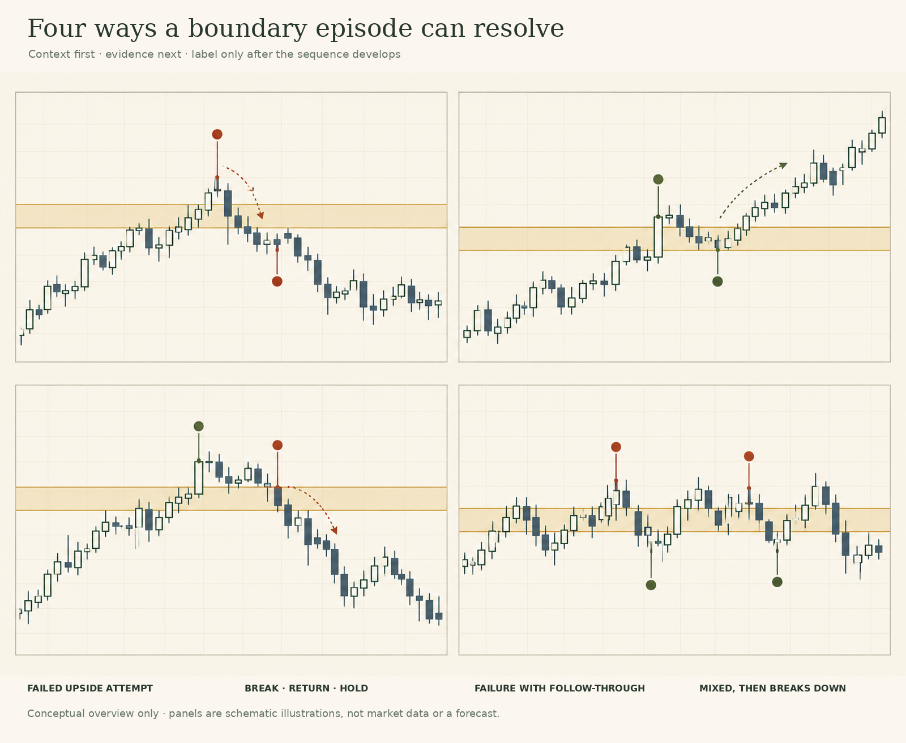
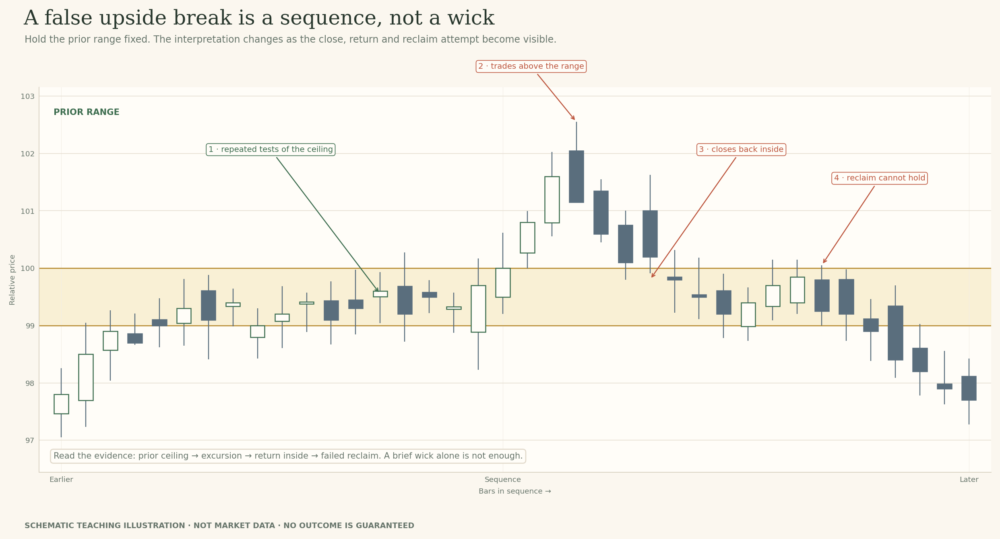
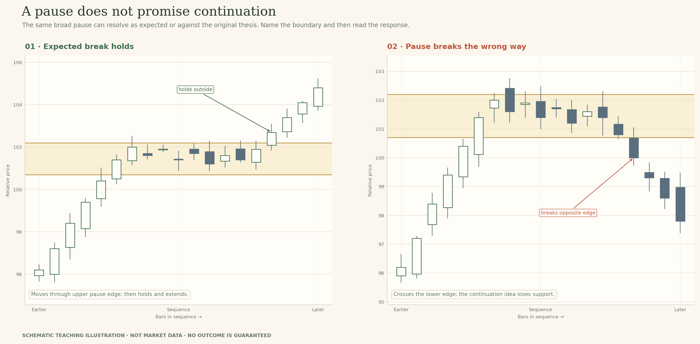
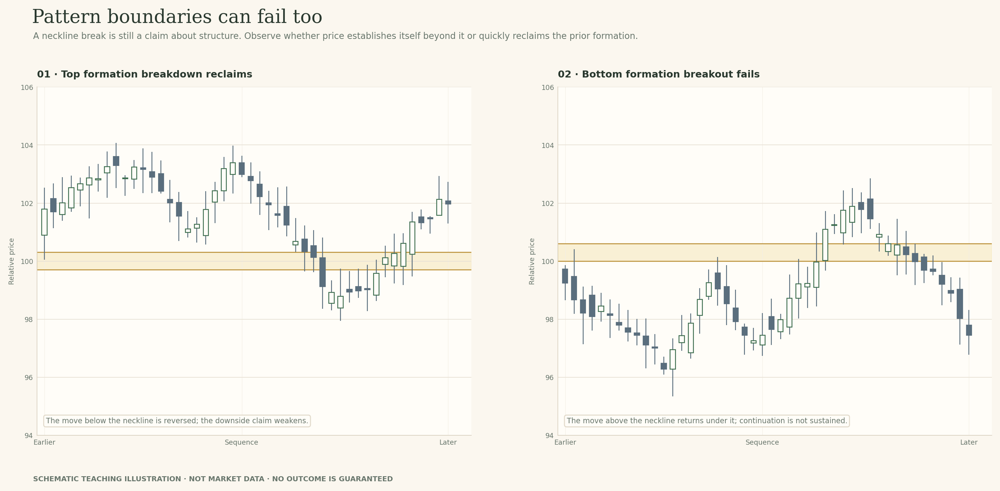
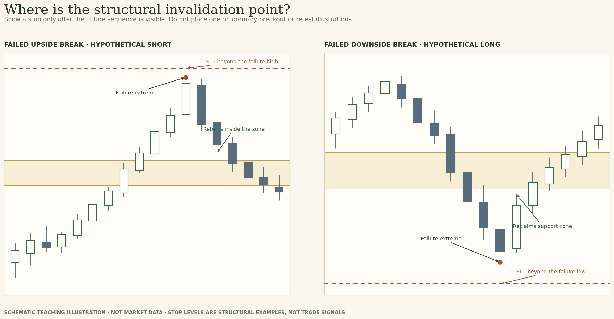
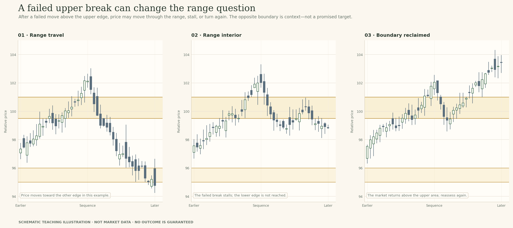
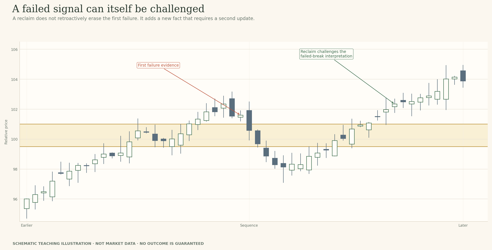

# Lesson 14 — Failed Breakouts and Alternate Outcomes

**Module:** 5 — Breakouts & Failures  
**Estimated time:** 55–65 min including Wider Neckline  
**Teaching hook:** *A failed breakout can tell you more than the breakout attempt—but it is not an automatic reverse signal.*

Learn to name the exact claim that failed, identify the contradiction, and decide what remains uncertain without treating every failure as an opposite-side trade.

## What you will learn

- Distinguish seven common failed-signal structures by the boundary and sequence involved.
- Separate an attempted break from later evidence that contradicts the continuation claim.
- Compare brief penetration, close back inside, failed reclaim and unresolved overlap.
- Describe how gaps, wide bars, pullbacks and volume complicate interpretation.
- For a hypothetical failed-breakout idea, identify the structural invalidation extreme and recognise when passing is the better decision.
- Review a first interpretation against later evidence without rewriting the original note.

## Read the idea

### Start with the question

Let’s keep two moments separate. The first is the breakout attempt: price moves beyond a boundary. The second is the later evidence that challenges the claim implied by that move. At the first moment, you do not know whether the breakout will hold. If you name it a failure before contradictory evidence appears, you have used the ending to label the beginning.

> The failure is not the first candle that crosses. It is the evidence that challenges what you thought the crossing meant.

*The same boundary can lead to different sequences. Read the response before you choose a label.*

### Before we name the failure, define what price was trying to cross

Start by naming the structure. Are you looking at the ceiling of a horizontal range, a previous swing high, a sloping trendline, a flag or pennant, or the neckline of a larger formation? These are different reference points. A move through the top of a range is not the same observation as a move through a rising trendline, even if both are drawn as lines on the screen.

Keep the original mark visible as the chart develops. If the line or zone has to change, write down what new evidence prompted the change. When we move a line after seeing the outcome without recording it, the chart becomes cleaner but the reasoning becomes harder to audit.

*Start with the structure, then study the sequence that challenges the first interpretation.*

### 1 · Range-edge upthrust or false upside break

Let’s start with the range because it gives us a clear object to study. Before price makes the move, you should be able to point to an upper area that has stopped or slowed several advances. It need not be a perfect horizontal line. Think of it as a band around the cluster of prior highs. Draw it from the evidence available then—not around the highest candle you can find after the move has already happened.

When price first trades above that band, do **not** call it a failure. You have an upside breakout attempt. Watch three things next: where the bar closes, whether later bars can remain outside, and what happens if price returns to the band. An upper wick above the ceiling followed by a close back inside is a warning that the move did not finish outside. It becomes a stronger failure-like sequence if later price remains in the old range and an attempt to reclaim the ceiling cannot hold.

Look closely at the chart. First notice the repeated tests near the ceiling; these explain why the area mattered. Then look at the excursion above it. The next bars return into the range. Finally, price tries to approach the upper edge again but cannot establish itself above it. That is the sequence you are describing—not a magical candle shape.

*A false upside break is identified by the sequence: prior ceiling, excursion, return inside, and subsequent response.*

Here is a useful way to word the note: ‘Price traded above the prior range ceiling, then closed back inside. The next attempt to reclaim the area failed, so the continuation claim weakened.’ Notice what the sentence does not say: it does not claim to know who bought, who sold, or whether anyone was deliberately trapped.

Now protect yourself from the opposite mistake. If price closes back inside for one bar and the next bars reclaim the area and remain above it, the failure interpretation has been challenged. Keep that possibility open. The label should follow the sequence, not become a story you defend after new evidence appears.

### 2 · Spring-like downside failure

Now mirror the same reasoning at the lower edge. First, identify the prior range floor using lows that were visible before the move. Price then trades below support. At that instant, you have a downside-break attempt. The later response tells you whether the break is sustaining itself or whether price has returned to the old range.

Watch the low and the close separately. The low records how far the excursion travelled below the floor. The close tells you where that bar finished. If the close returns inside the range, the breakdown claim has weakened; if later bars remain inside and a renewed push below support cannot hold, the failure-like interpretation becomes stronger. If price keeps overlapping around the floor, do not force the label.

*A spring-like downside failure is described by the probe below support and the return; the later response determines how convincing the interpretation is.*

You may hear this pattern called a ‘spring’ or a ‘bear trap’. Use the short name only after you can describe the bars that justify it. The name does not prove that anyone set a trap, and it does not guarantee a rally. After returning inside, price may advance, stall, or later break the range floor for real. The same discipline applies as on the upside: observe the excursion, the close, the return and what happens next.

One extra caution: the lowest wick is not automatically the best boundary for every analysis. The floor should come from the prior structure. Do not redraw support around the failure low just to make the story look neat. That lower extreme belongs in your note as part of the event, not as a replacement for the original range edge.

### 3 · Trendline penetration and reclaim

A trendline is different from the range ceiling you just studied. It is a sloping reference drawn through prior swing points, so it describes the angle of a sequence rather than a flat boundary. Before reading a break, ask yourself which pivots anchor the line and whether those pivots were reasonably clear at the time. A line drawn only after price turns can explain the past in a convincing way without having been a useful reference beforehand.

When price crosses the line, record the event—but do not immediately declare the trend dead. A wick through the line may be an excursion. A close through it adds evidence. A later reclaim may challenge the idea that the trend has broken. Conversely, a reclaim that immediately fails again adds a different kind of evidence. You need to look at how price behaves around the line, not only whether one candle crossed it.

Then widen the question from the line to the swing structure. In an advancing sequence, are the higher lows still intact? Has price also broken a prior swing low? Is the broader structure still rising even though the local line failed? If the line is broken but the key swing structure remains intact, describe that distinction. If important pivots also give way and later attempts to recover them fail, you have a stronger case that more than the line has changed.

*A trendline break and a range break are different observations. Describe the reference before naming the failure.*

Try to write the narrowest defensible sentence first: ‘Price crossed below the rising trendline and later reclaimed it; the prior higher-low structure remains intact.’ Or: ‘Price crossed below the line, broke the prior swing low and could not reclaim it.’ Those two sentences describe different evidence. Neither requires you to predict the next move.

### 4 · A prior swing break that is quickly surrendered

Now forget the full range for a moment and focus on one prior pivot. A swing high or swing low is a local turning point that was visible before the test. Mark it before the later candles arrive. The idea here is simple: price moves beyond that pivot but quickly gives the break back. The pivot break is the attempt; the reversal through the level is the contradiction.

For an upside test, watch price trade above the prior swing high. If the bar closes back below the pivot, the breakout attempt has not held through the close. If the following bar then moves lower and the market continues to trade beneath the pivot, the failure-test interpretation gains weight. If price immediately reclaims the pivot and remains above it, the failure label has itself been challenged. The downside version is the mirror image: price trades below a prior swing low, then returns and closes back above it.

*A pivot failure needs a visible prior reference and a reversal that surrenders the break; a wick alone is not the full sequence.*

Do not confuse this with a broad range-edge failure. A pivot can be crossed while price remains inside a much larger range. That still matters as a local event, but its significance depends on the surrounding structure. Also, be wary of pivots that become obvious only after the reversal. A level should be identifiable from earlier bars; otherwise you may be explaining the chart after the fact.

The useful question is not ‘Did the market take the high?’ It is ‘What happened after the high was taken?’ A break that continues to hold and a break that is quickly surrendered start with the same event and develop into different sequences.

### 5 · A continuation pause breaks the wrong way

A flag, pennant or compact pause is often read as a rest before the prior move continues. That is a reasonable hypothesis to test, not a promise built into the shape. First identify the movement leading into the pause. Then outline the pause boundaries using the bars already visible. Ask which side would represent the expected continuation and which side would challenge it.

Now follow the actual close at the edge. If price breaks in the expected direction and remains outside, the continuation idea is still viable. If it moves through the opposite edge, the expected direction has lost support. If it briefly breaks one side and returns into the pause, you may have an unresolved or failed attempt rather than a clean resolution. A name like ‘flag’ does not rescue the thesis from evidence that goes the other way.

*Compare the outcome with the original continuation idea. A pause can resolve in more than one direction.*

Let’s make the review concrete. What was the direction of the move before the pause? Which edge was the expected continuation edge? Where did the relevant bar close? Did later price remain outside or return? If price breaks the opposite edge, write that the continuation interpretation was challenged. Do not rename every adverse move a ‘shakeout’ unless the later sequence actually supports a renewed continuation.

This is also where the wider market state matters. A small pause may be only a minor interruption inside a larger range. A break of the pause can be locally clear without being a breakout from the larger market structure. Describe both scales if they disagree.

### 6 · The first pullback holds; a later pullback fails

This is one of the easiest situations to misread because the first return can look persuasive. Price breaks above the range ceiling, returns towards the old area, holds mostly above it and then advances. You can reasonably describe that first sequence as hold-like. But do not turn one visit into a universal rule that the former ceiling will always behave as support.

When price comes back again, treat it as a new test. Compare the second return with the first. Did it penetrate deeper? Did the relevant bar close inside the band or the old range? Was the next push away weaker? Did price break the swing low that supported the earlier continuation? Those are concrete differences you can point to. A later pullback that closes back inside the old range and cannot reclaim the ceiling weakens the role-reversal idea, even though the first pullback genuinely held.

*One holding response describes one visit. It does not guarantee the next return.*

Avoid the opposite oversimplification too. A deeper retest is not automatically a failure, and a shallow touch is not automatically strong. The full candle sequence matters: depth, close, the reaction after the return, and the surrounding swing structure. Keep both visits in view so that the second one does not erase your record of what happened during the first.

A useful note might read: ‘The first pullback stayed above the prior ceiling and price moved higher. The second return closed inside the band, then failed to reclaim the old edge; the role-reversal interpretation weakened.’ That is a better review than saying ‘support failed’ without showing what changed.

### 7 · A neckline break in a top or bottom formation fails

A neckline is the reference boundary in a formation such as a double top or double bottom. You do not need to turn this lesson into a full course on those patterns. Use the neckline to study the same question you have been asking throughout this module: did price stay beyond the boundary it broke, or did it return through it?

For a top formation, suppose price breaks below the neckline. First ask where the bar closed, then whether subsequent bars stayed below. If price reclaims the neckline and remains above it, the breakdown interpretation has been challenged. For a bottom formation, reverse the direction: price breaks above the neckline, but later closes back beneath it and cannot reclaim it. The original pattern label is not enough to settle the event.

*The formation supplies the boundary; the response still determines whether the break is holding.*

Why include this example? Because a named pattern can create confidence before the evidence has earned it. You may recognise a familiar shape and start anticipating its expected outcome. Instead, state the pattern boundary, the break attempt, the reclaim or reversal, and whether later bars support the original direction. A failed neckline break is another instance of a claim being contradicted—not proof that the opposite move must travel a measured distance.

If the bars are mixed around the neckline, stay with the mixed description. You can say ‘the breakdown attempt has not established itself below the neckline’. That is more precise than either ‘the top is confirmed’ or ‘the pattern has failed’ when the chart has not yet made the answer clear.

### How strong is the contradiction?

Let’s not stamp every return with the same word. Evidence has degrees. A brief wick back inside the zone is a warning. A close back inside is a clearer contradiction to a claim that price is sustaining itself outside. Several closes inside, followed by a reclaim attempt that cannot hold, make the continuation interpretation harder to defend. If price later reclaims the area and remains outside again, the failure interpretation is challenged in turn.

Use this as a description ladder, not a universal scoring rule. The relevant timeframe, volatility and session all matter. One daily candle is not interchangeable with one five-minute candle. Your task is to state the rule you are using and identify the event that changed the interpretation—not invent a magic candle count that makes all markets behave alike.

- **Warning:** a wick or brief excursion returns through the boundary, but the close and next response are not yet clear.
- **Contradiction:** the bar closes back inside the original area, challenging the claim that price is sustaining itself outside.
- **Stronger contradiction:** later closes remain in the old range or repeated reclaim attempts fail.
- **Reassessment required:** a subsequent reclaim and renewed holding action challenges the failure label itself.
- **Still unresolved:** price overlaps around the boundary, with closes alternating and no sustained response.

*Use the checklist to discipline the description, not to produce a mechanical verdict.*

### Gaps and wide-range bars: sometimes the path is missing

A gap can place the open beyond the prior boundary before the new session begins. That is not the same as watching price trade continuously through the area. The missing path matters: you cannot tell from the daily bar which prices between the prior close and the new open actually traded during the closed market interval.

A wide-range bar creates a different difficulty. Its extreme may extend far beyond the band while the close returns near or inside it. The high or low records the farthest excursion for that period, not sustained movement. Later bars may continue, retreat through the middle of the bar, or move back into the old range. Ask what part of the bar supports your claim: the open, the extreme, the close, or what follows.

*Do not draw a smooth crossing where the supplied data shows a gap.*

### Volume: useful context, not proof of a trap

Volume can expand during a breakout that holds and during one that fails. It can remain muted when price continues as well. Read price outcome and volume as separate observations. If volume expands as price returns back through a boundary, that may add context to the activity during the reversal; it does not show who traded or prove that anyone deliberately hunted stops.

Check the feed and baseline. Exchange-traded instruments may report traded volume; spot FX and certain CFDs may show tick or broker-specific volume. “High” only has meaning relative to a comparable source and period. If the chart does not include reliable volume, leave that question unanswered instead of inferring it from the candle shape.

*Volume describes activity in the feed; it does not decide the outcome.*

### Where does a stop belong in a failed-breakout idea?

This is the only lesson in this module where I mark a stop-loss on the chart, because we are discussing a specific hypothetical failed-breakout idea—not an ordinary breakout, retest or role-reversal diagram. The principle is structural: if the setup depends on price failing beyond an extreme, ask what price level would contradict that failure interpretation.

Consider a possible short after an upside failure. Price pushes above a prior range ceiling, then returns and closes back inside. If the short-side idea is based on that excursion failing, the high of the failure move is important. A stop reference just beyond that high is intended to say: ‘If price reclaims and exceeds the failure extreme, the reason for this short-side interpretation is under pressure.’ Placing the stop just over the original zone without checking the failure high may leave it inside the very move that created the failure.

Sometimes the failed move is evident on the same bar: price trades above resistance, then closes back below it. Sometimes the first bar closes outside and only the following bar reverses back into the range. In the second case, the new extreme made during that sequence may be the more relevant structural reference. The drawing shows the principle, not a required entry trigger or a one-size-fits-all buffer.

For a possible long after a downside failure, reverse the logic. Price probes below the prior floor and then reclaims it; the low of that failure move is the point the idea must survive. A stop reference beyond that low expresses the invalidation. In either direction, choose the reference because it changes the technical explanation—not because a standard number of ticks sounds tidy.

Now the practical limitation: if the distance to that structural point is too large for your risk limit, the answer is not to squeeze the stop into ordinary noise just to make the trade fit. You may reduce exposure, wait for a different structure, or pass. A stop order is not a guaranteed fill at the stop price; gaps and fast markets can result in worse execution. And a failure interpretation by itself is not a complete trade plan.

*Stop markers appear only in failed-breakout examples. They illustrate structural invalidation, not a trade signal.*

### After a failure, three paths remain possible

A failed upside move can travel farther into the old range, stall around the boundary, or reclaim the upper edge and challenge the failure interpretation. The mirror image applies after a failed move below support. The opposite edge of the range is useful context, but it is not a promised destination.

This is why I do not want you to replace “every breakout must continue” with “every failure must reverse”. Both statements turn a conditional description into a forecast. A failure makes alternatives more relevant; it does not tell you how far price will travel or whether a trade is appropriate.

*The next path is another question, not an automatic target.*

### A failure can itself be challenged

Suppose price crosses above a range and then returns inside. At that point, the continuation thesis has been challenged. Later, price reclaims the upper boundary and remains above it. Do not erase the earlier return; it was real contradictory evidence in the earlier window. The reclaim is new evidence that weakens the failure interpretation.

I want you to get comfortable changing the wording as the evidence changes. You might first write “breakout attempt”, then “continuation weakened by return inside”, then later “the failure interpretation is now challenged by a reclaim”. That is not indecision. It is a more accurate description of a developing market.

*Each interpretation has conditions under which it becomes less useful.*

### The failure review: preserve your original read

Before you label a signal, work through this sequence. Keep the first note visible, and do not edit it after the final candles appear.

1. **Define the original structure.** Was the boundary a range edge, a pivot, a trendline, or a formation boundary?
2. **Write the original claim.** What would holding beyond the boundary look like on this timeframe?
3. **Record the attempt.** Did price wick through, close outside, gap past the boundary, or show follow-through?
4. **Identify the contradiction.** What later event weakened the claim: close back inside, persistent re-entry, a failed reclaim, or a changed swing structure?
5. **Assess persistence.** Was the contradiction brief, sustained, or still inconclusive?
6. **Keep alternatives alive.** Could price continue into the old range, reclaim the boundary, stall, or remain mixed?

*The record should show when the view changed and which evidence caused the change.*

### Process and outcome are not the same thing

A reasonable first read can fail because later candles were not yet available. A profitable outcome can also follow weak reasoning. Judge the process by whether the boundary was defined in advance, the evidence was described honestly, the alternative was preserved, and the interpretation changed when new information justified the change.

After the final reveal, read your first note again. Underline one sentence that still stands and one that needs revision. Then name the precise candle or sequence that caused the revision. That is the skill you are practising here: not predicting perfectly, but maintaining a coherent explanation as the evidence develops.

## Examine the evidence

The chart stages below are meant to be opened in order. Record what you can observe before you reveal the next stage. The NIFTY 50 material is temporary internal teaching data; the candidate bands are instructional choices, not official levels.

### Stage 1 · Before the breakout attempt

**Instructor prompt:** Which visible reactions define your candidate area? What would count as contradictory evidence later?

**Write before revealing:** State the initial hypothesis, prior evidence, and a specific invalidation condition.

### Stage 2 · The return looks acceptable

**Instructor prompt:** At this point, what interpretation is plausible? What evidence is still missing?

**Write before revealing:** Write the provisional view before you see the next sessions.

### Stage 3 · The thesis is challenged

**Instructor prompt:** Which specific new evidence weakens the continuation thesis? Does it guarantee an opposite trade?

**Write before revealing:** Record the contradiction, your revised view, and what remains uncertain.

## Field notes

Use the four prompts below to preserve the development of your reasoning. Keep the first response; add a revision rather than rewriting history.

### 1 · Original structure & attempt

Was the boundary a range edge, pivot, trendline or formation edge? Describe the attempted break using only the bars visible at that stage.

### 2 · What contradicted the claim?

Point to the exact close or later sequence that weakened the continuation idea. Was it a brief warning, sustained contradiction or still inconclusive?

### 3 · What may happen next?

Could price continue into the old range, stall, reclaim the boundary or remain mixed? Keep at least one credible alternative alive.

### 4 · Invalidation & process

What observable event would undermine the failure interpretation? For the hypothetical failed-breakout example, identify the failure extreme; if the structural distance is too large, passing is valid.

## Knowledge check

Answer before reading the feedback. In the interactive preview, explanations remain hidden until the answers are submitted.

### 1. Price breaks above a zone and later closes back inside the prior range. What is the most careful conclusion?

- A. The next move must be lower.
- **B. The return is contradictory evidence against sustained continuation; assess the later sequence.**
- C. The original area was drawn incorrectly.

**Instructor feedback:** The failure weakens the original thesis. It does not guarantee direction or prove that the original zone was invalid.

### 2. What distinguishes a failure test from a single wick beyond a zone?

- A. Any wick is enough to prove the failure test.
- **B. The sequence includes a move beyond a prior pivot or area and a quick reversal that challenges the initial move.**
- C. A volume surge is mandatory.

**Instructor feedback:** The sequence and the response matter. One wick beyond a boundary does not establish the complete pattern.

### 3. Price fails to hold beyond resistance, then later reclaims the original boundary and remains above it. What should you record?

- A. The first failure never happened.
- **B. The reclaim is new evidence that may weaken the failure interpretation; preserve both events.**
- C. The original continuation thesis is guaranteed to succeed now.

**Instructor feedback:** The sequence changes as new candles appear. A reclaim challenges the current label without erasing earlier observations.

### 4. Does high volume on a failed breakout prove stop hunting?

- A. Yes; high volume proves that stops were triggered intentionally.
- **B. No. Volume describes activity in the feed; it does not prove hidden motive.**
- C. Only if the candle closes outside the zone.

**Instructor feedback:** The data feed and its baseline matter, but OHLCV alone cannot establish who acted or why.

### 5. In a hypothetical failed-upside-break setup, what is a defensible structural reference for an initial stop?

- A. A fixed line just above the old zone, regardless of the failure high.
- **B. Beyond the failure extreme that would undermine the failure thesis, with appropriate room; if that distance is too large, reduce exposure or pass.**
- C. Exactly one fixed tick amount on every instrument.

**Instructor feedback:** The structural reference is the extreme that would invalidate the failed-breakout interpretation. It is not a universal buffer, and stop orders may fill worse than the stop price during gaps or fast markets.

## Instructor close

Define the original structure, describe the attempt, point to the contradiction and reassess what remains possible. Keep any stop reference tied to structural invalidation, not an arbitrary distance.

The historical chart extracts in this internal review package are temporary teaching examples. Replace them with user-owned or rights-cleared data before public release.
