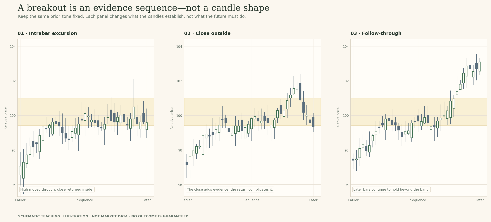
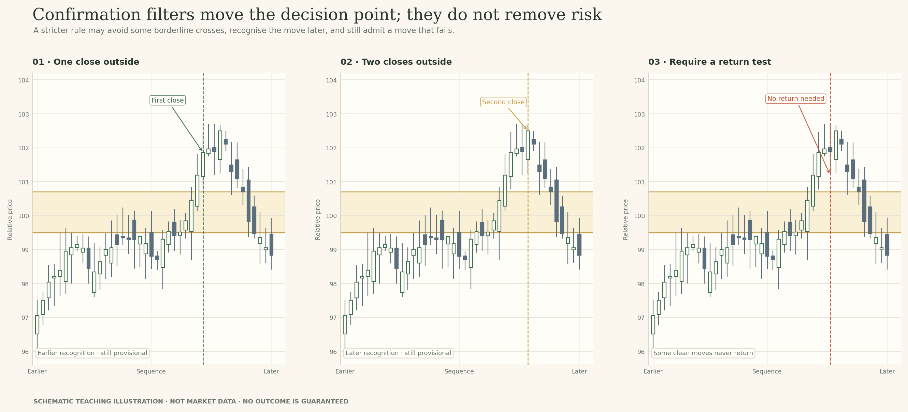
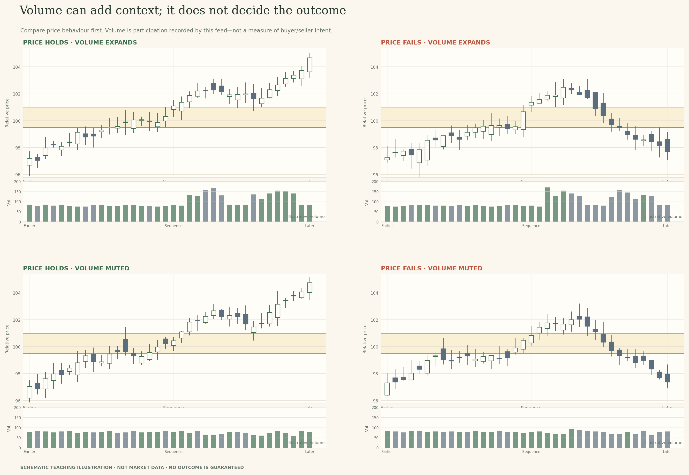

# Lesson 12 — Breakout or Temporary Penetration?

**Module:** 5 — Breakouts & Failures  
**Estimated time:** 30–35 min  
**Teaching hook:** *A close beyond a line is evidence. It is not a verdict.*

Learn to tell a brief move beyond a zone from a move that begins to hold outside it. We will compare the clues and their trade-offs.

## What you will learn

- Mark a useful zone using price behaviour that came before the move.
- Tell the difference between a wick beyond a zone and a candle close beyond it.
- Compare close, distance, time and volume as clues, including what each can miss.
- Keep a second possible explanation open while the chart develops.

## Read the idea

### Start with the question

Imagine price has just moved above an area that stopped it several times before. Is that a breakout, or has price only poked above the area for now? The first candle rarely answers the whole question. We can make a better judgement by describing what happened, then watching what comes next.

> A close beyond a line is evidence. It is not a verdict.

In this lesson, **continuation** simply means price keeps moving in the direction of the break. We will watch the later candles to see whether that happens.

### First name the boundary

Start with the chart before the move. Which earlier highs, lows or range edge make this area worth watching? Mark the area first, while the later candles are still hidden. That gives you a fair reference point for judging the move.

A **zone** is an area, not a price that must hold to the last tick. Once you have drawn it, keep it in place while you review the next candles. If you later decide the zone should be wider, narrower or somewhere else, that is allowed—just record the change and the reason for it.

A move outside the zone may be the start of a new direction. It may also be a brief move that returns to the old range. At first, call it a **breakout attempt**. Let the later candles help you decide how well the move held up.

### Four kinds of evidence

Four clues are easy to mix together, so let's keep them separate. A **wick** beyond the zone shows that price traded there during the candle. A **close** beyond it tells you where the candle finished. **Time or distance outside** tells you whether price stayed beyond the area and how far it travelled. **Follow-through** is what later candles do: they may keep moving away, stall, or come back through the zone.

Each clue adds something, but none predicts the next candle. A close just outside the band can fail. Several closes can fail too. That's not a reason to ignore the evidence; it's a reason to describe what each piece tells you—and what it leaves open.

Volume may add useful context when the feed is reliable and you know what it measures. We will look at that later. The historical example in this lesson shows price only, so use the candles that are actually on screen.

### Every filter has a cost

A **filter** is a rule you decide to use before judging a move. For example, you might require a candle to close outside the zone, a minimum distance beyond it, or two closes in a row. A clear rule helps you read similar situations in a similar way.

Every rule also has a cost. Waiting for a close can screen out some brief wicks, but a close just outside may still fail. Waiting for two closes adds another check, but you will recognise some moves later. A distance rule may ignore tiny crossings, yet the price can travel a long way before it meets your threshold.

I would write down the rule I used before looking at the ending. Then I would ask two questions: what kind of false start might this rule help me filter out, and what kind of real move might it make me recognise late? No filter catches everything.

### The market state still matters

Before you decide how important a break is, take one step back. The **timeframe** is the length of each candle—for example, five minutes or one day. A break on a short chart can still sit inside a much wider range on a daily chart.

Try looking at the same move on a nearby timeframe. Has price left the larger range, or has it only crossed a small local high? The answer can change how much weight you give the move. Neither view is automatically wrong; they are answering questions at different scales.

For this lesson, focus on describing the chart, not choosing a trade. Say what the move has shown so far, what it has not shown, and what you would watch next.

### The range is a market state, not just a shape

A range is a period when price moves back and forth between an upper area and a lower area without getting far beyond either one for long. The edges matter because price has reacted around them before. That history gives the next crossing some context, but it does not tell us which side will hold next.

When price leaves a range, two paths can begin with very similar candles. One move keeps travelling outside the range. Another slips back inside. At the start, they can look alike. The difference becomes clearer as later candles arrive.

*A local break can be clear while the wider market is still ranging.*

### The evidence ladder: wick, close, acceptance, follow-through

Here is a quick reference you can keep beside your chart. Read from left to right: what you can see, what it supports, and what it cannot promise. **Acceptance** simply means price spends time beyond the area and continues to hold there; it is a description, not a special signal.

| What you see | What it tells you | What it does not tell you |
| --- | --- | --- |
| A wick passes the edge | Price traded beyond the zone during the candle. | The candle may still close back inside. |
| The candle closes outside | The candle ended beyond the chosen edge. | The next candle does not have to stay there. |
| Price spends time outside | The move has remained beyond the zone for a while. | The move is not guaranteed to continue. |
| Later candles hold or move farther away | The idea of a sustained break has more support. | The market can still return through the zone. |
| Price returns into the old range | The claim that price is holding outside has weakened. | A move in the opposite direction is not guaranteed. |

*The evidence can grow. Certainty does not grow at the same rate.*

For example, a daily close a little above resistance means the day ended beyond the area you chose. That's more information than a wick alone. But it is not the same as knowing that buyers will keep pushing price higher. That part has not happened yet.

### Different rules recognise a move at different times

Compare what each rule asks you to wait for. A close-based rule uses where the candle finishes. A distance rule waits until price has moved farther beyond the zone. A two-close rule asks you to wait for another bar or session. The same price move may meet these rules at different times.

Waiting for more evidence can help you screen out brief crossings, but it usually means recognising a move later. A faster rule lets you assess the move sooner, but you will also see more attempts that return inside. Choose a rule you can explain, then keep using it long enough to review its trade-offs.

*A rule changes when you recognise a move; it cannot choose the outcome.*

For the examples in this lesson, we will use a daily close beyond the marked zone as our working rule. It gives us one consistent way to compare the charts; it is not a rule every trader must use.

### Volume: useful context, not a verdict

Now that we have separated the wick, close and later follow-through, let's ask a different question: can volume add useful context? Sometimes it can. But volume does not decide whether a breakout is valid or false.

In the figure, compare price first. Two sequences keep moving away from the zone and two return through it. Now compare the volume panels. Higher activity appears in a sequence that holds and in one that fails. The same is true of quieter activity. That is why I read price and volume as two clues, not as one verdict.

Before interpreting volume, check what your chart is measuring. For listed shares and exchange-traded futures, volume usually refers to shares or contracts traded, as reported by the relevant venue or data provider. **Spot FX** means currency trading at the current exchange rate. Retail spot FX is generally handled through a network of dealers and brokers rather than one central exchange, so a chart may not have one consolidated volume total. A **CFD (contract for difference)** is a contract with a provider whose value follows an instrument's price; trading it does not mean you own the underlying share, index or commodity. Some FX and CFD charts show **tick volume**—a count of price updates used as a rough measure of activity—or provider-specific data instead of a count of all traded contracts or shares. These measures are not interchangeable.

Here is a useful check: if the platform does not clearly tell you what its volume figure represents, do not treat it as confirmed traded size. Compare like with like: the same instrument, similar sessions and a clear baseline. If you cannot verify those things, leave the volume claim out.

*Compare the price result with the volume bars. The same kind of activity can appear in different outcomes.*

Here is how I would record it in a journal: 'Price closed above the zone and held there for three bars. The volume shown is higher than in the previous section of this chart, which adds context, but the later outcome is still open.' That is enough. We do not need to guess who traded or why.

> **RELATED COURSE IN THE TRADETHESIS CATALOGUE · Volume**
>
> For a fuller look at how to read volume, continue with the separate **Volume** course in the TradeThesis catalogue. Here, we only need to know what volume can add to a breakout reading—and what it cannot prove.
>
> Keep this lesson focused on price structure. The Volume course explores the volume question in its own right.

One important detail before the NIFTY example: the historical NIFTY 50 chart below is an index-price chart and has no volume bars. We will use it to study price only. Volume cannot be used to explain the outcome of this particular example.

### What the historical case can teach—and what it cannot

Let's put the idea to work on a real chart. This is a temporary internal NIFTY 50 daily-price example. The shaded band is a candidate upper area drawn for this exercise; it is not an official level. We'll start with the candles that were visible before the move, then reveal later sessions only after you have recorded your first read.

*NIFTY 50 · daily OHLC · 15 July–2 September 2016. The shaded 8,810–8,850 band is the candidate upper area for this exercise. Later sessions are hidden. Temporary internal teaching data; the band is an instructional choice, not an official level.*

**Pause before the next reveal:** Before seeing any later candles, point to the earlier highs near the shaded band. Why is this a reasonable area to watch? What rule will you use to count a break?

*In the interactive preview, record your first read in the staged chart exercise before revealing later candles.*

Take a moment with the chart before opening the next stage. A useful first note might be: 'Price has turned away from this upper area before, so I will treat it as a candidate ceiling. I will count a daily close above the band as a break for this exercise. I do not yet know whether price will stay above it.' Your wording can differ; the important thing is to name the evidence and the rule you chose.

Use **Examine the evidence** to record that first read. The next two chart views will reveal what happened after this date. When they appear, keep the earlier closes as facts and update only the interpretation that the new evidence changes.

*Keep the first view and the later revision so you can see why your thinking changed.*

### Which boundary is being broken? The label depends on the structure

Before you call a move a breakout, name the object price is moving through. Four common cases are often treated as if they were the same:

- **A range boundary** is the upper or lower edge of a stretch of overlapping price. The question is whether price is beginning to establish itself outside that prior range or has only visited the outside and returned.
- **A prior swing high or low** is a local turning point price made before the current move. Price can cross it while remaining inside a larger range; that is still a real event, but it may be a local break rather than a broad market transition.
- **A trendline or channel boundary** is a sloping reference drawn from prior pivots. A brief move through that line can be followed by a **reclaim**—price moving back across the line after crossing it. The relevant evidence is not the line crossing alone, but whether the surrounding swing structure changes in a sustained way.
- **A chart-pattern boundary** belongs to a structure such as a flag or a top/bottom formation. Its interpretation depends on the validity of that pattern and on the price action that follows. A pattern label does not replace the need to observe the breakout and its response.

This matters because we need to know what we expected price to do before we can say that the move failed. “Price crossed the old range ceiling and returned inside” is more precise than “the breakout failed”. “Price broke a rising trendline but later reclaimed it” is a different description. The two may both challenge an earlier interpretation, but they do not tell the same story. Choose the boundary using candles you could see before the break. If you draw it around later candles, it becomes hard to tell whether the chart changed or the drawing did.

*Figure 6. State the structure first. A line break and a range break are not interchangeable labels.*

### Acceptance is a useful description, not a secret confirmation rule

You may hear traders say price has been 'accepted' above a level. In plain English, they mean it has spent time there and has not immediately fallen back through the area. That can be a helpful description of the chart.

The word does not turn the move into a guarantee. A price can hold above a zone for several candles and later return below it. When you use the term, explain what you mean: how many bars, which closes, and which area are you talking about? That lets another reader follow your reasoning.

*Use the word acceptance only after you can point to the behaviour it describes.*

### Three questions to ask before keeping a breakout interpretation

When the chart has given you a few more candles, pause and ask: (1) Is price still outside the zone I marked? (2) Are the closes and the surrounding structure consistent with a move holding beyond it? (3) What evidence would make me change my mind?

Your current answer can be 'the break still looks plausible', 'the idea has weakened', or 'I cannot tell yet'. You do not need to force a confident label just because the lesson is about breakouts.

*A clear description can still leave more than one future path open.*

### How to review the rule you chose

After you have reviewed several examples, look at more than the ones that worked. Ask what your rule helped you ignore, which moves it made you recognise late, and whether you applied it the same way each time. This is how you learn whether a rule suits the instrument and timeframe you are studying.

- **It helped when:** which brief crossings did the rule screen out?
- **It cost me when:** which moves had already travelled before the rule was met?
- **I would keep or change it because:** what did you see across several examples, not just one?

Here is what I would add to my journal: 'I waited for two closes. It helped me ignore one quick return inside, but on this example I recognised the move a bar later.' That is a useful review because it records both sides of the trade-off.

### The note should preserve the rule you actually used

A useful note is short and specific. It says which zone you marked, which rule you used, what price did, and what you would watch next. It does not need to sound technical to be good.

**Weak note:** 'Confirmed breakout. Strong move.'

**A more useful note:** 'Price closed above the prior range ceiling on my daily-close rule. That supports a breakout attempt. I will reconsider if price closes back inside the range.'

The second note is stronger because another person can see what you observed and what would change your view. That is the habit we are building. You can be wrong about the next move and still have made a careful read of the chart.

## Examine the evidence

The chart stages below are meant to be opened in order. Record what you can observe before you reveal the next stage. The NIFTY 50 material is temporary internal teaching data; the candidate bands are instructional choices, not official levels.

### Stage 1 · Before the break

**Question to consider:** Look at the earlier highs near the shaded band. What makes this a reasonable upper area to watch, and what rule will you use to call a break?

**Write before revealing:** Describe the earlier reactions, state your rule, and name one thing you cannot know yet.

### Stage 2 · Several closes outside

**Question to consider:** Compare the latest candle closes with the same band. What has been added to the evidence, and what would still make you reconsider?

**Write before revealing:** Say which evidence has been added and what would make you reconsider.

### Stage 3 · Later evidence

**Question to consider:** Now compare the final sequence with your first note. Which observations remain true, which interpretation needs updating, and what still cannot be concluded?

**Write before revealing:** Keep the earlier closes as facts, then describe the new evidence and your revised view.

## Model answers and self-check

Read these after you have recorded all three chart stages. They show one way to explain your thinking; your wording can be different if it points to the chart evidence.

### Stage 1 · Before the break

You could write: “Price has turned away from this upper area before, so I will use it as a candidate ceiling. For this daily chart, I will count a daily close above the band as a break. Even if that happens, I will not know yet whether price can stay above it.”

**Self-check:** A useful response points to earlier highs, states a clear rule (such as a daily close outside), and leaves the later response open.

### Stage 2 · Several closes outside

You could write: “Several daily closes above the band give the breakout attempt more support than the first crossing alone. My rule has been met, but I still need to see whether price continues to hold outside. A return into the old range would weaken the idea.”

**Self-check:** Mention the repeated closes, avoid calling continuation certain, and name a later event that would weaken the reading.

### Stage 3 · Later evidence

You could write: “The earlier closes above the band were real, but price later closed back below it and moved into the old range. That weakens the idea that the move was holding above resistance. I cannot say from this chart alone why it failed or that a short trade must follow.”

**Self-check:** Keep the earlier evidence, identify the return below the band, update the interpretation, and avoid inventing a cause or a trade.

### A quick rubric for your own answer

- Points to price behaviour visible at that stage.
- Separates the observation from what it may mean.
- Names one uncertainty or alternative path.
- Says what new evidence could strengthen or weaken the view.

## Field notes

Use the four prompts below to preserve the development of your reasoning. Keep the first response; add a revision rather than rewriting history.

### 1 · What was crossed?

Name the prior zone, timeframe, and whether the wick or close moved beyond it. Describe only the candles visible at this stage.

### 2 · The rule I used

Which rule are you using—close, distance, time outside, or a combination? What does the evidence show so far?

### 3 · Cost and alternative

Could the move hold, return into the band, or remain unclear? What could your chosen filter make you recognise late or miss?

### 4 · What would change my reading?

State an observable event—such as a close back inside or a failed reclaim—that would weaken the continuation interpretation.

## Knowledge check

Try the questions before reading the answer key below. In the interactive preview, the answers and automated explanations remain hidden until you submit all responses.

### 1. A candle wicks above resistance but closes back inside the zone. Which description fits?

- A. The session closed and stayed above the resistance zone.
- B. Price traded above, then closed back inside the zone.
- C. The upper band has become support after this first test.

### 2. One daily candle closes just above a marked area. What can you say now?

- A. The session finished above the chosen boundary.
- B. The close suggests buyers kept control into the end.
- C. The close tells us the next session will rise.

### 3. Two closes are above the zone, but later price closes back inside. How would you review it?

- A. The earlier closes no longer count after price comes back.
- B. The return proves the zone was drawn too low from the start.
- C. The rule was met, then later evidence weakened the move.

### 4. A chart shows higher volume on both a move that holds and one that fails. What does that suggest?

- A. More volume makes a failed move more likely than a hold.
- B. Volume adds context, but does not settle the outcome alone.
- C. Less volume confirms that price will return inside the zone.

### 5. A fixed 20-point buffer is used on two different instruments. What is the main concern?

- A. The same buffer can mean different things across markets.
- B. The buffer may miss some moves, but works the same across markets.
- C. A fixed buffer matters only after the candle closes outside.

### 6. A five-minute break occurs while price remains inside a broad daily range. Which note is clearest?

- A. The local break means the daily range has already ended.
- B. The local break is clear; the wider range still matters.
- C. Keep the daily chart for review only if the break fails.

### 7. Which journal note would be most useful to review later?

- A. Strong breakout; I expect price to keep moving higher from here.
- B. Price moved quickly, so continuation seems more likely now.
- C. Close above the zone; reconsider if it closes back inside.

## Knowledge-check answer key and explanations

Use this section only after you have tried the questions.

### 1. Answer: B

Price traded above, then closed back inside the zone.

The high shows where price travelled during the candle; the close shows where it finished. This is an intraday move beyond the zone, not a close outside it.

### 2. Answer: A

The session finished above the chosen boundary.

The close is an observation. It tells you where this session ended, not what the next session must do.

### 3. Answer: C

The rule was met, then later evidence weakened the move.

The earlier closes remain valid observations. The later return changes the current reading, but it does not create an automatic opposite-side trade.

### 4. Answer: B

Volume adds context, but does not settle the outcome alone.

Volume and price behaviour are two separate clues. Activity can rise in moves that continue and in moves that fail.

### 5. Answer: A

The same buffer can mean different things across markets.

Instrument scale and normal price movement differ. A fixed distance is a convention to test, not a universal threshold.

### 6. Answer: B

The local break is clear; the wider range still matters.

Both statements can be true: a local boundary was crossed, while the wider structure remains a range.

### 7. Answer: C

Close above the zone; reconsider if it closes back inside.

A useful note gives the area, the rule, the observation and a condition that would change your view.

## Take this with you

Describe what crossed the zone, say which rule you used, then watch what price does next.

The historical chart extracts in this internal review package are temporary teaching examples. Replace them with user-owned or rights-cleared data before public release.
