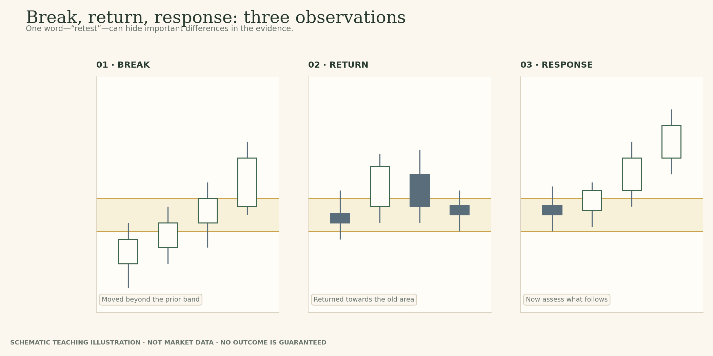
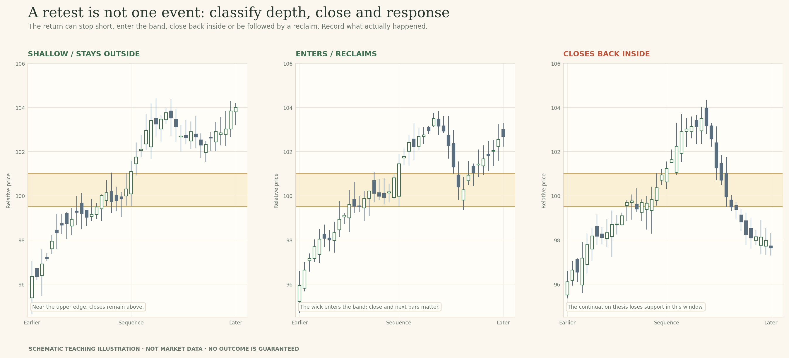
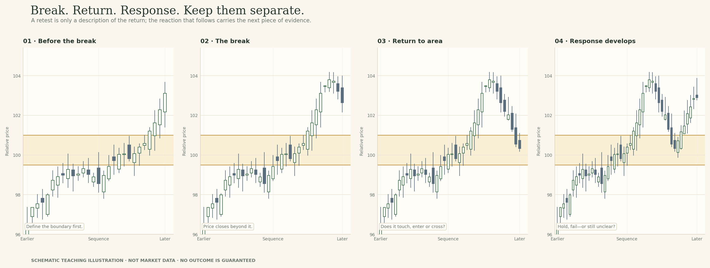
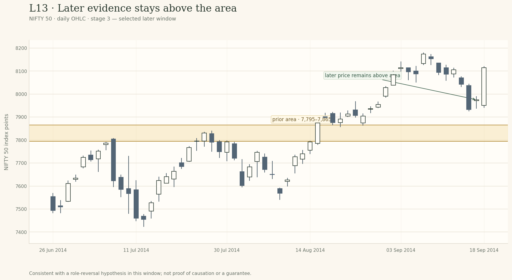

# Lesson 13 — Retests and Role Reversal

**Module:** 5 — Breakouts & Failures  
**Estimated time:** 38–45 min  
**Teaching hook:** *A retest gives you another clue, not a guarantee.*

Separate the break, the return and what price does next. A retest gives you another clue, but it cannot tell you in advance whether the old area will hold.

## What you will learn

- Separate the first break from a later return towards the zone.
- Describe how far price returns into the area and where the candle closes.
- Compare a response that holds, one that fails, and one that is still unclear.
- Explain why an old resistance area may act as support, without assuming it will.
- Keep your first read so you can compare it with later evidence.

## Read the idea

### Start with the question

Price has moved above an area that held it back before. Later, it comes back towards that area. This return is often called a **retest**. Start by asking how far price came back, where the candle closed, and what happened next. The name describes the event; it does not tell us whether the area will hold.

> A retest gives you another clue, not a guarantee.

### Three observations: break, return, response

Let's slow this down. The **break** is the first move beyond the zone. The **return** is when price comes back towards it. The **response** is what price does after the return. Those are three separate events, even when traders use one word—'retest'—for the whole sequence.

On the first chart, point to the break. On the second, find the return. On the third, see how price reacts. A return can stop short, touch the edge, move deep into the band, close back in the old range, or cross the whole zone. The next bars may move away again or keep crossing back and forth.

*Start simple: find the break, then the return, then the response.*

A good first note might be: 'Price closed above the old resistance area, later returned to its edge, and then moved away while staying above it.' That sentence describes a hold-like response. It does not promise that the area will hold on the next visit.

Keep this order in mind: the break tells you where price went; the return tells you it came back; the response tells you what happened next. You can only describe the last part after you have seen it.

### The depth of the return matters—but does not settle the outcome

A return can stop just above the band. It can touch the edge, enter a little, move deep into the area, or close back in the old range. Those are useful differences because they show how much of the earlier range price has moved back into.

Watch the wick and the close separately. A candle may dip into the band and still finish above it. Another may close well inside the old range. The second is a clearer challenge to the idea that the old resistance area is now holding price up—but the next bars still matter.

- **No return:** price keeps moving away. There has not been a retest to judge.
- **Shallow touch:** price reaches the near edge and moves away. That may fit a hold, depending on the close and what follows.
- **Deep return:** price moves well into the band. Check whether later closes are moving back into the old range.
- **Close inside the old range:** the idea that price is holding outside the range has weakened.
- **Cross and reclaim:** price passes through the band, then moves back above it. Keep both events in your record.
- **Repeated overlap:** candles keep crossing the band. The answer may still be unclear.

*The depth of the return and the closing price are two different clues.*

If you later redraw the zone, that's fine. Just keep the original one visible in your notes and explain what new evidence made you change it. This is how you can tell whether the idea improved—or whether the new drawing simply fits the ending better.

### Three responses that share the same name

Now look at the response after the return. In a **hold-like** response, price turns away from the zone and mostly stays on the new side. That supports the idea that the old area may be acting differently, at least in this part of the chart.

In a **failure-like** response, price moves back through the band and closes in the old range. If it then tries to reclaim the area and cannot stay above it, the role-reversal idea becomes harder to defend.

An **inconclusive** response is simply one that is not clear yet. Price may keep crossing the band, with candles closing on both sides. You have not missed a secret answer; the chart has not given a clear one.

*Three broad outcomes: holds for now, fails for now, or still unclear.*

The simple picture gives you the basic map. The longer examples add more candles and less tidy movement. As you look through them, keep asking the same questions: where was the boundary, how deep was the return, where did price close, and what did it do afterwards?

*Longer sequences can add evidence—or leave the answer mixed.*

### A four-stage view: before, break, return, response

It can help to look at a chart in stages. First, study the old area without seeing the breakout. Then reveal the break. Next, look at the return. Only then look at the later response. This stops the final picture from colouring how you remember the beginning.

*Look at the same area through the sequence, not only at the final chart.*

When you do this, keep your first note. After the final stage, add a second note that says what changed. The aim is not to guess the last candle; it is to explain why your view became stronger, weaker, or stayed uncertain.

### Some breakouts never retest the zone

Some moves continue without coming back to the old area. That is a normal possible path, not an incomplete chart. If your rule requires a retest, you are choosing to wait for that extra evidence. Sometimes it will arrive; sometimes price will keep moving without it.

A missing retest does not by itself prove that the breakout is valid or false. It simply means there is no return to assess in the window you are studying. You also do not need to chase a move just because the clean retest you hoped for never appeared.

*A retest is one possible path, not a required step.*

### Role reversal is possible, not automatic

After price breaks above resistance, traders often watch to see whether that old ceiling may act as support. After a break below support, the reverse question is whether the old floor may act as resistance. This possible change in behaviour is called **role reversal**.

The key word is 'may'. The boundary does not change roles automatically because price crossed it once. If price returns and stays on the new side, the idea gets some support. If it closes back inside the old range and cannot reclaim the area, the idea weakens. If candles keep overlapping around the band, the answer may still be unclear.

*The same question applies to a range edge or trendline: what happened after the break?*

A trendline deserves one extra check because it is drawn through earlier swing points and slopes across the chart. Ask whether those turning points were clear before the break. Then look at the wider swing structure. A line may break while the larger pattern of higher lows or lower highs remains in place.

I'd write what I can see before using a pattern name: 'Price moved below the rising trendline, then reclaimed it. The prior higher low is still intact.' Or: 'Price crossed the line, broke the prior swing low, and has not reclaimed it.' The two notes describe different evidence without pretending to know the next move.

### A return gives you evidence, not a story about motive

A boundary may matter because many people are watching the same area, but a chart does not show us what each person intended to do there. We can see the prices that traded, the highs and lows, and where the candle closed. We cannot tell from those bars alone whether someone deliberately defended the zone or set a trap.

You do not need to explain who was behind the move to read it well. Describe the return and the response. That gives you something another learner can check against the same chart.

### What the historical case can teach—and what it cannot

Let's work through a second NIFTY 50 daily-price example. The shaded band marks a candidate former-resistance area around 7,795–7,865. It was chosen for this exercise from earlier reactions; it is not an official level. The first chart stops before the move we want to study, so you can decide what the earlier structure tells you without hindsight.

*NIFTY 50 · daily OHLC · 26 June–14 August 2014. The shaded 7,795–7,865 band is the candidate former-resistance area. Later candles are hidden; the zone is an instructional choice, not an official level.*

**Pause before the next reveal:** Look at the earlier approaches to the band. What reactions support drawing this area? Would a careful reader be justified in drawing the band slightly differently?

*In the interactive preview, record your first read in the staged chart exercise before revealing later candles.*

For now, do not try to predict whether the area will hold if price returns to it. First decide whether the original band is defensible and what you will inspect on a return: the low, the amount of overlap with the band, the close, and the candles that follow.

Open **Examine the evidence** and record your first read. The next stages will let you inspect the crossing, the return and the later response separately. A hold-like outcome in one selected window is an example to study, not a probability you can transfer to every zone you draw.

*Keep the first view and the later revision so you can see why your thinking changed.*

### Your field note: keep the first read

Here is what I would put in my own journal: first, what I saw; second, what I thought it might mean; third, what else could happen; and fourth, what would make me change my mind. You do not need elaborate language. Exact details are more useful than impressive-sounding labels.

**Weak note:** 'Retest successful. Resistance became support.'

**A stronger note:** 'Price closed above the old resistance area, returned towards the band, and then moved higher while staying above it. That is consistent with a hold for now. Repeated closes back inside the old range would weaken this reading.'

The stronger note is useful because it shows the sequence and keeps the claim limited. After the final reveal, compare it with your first answer. Which part still fits? Which part would you update? Getting the final direction right is not the test; explaining the evidence is.

## Examine the evidence

The chart stages below are meant to be opened in order. Record what you can observe before you reveal the next stage. The NIFTY 50 material is temporary internal teaching data; the candidate bands are instructional choices, not official levels.

### Stage 1 · The old upper area

**Question to consider:** Look at the earlier approaches to the band. Which reactions support the area, and could another careful reader draw it slightly differently?

**Write before revealing:** Point to the earlier highs and say what your band includes.

### Stage 2 · Price returns towards the area

**Question to consider:** Find the bar whose low returns towards the band. Does its low enter, touch or stop short of the zone? Where does that bar close, and what happened after it?

**Write before revealing:** Describe the low and close separately; leave the outcome open for now.

### Stage 3 · Later evidence

**Question to consider:** What does the later sequence support in this window? Which claim would go too far—for example, that the band must always hold or that every breakout should be bought on a return?

**Write before revealing:** Describe the response, then name one thing the chart still cannot promise.

## Model answers and self-check

Read these after you have recorded all three chart stages. They show one way to explain your thinking; your wording can be different if it points to the chart evidence.

### Stage 1 · The old upper area

You could write: “Several earlier highs sit near this band, so it is a reasonable candidate ceiling. Another reader might draw the upper edge slightly higher or lower. I will keep this band fixed for now so I can judge the later move fairly.”

**Self-check:** Point to earlier reactions, accept that a reasonable boundary can vary, and keep the chosen zone fixed during the first comparison.

### Stage 2 · Price returns towards the area

You could write: “Price has moved above the old area and the later low approaches the band. I will describe the exact low relative to the drawn edge, then check the close separately. This is a return to assess; it does not yet prove that the area is acting as support.”

**Self-check:** Describe the low in relation to the displayed band, name the close location, and avoid declaring the retest successful before seeing the response.

### Stage 3 · Later evidence

You could write: “In this selected window, price moves above the candidate area after the return, then pulls back while staying above the band. That supports a hold-like reading for now. It does not prove the area will always hold or that every breakout needs a retest. Later price could still return through it.”

**Self-check:** Connect the return to the later response, keep the conclusion limited to this window, and mention what could change it.

### A quick rubric for your own answer

- Names the original area and how price moved relative to it.
- Separates the return (low or wick) from the candle close.
- Describes the later response rather than guessing in advance.
- Keeps the claim limited and names what could change it.

## Field notes

Use the four prompts below to preserve the development of your reasoning. Keep the first response; add a revision rather than rewriting history.

### 1 · Break and return

Name the original boundary, how price crossed it, how far the return travelled into the band, and where the relevant bar closed.

### 2 · Response so far

Does the sequence look hold-like, failure-like or inconclusive? Point to the actual closes and later bars that support your wording.

### 3 · What else remains possible?

Consider no retest, a shallow touch, a deeper return, a close back inside the old range, or a reclaim that challenges your current view.

### 4 · What would change your read?

Name an observable event that would strengthen or weaken the role-reversal idea. Keep the original zone visible and record any change you make.

## Knowledge check

Try the questions before reading the answer key below. In the interactive preview, the answers and automated explanations remain hidden until you submit all responses.

### 1. Price breaks above a range and continues higher without returning. What can you conclude?

- A. No return appeared here; a retest was not required.
- B. Without a return, the breakout is still incomplete for review.
- C. A retest is usually needed before a move can continue.

### 2. After an upside break, what does “role reversal” mean?

- A. The former ceiling can still resist price on a return.
- B. One close above confirms support for future visits.
- C. The old resistance area may now act as support.

### 3. The wick dips into the band, but the candle closes above it. What should you record?

- A. The low places price inside the band for the full candle.
- B. The wick entered the area; the close remained above it.
- C. The zone no longer matters after the candle closes.

### 4. Three later candles close on alternating sides of the band. What is the fairest label?

- A. The hold is clear enough to call the role change complete.
- B. The break has changed into a complete reversal now.
- C. The response remains mixed; more candles are needed.

### 5. Price closes inside the old range and a later reclaim attempt fails. What changed?

- A. The failed reclaim weakens the role-reversal idea.
- B. The boundary must be moved around the newest candles.
- C. The opposite range edge is now the most likely target.

### 6. You decide the band needs to be wider after seeing more candles. What is the best practice?

- A. Replace the old band after each new high or low.
- B. Keep both versions and record why you revised it.
- C. Choose the wider band because the final chart looks cleaner.

### 7. Which note best describes a return that holds for now?

- A. The old area worked, so future visits should hold too.
- B. A long position is justified on the next test of the band.
- C. Price returned, moved away, and stayed above the band.

## Knowledge-check answer key and explanations

Use this section only after you have tried the questions.

### 1. Answer: A

No return appeared here; a retest was not required.

Some moves continue without returning. A retest is an additional event to assess, not a step every breakout must complete.

### 2. Answer: C

The old resistance area may now act as support.

Role reversal is a possibility to test. Price may hold above the area, cross back through it, or remain mixed.

### 3. Answer: B

The wick entered the area; the close remained above it.

The low and close give different information. Record both, then look at the later response.

### 4. Answer: C

The response remains mixed; more candles are needed.

When candles keep crossing the band without moving away clearly, the answer is still unclear. You can leave it there for now.

### 5. Answer: A

The failed reclaim weakens the role-reversal idea.

Closes in the old range and a failed reclaim are evidence against the idea that the old ceiling is holding as support.

### 6. Answer: B

Keep both versions and record why you revised it.

A revision can be reasonable. Keeping the old boundary and noting the reason helps you avoid fitting the drawing to the ending.

### 7. Answer: C

Price returned, moved away, and stayed above the band.

The third note describes the visible sequence and keeps the conclusion limited to this visit.

## Take this with you

Name the break, describe the return, then judge the response. The word retest covers too much when we use it for all three events.

The historical chart extracts in this internal review package are temporary teaching examples. Replace them with user-owned or rights-cleared data before public release.
