# Lesson 14 — Failed Breakouts and Alternate Outcomes

**Module:** 5 — Breakouts & Failures  
**Estimated time:** 55–65 min including Wider Neckline  
**Teaching hook:** *A failed breakout can tell you more than the breakout attempt—but it is not an automatic reverse signal.*

Learn to recognise different ways a breakout attempt can fail, describe what the chart shows in plain language, and keep more than one next path in mind.

## What you will learn

- Recognise several ways a move beyond a boundary can lose support.
- Point to the exact evidence that weakens the original idea.
- Compare an early warning with stronger evidence against the first idea.
- Explain why a failed breakout does not guarantee a move in the opposite direction.
- Use a hypothetical failure example to understand a price level that would undermine the idea, and know when passing may be safer.
- Review the first read without judging it only by the eventual outcome.

## Read the idea

### Start with the question

Let's keep two moments apart. First, price moves beyond an area. We don't know yet whether it will hold there. Later, price may return through the area or fail to continue. That later behaviour is what can weaken the first idea.

> A failed breakout is not the first candle that crosses. It is the evidence that challenges the first idea.

In this lesson, a **thesis** just means your current explanation of what the chart may be showing. If you think price is beginning to hold above resistance, that is your thesis. New candles may support it, weaken it, or leave you unsure. Changing your mind when the evidence changes is part of the job.

### First, name the boundary

Start with a reference you could have marked before the move: the edge of a range; a prior swing high or low (a local turning point); a trendline; a continuation pause (a short rest after a move); or a neckline (an area used to judge a formation such as a double top or double bottom). Each is a different kind of boundary. The same candle can mean different things depending on which one price is crossing.

Then record the attempt. Did only the wick move outside? Did the candle close beyond the area? Did several bars stay there? Only after that should you look for evidence that challenges the first reading.

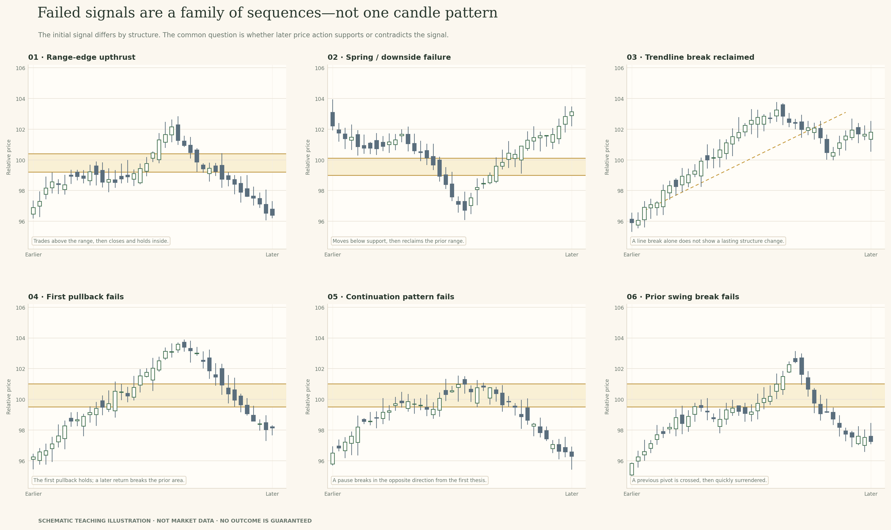

*These are different chart structures, but the same review question applies: what did price do after the break?*

If I were reviewing the chart with you, I'd keep four moments separate: the old structure, the move beyond it, the return or other challenge, and what price did next. We call it a failure when later candles challenge the first idea—not just because one candle crossed the line.

### 1 · Range-edge upthrust or false upside break

Let's start with a range, because the ceiling gives us a clear place to look. Before price moves, you should be able to point to an upper area that has slowed or stopped several advances. It need not be a perfect line; a band around the earlier highs is often more realistic.

When price first trades above the band, call it an upside-break attempt. Then check the close and the next few bars. A wick above the ceiling followed by a close back inside tells you the move did not finish outside. If price stays in the range and a later attempt to move above the ceiling also fails, the case for a false upside break becomes stronger.

*The sequence matters: old ceiling, move above it, return, and later response.*

A useful journal note would be: 'Price traded above the range ceiling, then closed back inside. The next attempt to reclaim the area did not hold, so the continuation idea weakened.' Notice how much that tells us without guessing who bought or whether anyone was trapped.

There is another possible path. Price might close back inside for one bar and then reclaim the area, staying above it. If that happens, the failure reading needs to be reconsidered. Keep following the candles rather than getting attached to the name.

### 2 · Spring-like downside failure

Now look at the lower edge of a range. Mark the floor from the lows that were visible before the move. If price trades below support, you have a downside-break attempt. The next question is whether price stays below or returns into the old range.

Compare the low with the close. The low shows how far price travelled below the floor; the close shows where the candle finished. If it closes back inside, the breakdown idea has weakened. If price stays in the range and another push below the floor cannot hold, the failure reading gets more support. If candles keep crossing the floor, leave the answer open.

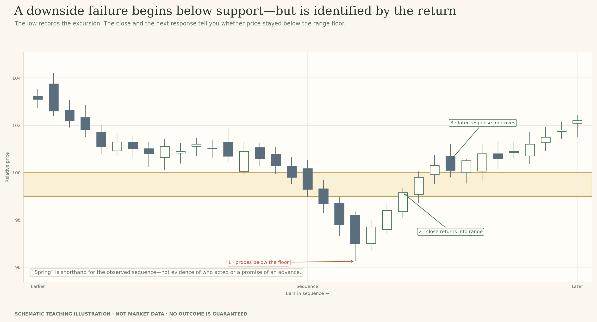

*A spring-like failure starts with a probe below the floor. The later bars tell you how the story develops.*

You may hear this called a 'spring' or a 'bear trap'. Treat those names as shorthand for the sequence, not an explanation of motive. The chart cannot prove that anyone deliberately set a trap, and the recovery may stall or fail again.

Keep the original range floor as your reference. The low of the failed move is important to record, but it does not replace the old floor simply because price later turned there.

### 3 · Trendline penetration and reclaim

A trendline slopes through earlier turning points. A range ceiling is flatter; a trendline is a way of tracking the angle of the move. Before using it, ask whether the points that anchor the line were clear at the time. A line drawn only after price turns can make the past look neater than it felt in real time.

When price crosses the line, record the crossing first. A wick through it may be brief. A close through it adds evidence. If price later moves back across the line, that reclaim challenges the idea that the trendline break has held. If the reclaim fails again, the evidence shifts once more.

Now check the nearby swing structure as well. In a rising move, are the higher lows still intact, or has price also broken a prior swing low? A trendline can break while the wider structure still holds. A break of the line plus a lost swing low is a different picture.

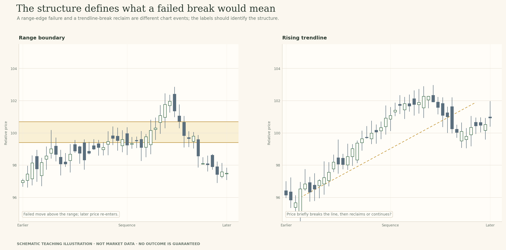

*A trendline break and a range break are different events. Name the reference first.*

For example: 'Price crossed below the rising line and later reclaimed it; the prior higher low is still intact.' Or: 'Price crossed the line, lost the prior swing low and has not reclaimed it.' Both notes stick to what happened, without forecasting the next move.

### 4 · A prior swing break that is quickly surrendered

Now focus on one earlier turning point. A swing high or low is a local high or low that was visible before price tested it. Mark that point first. Then watch whether price moves beyond it and quickly gives the move back.

For an upside test, price may trade above the old swing high and then close back below it. That is a warning. If later bars continue lower and remain beneath the pivot, the failure-test reading becomes stronger. If price quickly reclaims the swing high, the failure label is challenged. The same logic works in reverse at a swing low.

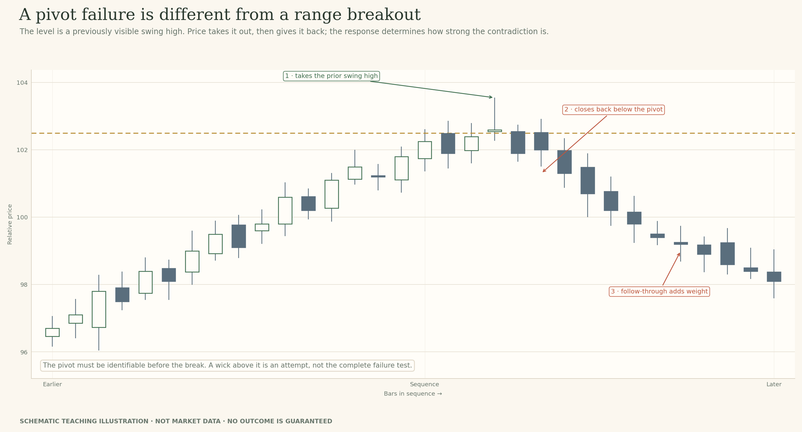

*A pivot break needs a prior reference and a response that gives the break back.*

A swing break can happen inside a much wider range. It is still a real local event, but it may not change the larger structure. Also, mark the pivot from earlier candles—not just because it looks obvious after the reversal.

The useful question is: what happened after price moved beyond the swing? The move continuing and the move being quickly surrendered begin in the same way. The response separates them.

### 5 · A continuation pause breaks the wrong way

A flag, pennant or short pause is often read as a rest before the earlier move continues. That's one possible interpretation, not a promise built into the shape. First look at the move leading into the pause. Then mark the pause edges and decide which side would fit the continuation idea.

If price breaks the expected edge and stays outside, that idea remains possible. If it breaks the other edge, the continuation explanation has lost support. If price briefly moves out and then returns into the pause, the result may still be unclear.

*A similar-looking pause can lead to different outcomes.*

Ask four simple questions: which way was price moving before the pause, which edge mattered to the continuation idea, where did the candle close, and what did the next bars do? A pause that breaks against the earlier move is evidence to review—not something to rename as a 'shakeout' before the chart supports that label.

Finally, zoom out. A clear break of a small pause may still be happening inside a larger range. Describe the local move and the wider structure if they tell different stories.

### 6 · The first pullback holds; a later pullback fails

This sequence is easy to misread because the first return can look convincing. Price breaks above a range, comes back towards the old ceiling, stays mostly above it and then moves higher. You can reasonably call that first response hold-like. It only describes that visit, though; it does not promise that every later return will hold.

When price returns again, compare the second visit with the first. Did it move deeper into the zone? Where did the candle close? Was the next push away weaker? Did price lose a swing low that supported the earlier move? Those details help explain why the second return may change your view.

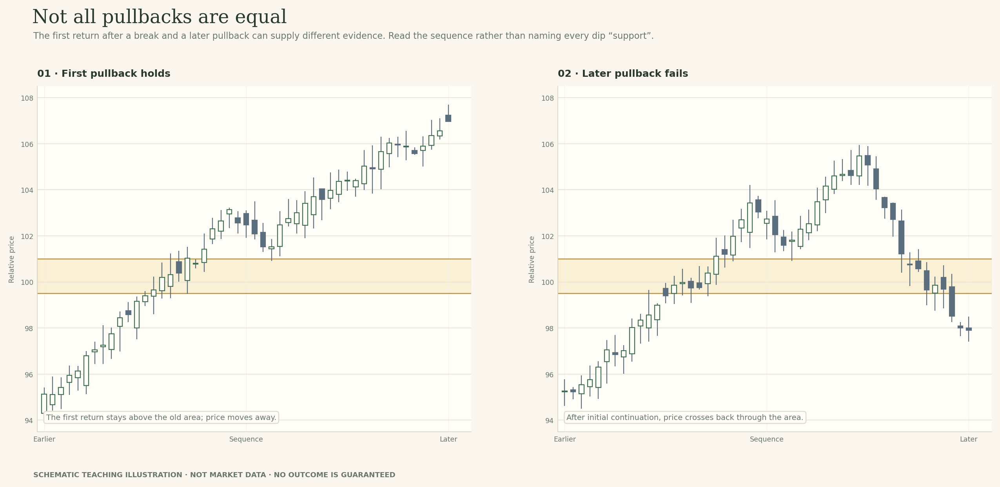

*One return holding does not guarantee the next return.*

A deeper return is not automatically a failure, and a shallow touch is not automatically strong. Look at the whole sequence. Keep both visits in your notes so that the later one does not erase what happened during the first.

For example: 'The first pullback stayed above the old ceiling and price moved higher. The second return closed inside the band, and price could not reclaim the edge; the role-reversal idea weakened.' That's much more helpful than simply writing 'support failed'.

### 7 · A neckline break in a top or bottom formation fails

A neckline is the reference area in a formation such as a double top or double bottom. We don't need to learn every detail of those patterns here. We're using them to ask the same question as before: did price stay beyond the boundary it crossed, or did it come back through?

In a top formation, price may break below the neckline. Check where the candle closes and whether later candles stay below. If price reclaims the neckline and remains above it, the breakdown idea is under pressure. For a bottom formation, reverse the direction: price breaks above the neckline, then closes back below and cannot reclaim it.

*The pattern suggests a boundary to watch. The later candles show whether the break holds.*

A familiar pattern can make us expect a particular ending before the chart has earned that confidence. Keep the note simple: name the neckline, describe the break, point to the return or reclaim, and say what later price supports. A failed neckline break does not guarantee a move of a fixed distance in the opposite direction.

If candles keep crossing the neckline, say that the breakdown or breakout has not established itself yet. 'Unclear for now' is better than forcing the pattern into a success or failure label too early.

### How much has the evidence changed?

Not every return is equally important. A brief wick back into the zone is an early warning. A close back inside is a clearer challenge to the idea that price is holding outside. Several closes in the old range, especially when a reclaim attempt fails, make the continuation idea harder to support.

You can use the list below as a description guide. It is not a scoring system. The same number of candles can mean different things on a five-minute chart and a daily chart, especially when volatility changes.

- **Early warning:** price briefly crosses back through the boundary, but the close and next response are still unknown.
- **Clearer warning:** a candle closes back inside the original zone.
- **Stronger evidence against the first idea:** later candles stay in the old range or a reclaim attempt fails.
- **The failure reading is challenged:** price later reclaims the area and holds outside again.
- **Still unclear:** price keeps overlapping the boundary, with closes on both sides.

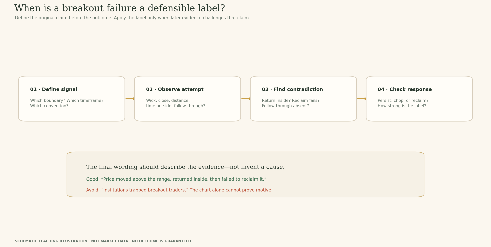

*Use the checklist to describe what you see, not to force a verdict.*

### Gaps and wide-range bars: sometimes the path is missing

A gap is a jump between one candle's close and the next candle's open, with no trades shown between those prices in the chart. A wide-range bar covers much more ground than nearby bars. Both can make a breakout or failure harder to read because the chart gives you less detail about how price travelled.

If the market opens below a range after closing above it, you can describe the open and close that you can see. You cannot say that price traded smoothly back through every point inside the gap; those prices are not shown in the data. In the same way, a very wide bar may cross the zone and finish far away without showing how the move unfolded inside the period.

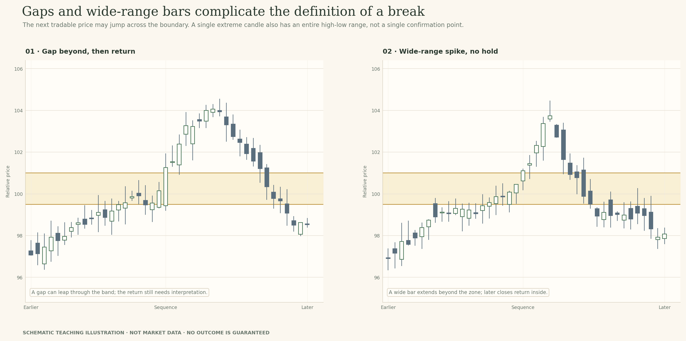

*Describe the open, high, low and close you have. Leave the missing path unknown.*

### Volume: useful context, not proof of a trap

Volume can help you compare activity around a break, but first check what the data source measures and what counts as normal for that instrument and session. An increase in activity can appear in a move that holds and in one that fails.

The candle and volume bar do not tell you who placed orders or why. **Causation** means what actually caused something to happen. Seeing high volume at the same time as a failed breakout does not prove that stop orders caused the reversal or that someone planned to trap traders.

A careful journal note might say: 'The break happened with higher reported volume than the previous bars, but price later closed back inside the range.' That's enough for the chart. You can mention volume as context without turning it into a story about hidden motives.

### Where does a stop belong in a failed-breakout idea?

A **stop-loss** is an order placed to exit a position if price reaches a chosen level. In this section it appears only in a hypothetical failed-breakout example, not as an instruction to enter a trade. We are using the marker to understand which price would make the failure idea harder to support.

Suppose price pushes above a range ceiling, then returns inside and closes below it. If you are studying a possible short-side idea based on that failure, the high of the failed move matters. A stop reference beyond that high says: if price climbs back through that extreme, the failure explanation may no longer fit.

The exact reference depends on how the failure developed. Sometimes the high appears on the same candle that closes back inside. Sometimes a later candle makes a higher high before the reversal becomes clear. Use the extreme that belongs to the sequence you are actually describing, not a neat-looking distance from the old zone.

For a possible long after a downside failure, the same idea works in reverse: the low of the failure move is the point that would challenge the recovery explanation.

Here is the important practical part. If that distance is too large for your risk limit, don't force the stop closer just to make the idea fit. You may reduce exposure, wait for a different structure, or pass. A stop is not a guaranteed execution price during a gap or a fast market. And the chart-reading idea alone is not a complete trading plan.

*The marker shows a price that would challenge the failure idea in this hypothetical example. It is not an entry signal.*

### After a failure, three paths remain possible

Once a breakout attempt has failed to hold, it is tempting to expect a strong move the other way. That can happen, but it is only one path. Price may move back into the old range, drift sideways around the boundary, or reclaim the area and try the original direction again.

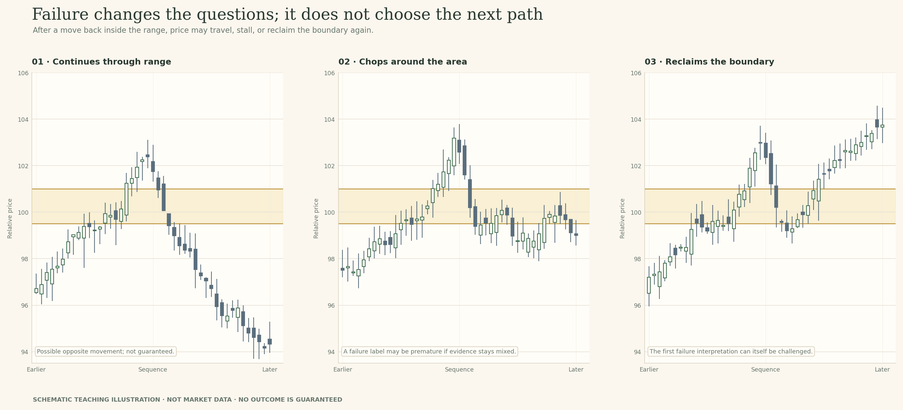

*The failure changes the questions you ask. It does not choose the next path.*

A failed breakout makes other explanations worth considering. It does not tell you how far price will travel or whether a trade is suitable. Ask what the first idea no longer explains, what alternatives still fit, and what new evidence you would need before becoming more confident.

### A failure can itself be challenged

Imagine price moves above a range and then closes back inside. That return weakens the idea that the breakout is holding. Later, price climbs back above the ceiling and stays there. The new strength challenges the failure reading.

Both events still belong in your notes. The first return happened; the later reclaim happened too. You don't need to erase one to explain the other. Just update your current view as each new candle arrives.

*A later reclaim is new evidence. It does not erase the earlier return.*

### The failure review: preserve your original read

A good review starts with the note you made before the ending was visible. Keep that note, then add what changed. I would check four things: what boundary I marked, what rule I used to call the break, which later bar challenged the idea, and whether the next move supported or weakened that revision.

- **Original structure:** what earlier highs, lows, trendline or pattern made the zone relevant?
- **Break attempt:** what traded or closed beyond it, and under which rule?
- **What challenged the first idea:** which later wick, close, return or failed reclaim changed your reading?
- **Current read:** does the original idea still fit, has it weakened, or is the sequence unclear?
- **Next question:** what could happen next, and what visible evidence would change your view again?

You can use the word **invalidation** for the event that would make your current idea no longer fit the chart. In plain language: what would show you that this explanation needs to be dropped or changed? It is a condition to watch, not a prediction that the event will happen.

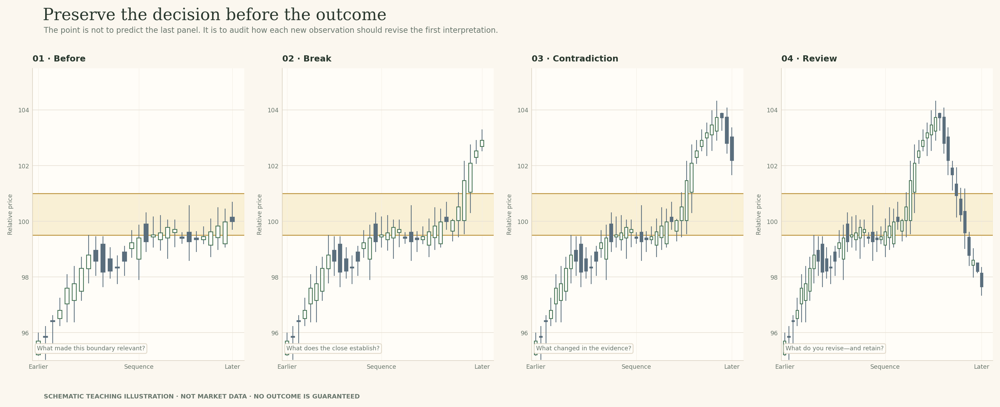

*Use your first note as the starting point for the review, not something to hide.*

### Process and outcome are not the same thing

Process means how you reached your view. Outcome means what price did later. They are related, but they are not the same thing. You can make a careful read using the evidence available and still have the move fail. You can also guess the ending correctly for weak reasons.

When you review your answer, ask whether you marked the area before the move, applied your stated rule, described the visible candles accurately, and named what could change your mind. That is a better test of your work than whether you guessed the final direction.

For this lesson, 'I am not sure yet' can be a strong answer when the candles point in different directions. The aim is not to sound certain. It is to explain what you see and update it when the evidence changes.

### Put the failure review to work on a chart

Now let's apply the questions to a historical chart. The NIFTY 50 daily chart below reaches a candidate upper area after a sustained rise. The band is drawn for this teaching exercise, not supplied as an official index level. At this first stage, the breakout attempt and its outcome are not yet visible.

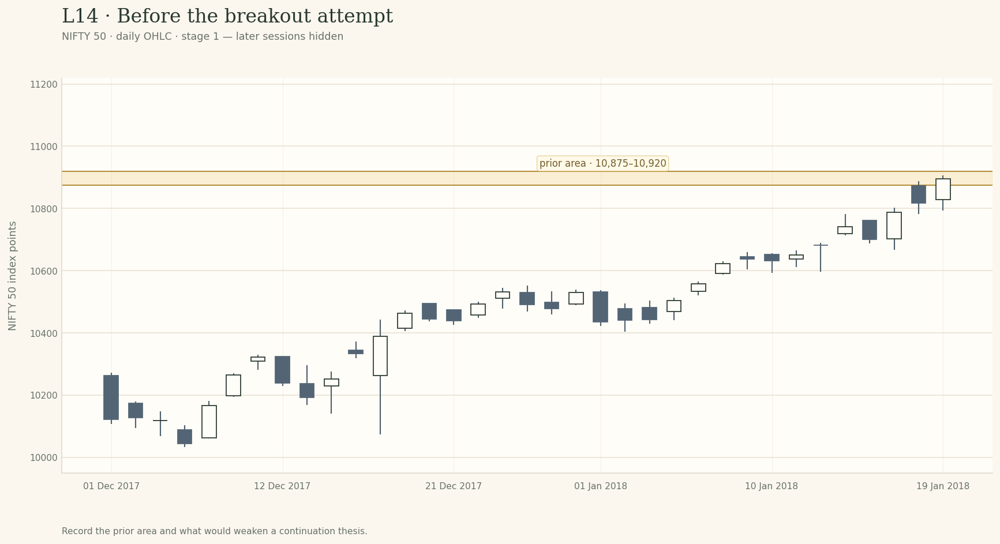

*NIFTY 50 · daily OHLC · 1 December 2017–19 January 2018. The shaded 10,875–10,920 band is a candidate prior upper area selected for this exercise. Later sessions are hidden; it is not an official level.*

**Pause before the next reveal:** Look at the rise into the shaded band. Which earlier highs make this an area worth watching? What would count as a break, and what later event would make you question the idea that price is holding above it?

*In the interactive preview, record your first read in the staged chart exercise before revealing later candles.*

You do not need to label this a failure yet. It is the starting picture. Write down the area, your rule for a break, and one kind of evidence that could weaken the first interpretation. Then open **Examine the evidence** to reveal the later candles in order.

When the later bars appear, notice the difference between a reasonable first read and a read that can no longer stand unchanged. The exercise is not to guess the final candle path; it is to identify what the chart adds at each stage and revise the explanation when that evidence changes.

## Examine the evidence

The chart stages below are meant to be opened in order. Record what you can observe before you reveal the next stage. The NIFTY 50 material is temporary internal teaching data; the candidate bands are instructional choices, not official levels.

### Stage 1 · Before the breakout attempt

**Question to consider:** Look at the rise into the shaded area. Which earlier highs make it relevant, and what would count as contradictory evidence after a break?

**Write before revealing:** State the prior evidence, the boundary you chose, and one possible warning sign.

### Stage 2 · The return still holds above

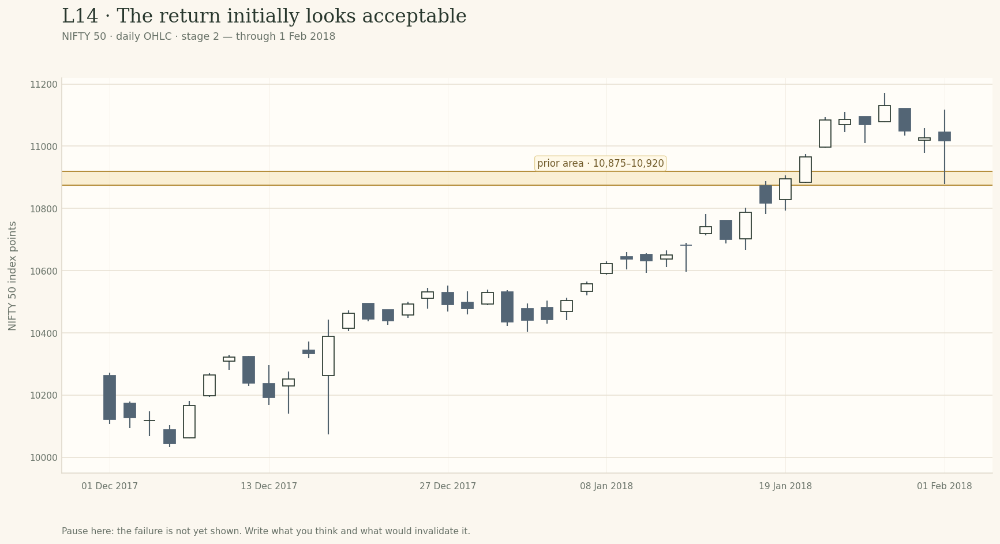

**Question to consider:** At this point, the close is still above the band after a return. What interpretation remains plausible, and what evidence is still missing?

**Write before revealing:** Describe the current evidence and keep at least one alternative open.

### Stage 3 · The continuation idea is challenged

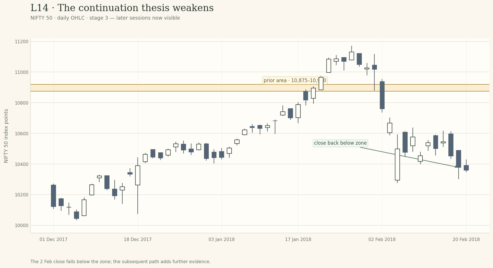

**Question to consider:** Find the close that moves back below the original band. How does it challenge the continuation idea, and what does it still not prove?

**Write before revealing:** Name the close or later response that changed your view; avoid inventing a cause or an automatic trade.

## Model answers and self-check

Read these after you have recorded all three chart stages. They show one way to explain your thinking; your wording can be different if it points to the chart evidence.

### Stage 1 · Before the breakout attempt

You could write: “Earlier highs cluster near this band, so I will use it as the candidate ceiling. I will count a daily close above it as a breakout attempt. A close back inside the old range, especially if price cannot reclaim the band, would weaken the idea that the move is holding.”

**Self-check:** Use earlier candles to explain the zone, state what would count as a break, and describe a future contradiction without assuming it will happen.

### Stage 2 · The return still holds above

You could write: “The close remains above the band after the return, so the idea that former resistance may be acting as support is still plausible. I do not yet have evidence of a sustained failure. Later closes back inside or a failed reclaim would change the reading.”

**Self-check:** Notice the close remains above, describe role reversal as possible rather than certain, and state what evidence is still missing.

### Stage 3 · The continuation idea is challenged

You could write: “The 2 February close back below the original band contradicts the idea that price was holding above it. Later weakness adds context. The first return had looked acceptable, but the new close changes the reading. It does not prove who caused the failure or mean a short trade is automatic.”

**Self-check:** Point to the close back below the band, explain how it weakens the continuation idea, and leave motive and trade choice unclaimed.

### A quick rubric for your own answer

- Names the boundary and the original breakout convention.
- Points to the new candle or sequence that changed the reading.
- Explains what the evidence weakens without claiming certainty.
- Does not infer hidden motive or turn the failure into an automatic trade.

## Field notes

Use the four prompts below to preserve the development of your reasoning. Keep the first response; add a revision rather than rewriting history.

### 1 · Original structure & attempt

Was the boundary a range edge, pivot, trendline or formation edge? Describe the attempted break using only the bars visible at that stage.

### 2 · What challenged the idea?

Point to the candle or sequence that weakened your first reading. What changed, and what remains uncertain?

### 3 · What may happen next?

Could price continue into the old range, stall, reclaim the boundary or remain mixed? Keep at least one credible alternative alive.

### 4 · What would change your view?

What later price action would make the failure idea harder to support? In the stop example, which price extreme would challenge the idea? If that level is too far away for your risk limit, passing is reasonable.

## Knowledge check

Try the questions before reading the answer key below. In the interactive preview, the answers and automated explanations remain hidden until you submit all responses.

### 1. A candle has just closed above a range ceiling. How should you label it at this point?

- A. Price has confirmed a move that should continue higher.
- B. The break has failed before any return inside appears.
- C. A breakout attempt; its next response is unknown.

### 2. One candle then closes back inside the old range. What does that tell you?

- A. The next move lower is now the more likely outcome.
- B. The close now challenges the idea of holding above.
- C. The original zone may have been set too high or low.

### 3. After a failed upside break, which paths may still happen?

- A. Price may return, move sideways, or reclaim the zone.
- B. Price should reach the opposite edge after a failed break.
- C. Only a strong reversal remains possible from here.

### 4. For a hypothetical short after an upside failure, which price point matters structurally?

- A. Use a fixed number of points above the old zone.
- B. Use the midpoint of the prior range as the reference.
- C. Use the extreme that would challenge the failure idea.

### 5. A market gaps from above a zone to below it. What can the candles tell you?

- A. The candle data lets us reconstruct every price inside the gap.
- B. We see the open and range, not the path inside the gap.
- C. The market crossed the gap without any missing prices.

### 6. High volume appears during a failed breakout. What does that prove?

- A. Volume shows activity, but not who traded or why.
- B. It shows that stops were targeted around the level.
- C. It makes a move in the opposite direction more likely.

### 7. Price returns into the range, then later reclaims the ceiling and stays above. What should the review say?

- A. The earlier return should now be removed from the written record.
- B. The first failure proves any later breakout will hold.
- C. The reclaim adds new evidence against the failure reading.

### 8. A neckline break fails and later candles cross the neckline repeatedly. Which description fits best?

- A. The pattern points to a move in the opposite direction now.
- B. The break is not established; the result is still unclear.
- C. The first crossing completes the pattern without more evidence.

## Knowledge-check answer key and explanations

Use this section only after you have tried the questions.

### 1. Answer: C

A breakout attempt; its next response is unknown.

At the first close you can record the attempt. A failure label needs later evidence that challenges the move.

### 2. Answer: B

The close now challenges the idea of holding above.

A close back inside is a clear contradiction to the idea that price is holding outside, but one close does not guarantee the next direction.

### 3. Answer: A

Price may return, move sideways, or reclaim the zone.

Failure makes alternatives worth reviewing. It does not select a single outcome.

### 4. Answer: C

Use the extreme that would challenge the failure idea.

The structural reference should relate to the move that failed. It is not a universal buffer or an entry instruction; if the risk is too large, passing may be appropriate.

### 5. Answer: B

We see the open and range, not the path inside the gap.

The chart does not show trades inside the gap. Describe the prices the data supplies and leave the missing path unknown.

### 6. Answer: A

Volume shows activity, but not who traded or why.

Volume can describe reported activity, but it does not establish hidden motive or guarantee follow-through.

### 7. Answer: C

The reclaim adds new evidence against the failure reading.

Both events matter. Keep the earlier return, then note that the later reclaim challenges your current label.

### 8. Answer: B

The break is not established; the result is still unclear.

A pattern name does not settle the result. Repeated overlap can leave the interpretation unresolved.

## Take this with you

Name the original structure, describe the break attempt, point to the later evidence that changed the reading and ask what may happen next. If you study a stop, tie it to the price that would weaken your failure idea—not an arbitrary number.

The historical chart extracts in this internal review package are temporary teaching examples. Replace them with user-owned or rights-cleared data before public release.
