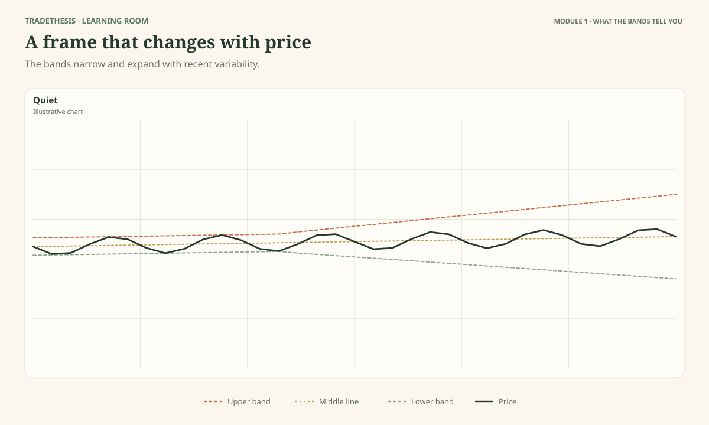
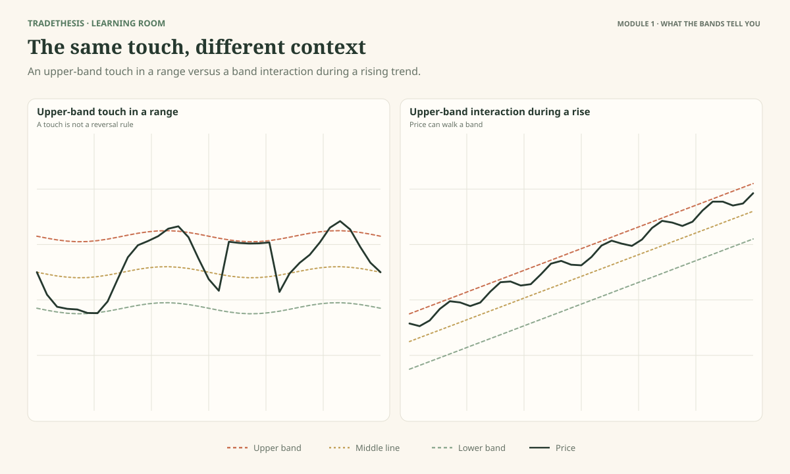
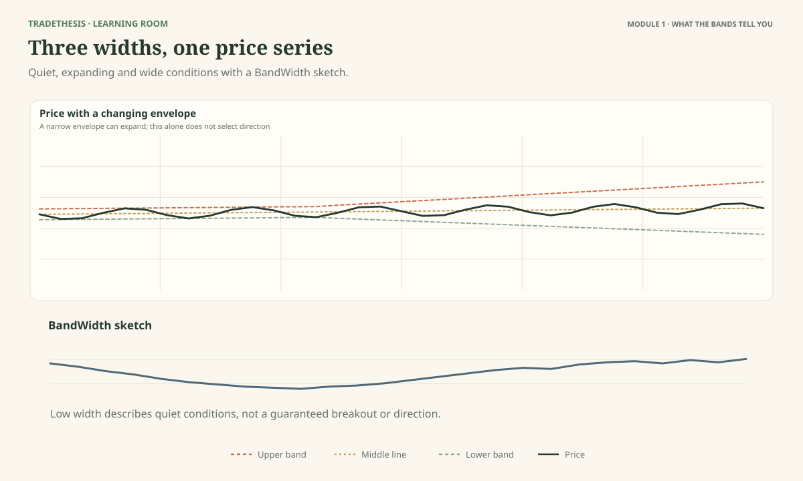
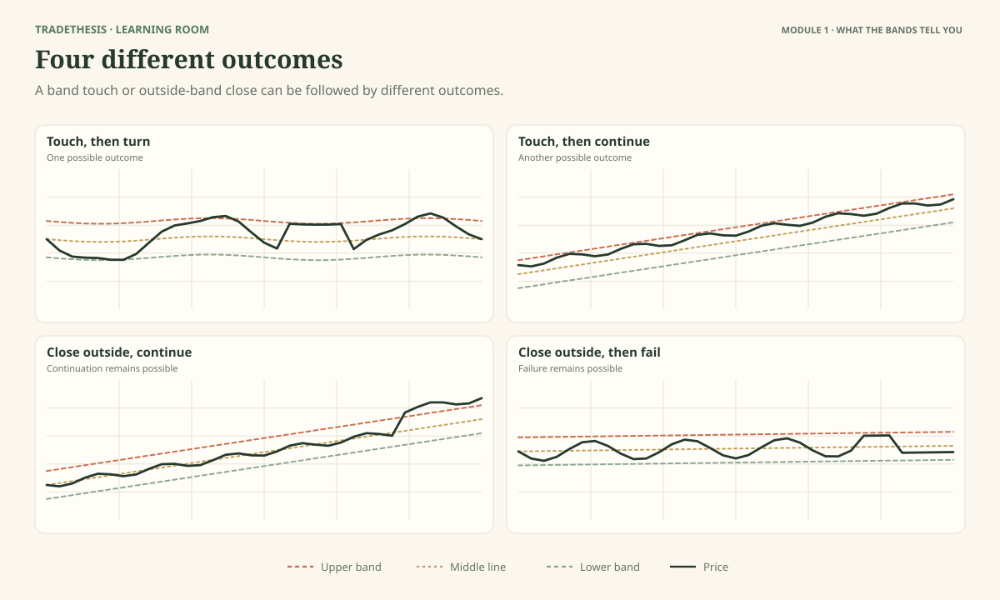

# Module 1 — What Bollinger Bands Actually Tell You

This module establishes the course's first habit: describe what the bands show before deciding what the chart might mean. Bollinger Bands help describe price relative to its recent behaviour. They do not tell you, by themselves, what price must do next.

By the end, you should be able to explain the middle and outer bands in plain language, read a band touch without turning it into an automatic signal, recognise changing volatility, and state the limits of what the bands can tell you.

## A three-step habit for reading any chart: Observe → Interpret → Test

Use this simple routine throughout the course:

- **Observe:** Describe what is actually visible. Where is price relative to the bands? Are the bands narrow or wide? What have the recent highs, lows and closes done? Avoid predicting in this first step.
- **Interpret:** Explain what those facts might mean in this market context. Also name one other explanation that could fit the evidence. For example, a close above the upper band may fit continuation, but the move can still fail.
- **Test:** Decide what evidence would strengthen or weaken your reading. For a possible trade, set the trigger and the condition that would invalidate the idea before acting.

Here, “test” does not mean prove what price will do next. It means checking your reading against a clearly stated condition or later evidence. Testing whether a trading method holds up across many examples is a separate job covered in Module 7. If the available evidence does not help you choose between reasonable explanations, waiting is a valid decision.

---

## Lesson 1.1 — What Are the Bands Showing You?

**Estimated study time:** 15 minutes.

As you work through this lesson, refer to **Figure 1.1**.

### The question

Why do the bands move closer to price in some periods and spread out in others?

A Bollinger Band chart adds three moving lines around price. The middle line is usually a 20-period simple moving average. It gives a moving reference point based on recent prices. The upper and lower bands sit above and below that average. Their distance from the middle line changes with how much price has been moving around its average.

Think of the bands as a frame around recent price behaviour. The frame adjusts as conditions change. It is not a pair of permanent walls.

### Read what is visible first

In Figure 1.1, find the three parts:

- **Middle band:** the moving average used as the centre of the calculation.
- **Upper band:** the middle band plus a chosen amount based on recent price variation.
- **Lower band:** the middle band minus the same amount.

The standard setup commonly uses 20 periods for the middle average and two standard deviations for the outer bands. You do not need the formula yet. For now, remember the logic: the average gives the centre; the amount price has varied helps determine how far the outer bands sit from it.

### What the bands add to a candle chart

A candle tells you where price opened, how far it travelled during that period, and where it closed. The bands add a moving reference for judging where that price sits relative to recent conditions.

Suppose price reaches the upper band. You now know it has reached the upper part of the banded range. You do **not** yet know whether it will reverse. In a sideways market, it might be approaching a range edge. In a strong uptrend, it might be showing continuing strength. The band gives you a useful question, not a complete answer.

### A simple reading method

When a band interaction catches your eye, ask three things:

1. **Where is price?** Is it near the upper band, middle band, or lower band?
2. **What has the market been doing?** Is price trending, moving sideways, or changing character?
3. **What would help next?** Does price hold its progress, turn back, or continue moving in the same direction?

These questions prevent a common mistake: treating the indicator as if it had one meaning in every market.

### Observe: Start with what you can see

**Task:** Using Figure 1.1, point to one section where the bands are relatively narrow and one where they are wider. Identify the middle, upper, and lower lines.

**Model reasoning:** The three lines can be identified by their positions around price. If the distance between the outer bands changes, the indicator is responding to a change in recent price variation. That observation alone does not identify the next direction.

### Interpret: What might the evidence mean?

Imagine two charts with price at the upper band. In Chart A, price has been moving back and forth between fairly stable boundaries. In Chart B, price has been making higher highs and higher lows for several periods. The same visible band touch sits in two different market stories. Chart A may deserve a closer look for a range-edge reaction; Chart B may be showing trend strength.

**Task:** In one or two sentences, explain why the touch has a different possible meaning in the two charts.

**Model response:** In the range, the touch is near a boundary where price has turned before, so a reaction is worth watching. In the rising trend, repeated upper-band interaction may reflect ongoing strength. Neither chart gives an entry from the touch alone.

### Worked chart comparison: Read the frame as it changes

**Case A — Quiet movement.** Imagine the middle band is near 100, the upper band near 104 and the lower band near 96. Several candles fluctuate between 98 and 102 and the outer bands gradually draw closer. The defensible observation is that the recent distribution of prices is becoming tighter. It does not tell you that price is about to rise, fall, or break out immediately.

**Case B — Movement expands.** Later, closes spread from around 100 toward 106 and the band gap widens. The widening reflects the larger recent variation, but the direction must still come from the candles and their sequence. If price keeps making higher highs and higher lows, that supports an upward reading; if it falls through a range floor, it supports a different one. The band shape is useful precisely because it describes the change without deciding the trade for you.

### Common mistake

**Mistake:** “The band is resistance, so price should turn.”

**Correction:** The upper and lower bands describe relative price position. They do not guarantee that price will stop or reverse.

### Keep this

> **The bands help you describe where price is relative to recent behaviour. The market context helps you decide what that observation might mean.**

**Source and further reading:** This mental model follows John Bollinger's official rules, especially Rules 1, 6, 7 and 22, and the construction discussion in *Bollinger on Bollinger Bands*. [Official rules](https://www.bollingerbands.com/bollinger-band-rules).

---

## Lesson 1.2 — When Price Reaches a Band, What Does It Mean?

**Estimated study time:** 14 minutes.

As you work through this lesson, refer to **Figure 1.2**.

### The question

If price touches the upper band, should you sell?

No. John Bollinger makes the distinction very clearly: a band tag is not, by itself, a signal. The band gives a relative definition of high or low. It does not tell you to buy or sell automatically.

### One visible event, two different contexts

Start with a market that has moved sideways. Price has repeatedly risen toward an area and then fallen back. If it now reaches the upper band close to that area, it is reasonable to watch for another rejection. But even there, you still need evidence that price is turning. The band and the range boundary identify a place to pay attention; they do not guarantee a reversal.

Now consider a market that is steadily rising. Price forms higher swing highs and higher swing lows, and several candles close near the upper band. Selling each upper-band touch would mean repeatedly trading against the direction that price is showing. In this setting, the band interaction may fit continuation better than reversal.

The point is not that range trades always reverse or trend trades always continue. The point is that **the same indicator event can play a different role depending on the market around it**.

### Observation is not a conclusion

Use the following language when describing a chart:

- **Observation:** Price reached the upper band.
- **Possible interpretation in a range:** Price is testing the upper part of the recent range.
- **Alternative:** The range may be breaking, or the touch may be an ordinary movement within the range.
- **Evidence to watch:** Does price turn back into the range, or does it hold above the boundary and continue?
- **Decision:** Wait until the condition required by your plan appears.

That may sound slower than instantly labelling a buy or sell signal. It is also more honest about what the chart has actually shown.

### Read the comparison

In the range panel, look for earlier turns near the same area. In the trend panel, follow the swing structure and the sequence of interactions with the upper band. Do not count band touches in isolation. Look at what price did before and after them.

### Observe and interpret: What does the touch tell you?

For each panel, finish this sentence: “The band touch tells me ___, but it does not yet tell me ___.”

**Model reasoning:** For the range, the touch shows price is near the upper side of its recent banded range; it does not prove that the range will hold or that a short trade is ready. For the trend, the touch shows price is at a relatively high position; it does not prove price is overextended or due to fall.

### Test: Apply the reading to a new case

The lower band is touched after several candles have made lower lows. A learner says, “This is cheap, so I will buy.”

What is missing from that reasoning?

**Model response:** The learner has described relative position as if it were value and a reversal signal. The chart may be in a downtrend, with price walking the lower band. The learner needs evidence that the decline is weakening, a clear trigger, and a planned invalidation before considering a long.

### Worked comparison: The same touch, two different readings

**Case A — Range edge.** A market has turned lower from roughly 104 on several earlier attempts. Price now reaches 104 while the upper band is nearby, then closes back at 102. The prior turns make a rejection worth investigating. The close back below the area adds evidence that price has not held above it, but the trader still needs the entry rule and invalidation used for the range plan.

**Case B — Advancing market.** Another market rises from 100 to 103, then 106 and 109. Several closes sit near the upper band while swing lows also rise. Selling simply because the upper band was touched would ignore the persistent progress. The contrast is not that range tags always reverse and trends always continue. It is that you should first compare the touch with structure, then wait for the condition your plan requires.

### Common mistake

Treating “upper” as sell and “lower” as buy.

### Keep this

> **A band touch is a reason to inspect the chart, not a complete trading plan.**

**Source and further reading:** John Bollinger's Official Rule 6 says tags of the bands are just that—tags, not signals. Rules 7 and 22 reinforce the need for context and setup-based decisions. [Official rules](https://www.bollingerbands.com/bollinger-band-rules).

---

## Lesson 1.3 — Why the Bands Keep Changing

**Estimated study time:** 15 minutes.

As you work through this lesson, refer to **Figure 1.3**.

### The question

Why can an instrument show narrow bands one week and much wider bands another week?

The bands adjust to recent price variation. When price moves in a quieter, more contained way, the outer bands tend to move closer together. When price begins making larger moves, the bands tend to spread apart. Traders often call this changing level of movement **volatility**.

Volatility is not the same as direction. A market can become more volatile while rising, falling, or moving sharply in both directions. The bands show that the recent movement has changed; you still need price structure to judge the direction.

### Think of the bands as an adjustable frame

Imagine wrapping a flexible frame around a sequence of prices. If recent prices are close to their average, the frame can be narrow. If prices have been spread farther from their average, the frame expands. Bollinger Bands work from a moving average and a measure of how spread out recent prices have been.

This also means the bands can change even if the current candle does not look dramatic. The calculation uses a rolling group of prices. New bars enter the calculation and older bars leave it. The band shape reflects the selected window, not just the last candle.

### Three states to notice

Figure 1.3 presents three common states:

**Narrow bands:** Recent price movement has been relatively quiet compared with the wider parts of the chart. This can be useful context, but it does not tell you when a move will happen or which way it will go.

**Bands beginning to widen:** Recent price variation is increasing. A larger move may be underway, but widening bands alone do not say whether it is a clean breakout, a sharp reversal, or a period of choppy swings.

**Wide bands:** Price has recently been moving more broadly. A new entry may now be late if the move has already travelled far from the level that would make the setup attractive.

The same band width can also mean different things across instruments or timeframes. A width that is unusually narrow for one market may be ordinary for another. We will later use BandWidth to make relative comparisons more systematic.

### What widening does—and does not—confirm

Suppose price breaks above a range and the bands widen. That pairing is consistent with stronger movement after a quiet period. It is not enough by itself to prove that the breakout will continue. A fast move that immediately fails may also widen the bands.

Read the price result alongside the width change. Did price move beyond a boundary? Did it hold there? Are the swing highs and lows supporting the same direction? If the evidence conflicts, the correct response may be to wait.

### Observe and interpret: Match width to price movement

Use Figure 1.3 to match the quiet, expanding, and wide-band sections to their visible price behaviour. Then name one conclusion that cannot be drawn from band width alone.

**Model reasoning:** The narrower section shows less recent variation, the widening section shows variation increasing, and the wide section shows broader recent movement. Band width alone cannot identify the next direction or guarantee a breakout.

### Test: What evidence would you wait for next?

A second chart shows narrow bands, followed by a sudden increase in candle size. Before choosing a direction, name one price event you would watch for and one condition that would make you reject the first move.

**Model response:** I would first identify a meaningful nearby boundary and watch whether price closes beyond it and meets the rule chosen for the setup. A quick return into the prior range may weaken the first-break idea. Wider bands alone do not choose the direction.

### Worked comparison: Compression is not a countdown

**Case A — Width contracts.** BandWidth on an instrument falls from a typical 6% reading to about 2.5% while candles overlap inside a compact range. You can describe the market as quieter relative to its own recent history. Mark the range high and low and prepare conditional scenarios. The low reading does not say when the quiet period will end.

**Case B — Width expands.** Price then closes above the range and the bands spread. This is consistent with a move becoming broader, but the first break can still fail. If price quickly returns inside, the expansion may have reflected the failed move rather than durable continuation. A useful reading therefore combines width with the price result after the change. Compare similar conditions across different periods instead of treating one BandWidth number as a universal threshold.

### Common mistake

Assuming narrow bands must be followed immediately by a big move, or assuming wide bands must soon contract.

**Correction:** Bands describe the recent calculation window. They do not provide a timer or a direction forecast.

### Keep this

> **Narrower bands mean recent price movement has been quieter; wider bands mean it has been broader. Neither state chooses a direction for you.**

**Source and further reading:** This follows the construction and volatility-cycle discussion in *Bollinger on Bollinger Bands* and official Rules 9, 18 and 19. A secondary, accessible explanation is available from [StockCharts](https://chartschool.stockcharts.com/table-of-contents/technical-indicators-and-overlays/technical-overlays/bollinger-bands).

---

## Lesson 1.4 — What the Bands Cannot Tell You

**Estimated study time:** 13 minutes.

As you work through this lesson, refer to **Figure 1.4**.

### The question

Can the bands tell you the next move or guarantee that price will stay between them?

No. The bands are useful reference points, not a fence around future prices. Price can touch a band, close outside it, keep moving, return inside, or move sideways. None of those outcomes is ruled out just because the bands are on the chart.

### Why the statistical language can mislead

The outer bands are commonly set two standard deviations away from a moving average. It is tempting to assume that almost all price observations should remain inside them. But financial prices do not reliably behave like a neat, stable bell-shaped distribution. Bollinger notes that with the default parameters the proportion inside the bands is typically closer to 90% than 95%.

The practical lesson matters more than the number: do not treat a band as a statistical barrier that price is not supposed to cross. A close outside the bands is an event to interpret with context.

### A close outside a band is not automatically a reversal

Bollinger's rule is counterintuitive to many new users: a close outside the bands is initially treated as a continuation signal, not a reversal signal. This does not mean every outside close should be traded. It means the close itself is not evidence that price must turn back.

Compare the two outside-close examples in Figure 1.4. In one, price continues in the direction of the move. In the other, price returns inside and the breakout fails. At the moment of the first close, you do not know which future path will develop. A trading plan needs a defined trigger, risk, and invalidation; it should not depend on guessing the outcome.

### Use the bands to ask better questions

The bands can help you ask:

- Is price at a relatively high or low position compared with its recent movement?
- Has recent price variation become unusually narrow or broad?
- Is price moving persistently along one band?
- Does the current movement fit the market structure, or is the structure changing?
- What would make my current explanation less convincing?

They cannot answer on their own:

- Who is buying or selling, or why.
- Whether a move will continue or reverse with certainty.
- The right position size for your account.
- Whether the trade has enough room to a target.
- Whether a setup has a positive result across a range of historical cases.

### Observe and interpret: Separate facts from claims

For each of the four panels in Figure 1.4, write one supported statement and one unsupported conclusion.

**Model reasoning:** “Price closed outside the upper band” is supported by the chart. “Price must reverse next” is not. “Price closed outside and later continued” is supported after the later bars appear, but it was not certain at the first close. Keep the decision-time evidence separate from hindsight.

### Test: Apply the reading to a new case

A chart shows a close below the lower band after several falling candles. What can you say without assuming a trade?

**Model response:** Price has closed below the lower band during recent weakness. The move may continue, or it may fail and return inside. I need to judge the trend, nearby structure, and my chosen trigger and invalidation before planning a trade.

### Worked comparison: What was knowable at the close?

**Case A — Continuation.** At the end of a candle, price closes above an upper band near 110. The next two candles close around 112 and 114. In hindsight, continuation is visible. At the first close, however, the only justified statement was that price had closed outside the band; the future candles were not yet known.

**Case B — Failure.** A different chart also closes above 110, then returns below the breakout area and falls back into the prior range. That close eventually becomes part of a failed move. The initial candle looked similar in both cases. This is why a decision should be judged using only the evidence available at that time, and why a setup needs a pre-written trigger and invalidation rather than a prediction that the first move will succeed.

### Common mistake

Using the bands as a prediction device.

### Keep this

> **Bollinger Bands describe relative price and volatility. They do not remove uncertainty, and they do not replace a trading plan.**

**Source and further reading:** John Bollinger's official Rules 7, 8, 14 and 22, and the book's chapter on statistics. [Official rules](https://www.bollingerbands.com/bollinger-band-rules).

---

## References and further reading

Primary reference: John Bollinger, *Bollinger on Bollinger Bands*, McGraw Hill, especially chapters on construction, statistics, band tags, continuation and the basic rules. See the [publisher's book page and table of contents](https://www.mheducation.com/highered/mhp/product/bollinger-bollinger-bands). This module uses original teaching explanations; no book text is reproduced.
