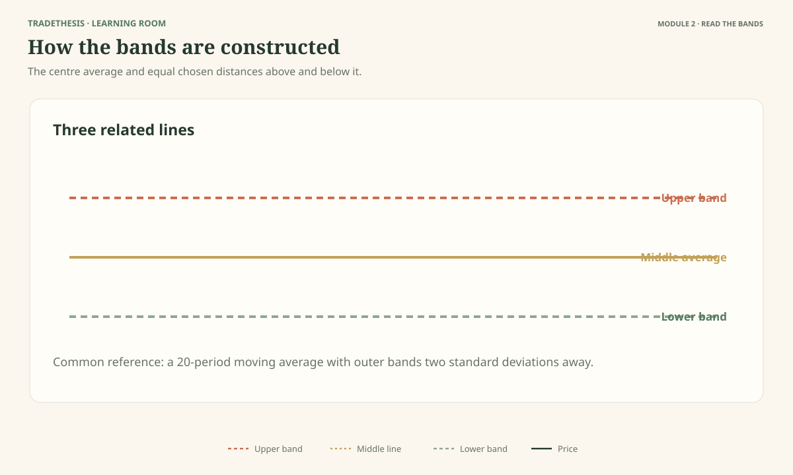
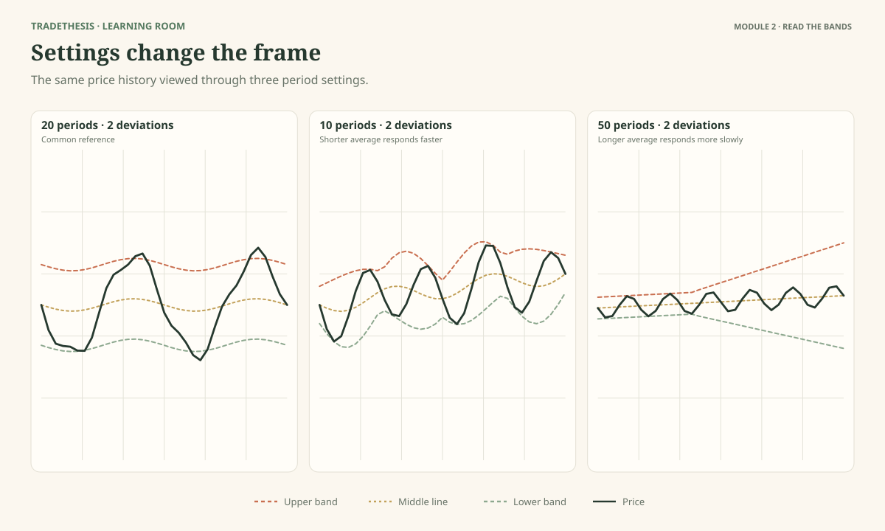
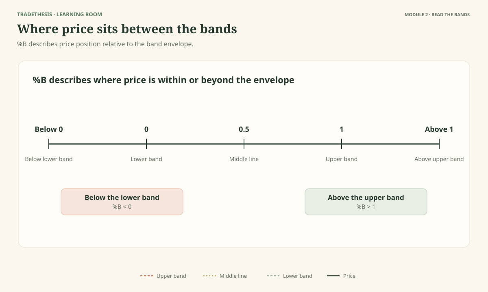
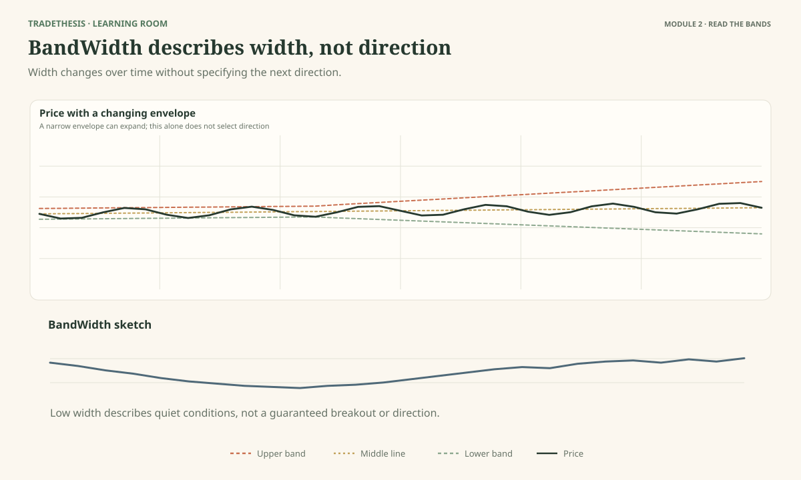

# Module 2 — Read the Bands and Their Measurements

This module explains the core settings and the two measurements most closely associated with Bollinger Bands: %B and BandWidth. The goal is not to turn the course into a mathematics class. It is to help you understand what each number adds and what it leaves unanswered.

By the end, you should be able to explain the usual settings, recognise the effect of changing them, read %B as a measure of relative position, and use BandWidth to compare how narrow or wide the bands are.

As you work through this module, use **Observe → Interpret → Test**: describe what the chart shows, consider what it may mean and what else could explain it, then name the evidence or condition that would strengthen or weaken the reading.

---

## Lesson 2.1 — How the Bands Are Built

**Estimated study time:** 16 minutes.

As you work through this lesson, refer to **Figure 2.1**.

### The question

What changes when recent prices are spread farther from their average?

Bollinger Bands have a centre and two outer bands. The centre is usually a 20-period simple moving average. The word *period* means the chart bars included in the calculation: 20 daily bars on a daily chart, or 20 five-minute bars on a five-minute chart.

The outer bands are calculated by adding and subtracting a chosen number of standard deviations from the middle average. You do not need to calculate standard deviation by hand to use the indicator. Think of it as a way to measure how widely recent prices have varied around their average.

### Build the picture in three steps

1. **Find the average.** The middle band smooths recent prices, making it easier to see a moving reference line rather than focus on every small movement.
2. **Measure how spread out price has been.** When recent prices have stayed close to their average, the spread is smaller. When they have moved more widely around it, the spread is larger.
3. **Place the bands around the average.** The upper band sits above the average and the lower band sits below it. The selected spread measure determines their distance.

The common default is a 20-period simple moving average with the outer bands set two standard deviations away. The result is a band whose width adapts to recent price variation instead of staying a fixed percentage away from the average.

### Why the difference matters

Compare Bollinger Bands with a fixed-percentage envelope. A fixed envelope stays at a chosen percentage above and below its average, even when recent price movement becomes much quieter or much larger. Bollinger Bands adapt their width to recent variation. That is what makes them useful for comparing changing volatility.

The trade-off is that the band depends on its settings and calculation window. It is not an objective boundary independent of choices. If you change the moving-average period or the standard-deviation multiplier, you change the view.

### Read Figure 2.1

Use the diagram to identify which element controls the centre and which element controls the outer-band distance.

**Task:** Complete these statements:
- The middle band is based on a ___.
- The outer bands are placed using a measure of recent price ___.

**Model reasoning:** The middle band is based on a moving average. The outer bands use standard deviation to measure how spread out recent prices have been. The settings determine the calculation.

### A useful limitation

The bands are often described in statistical language, but price movements are not guaranteed to follow a normal distribution. Do not assume that two standard deviations means the same fixed percentage of price bars will always stay inside the bands. It is a calculation setting, not a promise about what the market will do.

### Test: Apply the reading to a new case

Recent candles become larger and the prices move farther away from their average. Without changing any settings, what would you generally expect the bands to do?

**Model response:** The bands would generally widen as the calculation reflects greater recent variation. The wider bands would describe the change in volatility; they would not tell me whether to buy or sell.

### Common mistake

Thinking the bands are a fixed percentage around price.

### Keep this

> **The middle band gives the moving average; standard deviation gives the outer bands their changing distance.**

**Source and further reading:** John Bollinger's official Rules 9 and 14 and the Construction and Statistics chapters of *Bollinger on Bollinger Bands*. [Publisher contents](https://www.mheducation.com/highered/mhp/product/bollinger-bollinger-bands).

---

## Lesson 2.2 — Why 20 and 2 Are Defaults, Not Laws

**Estimated study time:** 14 minutes.

As you work through this lesson, refer to **Figure 2.2**.

### The question

Is a chart better because its indicator settings make the past look neat?

Not necessarily. A familiar starting point is a 20-period simple moving average and bands two standard deviations away. Bollinger presents these as defaults, not universal laws. Settings affect how quickly the indicator reacts and how much smoothing it provides.

### What happens when you change the settings?

A shorter averaging period reacts more quickly to recent price changes. It may also produce a more restless middle line and more frequent changes in the bands. A longer period usually looks smoother, but it can react more slowly when conditions change.

The standard-deviation multiplier affects the distance between the middle line and outer bands. A larger multiplier places the outer bands farther away; a smaller multiplier brings them closer. These changes affect how often price reaches or closes outside the bands.

The settings are linked. If you change the averaging period, the level of variation used for the outer bands also changes. Bollinger suggests modest adjustments when the averaging period changes, rather than treating the two inputs as completely unrelated. His examples include a 50-period average with 2.1 deviations and a 10-period average with 1.9 deviations. These are examples of coordinated settings, not proof that either is best for your instrument.

### Faster is not automatically better

Figure 2.2 shows the same price history with different settings. Do not ask which version produces the most impressive historical signal. Ask what each version makes easier or harder to see.

A fast setting may identify a change earlier, but it can also react to ordinary noise. A slower setting can reduce small fluctuations, but it may show a change later. The choice depends on your trading question, timeframe, instrument, and the way you will test the resulting rules.

### Avoid hindsight tuning

A common trap is to move settings until they fit a trade you wish you had taken. You may end up designing a setting that describes that particular historical section exceptionally well but does not transfer to other periods.

A fair test keeps the rules stable while you review a varied sample. If you decide to test a new setting, treat it as a new version of the method and compare it against the old one under the same conditions. Do not keep changing parameters after every loss.

### Observe: Read how the bands are built

Look at the three versions in Figure 2.2. Which reacts most quickly to a sudden price change? Which looks smoother? Does either picture prove which setting will perform better in the future?

**Model reasoning:** The shorter period should react more quickly; the longer period should look smoother. The picture alone cannot prove future performance. That requires consistent testing across different market conditions.

### Test: Apply the reading to a new case

You change the settings after every losing trade, and each new version looks better on the examples you just reviewed. What is the problem?

**Model response:** I am repeatedly fitting the settings to past outcomes. The result may describe the sample rather than produce a repeatable method. I should choose rules deliberately, test them on a varied set, and evaluate a new version separately.

### Common mistake

Treating the default as magic—or assuming a custom setting is superior because it looks cleaner.

### Keep this

> **Choose settings for a clear reason, then test them consistently. Do not let hindsight choose them for you.**

**Source and further reading:** John Bollinger's official Rules 9, 11 and 12. His suggested adjustments are examples, not universal recommendations. [Official rules](https://www.bollingerbands.com/bollinger-band-rules).

---

## Lesson 2.3 — Use %B to Describe Price Position

**Estimated study time:** 15 minutes.

As you work through this lesson, refer to **Figure 2.3**.

### The question

How can you describe the location of price more precisely than saying it is “near the top” or “near the bottom”?

%B, usually read as “percent B”, turns the price's location relative to the Bollinger Bands into a number. It is calculated from price's position between the lower and upper bands.

The important reference points are easy to remember:

- **%B = 0:** price is at the lower band.
- **%B = 0.5:** price is halfway between the lower and upper bands.
- **%B = 1:** price is at the upper band.
- **Below 0:** price is below the lower band.
- **Above 1:** price is above the upper band.

Some charting platforms display %B in a slightly different number format or use the indicator on a different price input. Check the platform's definition if you are comparing values from different tools.

### What a %B value adds

Suppose two charts look different because one instrument trades at a much higher price than the other. Saying “it is close to the upper band” is a useful visual description, but a %B value can make relative position easier to compare. It removes the need to express band position in currency units.

But %B does not tell you whether price is expensive, cheap, overbought, or oversold in a broad sense. It describes position within the current bands. A value above 1 means price is outside the upper band; it does not mean price must reverse. A value below 0 means price is outside the lower band; it does not mean a buy is due.

### Same value, different market

Imagine %B reads 0.95. In one chart, price is near the upper band while moving sideways inside a well-established range. In another, price has been advancing and continues to form higher highs. The number describes a similar relative location, but the context changes the question you should ask.

In the range, you might inspect whether the range edge is holding and whether price shows a turn. In the trend, you might inspect whether the movement continues to hold its progress. The reading is not a trade signal by itself.

### Use %B to organise evidence

Bollinger also discusses using %B in pattern recognition and indicator comparison. If you use it to look for divergence—where price makes a new high or low but the indicator does not show the same behaviour—treat the mismatch as a reason to investigate, not a guarantee of reversal. Divergences can persist while a trend continues.

### Observe and interpret: Compare the settings

Using Figure 2.3, match the readings 0, 0.5, 1, -0.2 and 1.2 to their positions.

**Model reasoning:** 0 is the lower band, 0.5 is halfway, and 1 is the upper band. -0.2 is below the lower band, and 1.2 is above the upper band.

### Test: Apply the reading to a new case

Price is above the upper band and %B is 1.15. Write one fact, one possible interpretation, and one thing you still need to know.

**Model response:** Fact: price is above the upper band and %B is above 1. Possible reading: price is moving strongly relative to its recent range. I still need to know whether the market is trending, whether price holds its progress, and what would invalidate a trade idea.

### Common mistake

Treating %B above 1 as a sell instruction or below 0 as a buy instruction.

### Keep this

> **%B describes where price is relative to the bands. The market context decides what that location may mean.**

**Source and further reading:** John Bollinger's official Rules 15–17 and the %B discussion in *Bollinger on Bollinger Bands*. A secondary formula reference is [StockCharts %B](https://chartschool.stockcharts.com/table-of-contents/technical-indicators-and-overlays/technical-indicators/b-indicator).

---

## Lesson 2.4 — Use BandWidth to See When the Bands Are Narrow or Wide

**Estimated study time:** 15 minutes.

As you work through this lesson, refer to **Figure 2.4**.

### The question

How do you know whether today's bands are narrow compared with this instrument's own history?

BandWidth measures the distance between the upper and lower bands relative to the middle band. In simple terms, it turns the width you can see into a value you can compare across time. The exact display format may differ by platform, so check whether your chart shows a decimal or a percentage.

### What to look for

When BandWidth is low, the bands are narrow relative to price. When BandWidth rises, the bands are widening. A very low reading compared with the same instrument's recent history can help you identify a period of unusually quiet movement. This state is often called a **Squeeze** in Bollinger's work.

The key word is *relative*. A BandWidth reading that is low for one instrument may be normal for another. Even on the same instrument, the useful comparison depends on the history and timeframe you are studying. For that reason, avoid adopting a universal BandWidth number and assuming it identifies every squeeze.

### Width is not direction

BandWidth tells you about band width, not whether buyers or sellers will win the next move. A low reading can be followed by an upward break, a downward break, or an initial move that fails. When the bands begin to widen, volatility is increasing; that still does not prove that the current direction will last.

Figure 2.4 aligns BandWidth with price so you can connect the measurement to the chart. The low area on the BandWidth line corresponds to a period when the price bands are close together. The rise in BandWidth corresponds to the bands widening. Check the price structure separately to understand what price is doing during those changes.

### Why use a separate width measure?

On a crowded chart, it can be difficult to compare the width of today's bands with the width several months ago. A lower panel makes the change easier to see. It also encourages you to compare the value with its own history rather than judging it from one glance.

BandWidth is not a countdown clock. It does not say that a breakout must occur in the next bar or that a narrow period will resolve in a particular direction. It helps you recognise a condition worth monitoring.

### Observe: Match %B to price position

Use Figure 2.4 to identify the narrowest period shown, then find where BandWidth begins to rise. What changes in the price chart during that time?

**Model reasoning:** The low point in BandWidth corresponds to relatively narrow bands. When BandWidth rises, the outer bands spread farther apart. Price may also begin moving more broadly, but direction must be judged from the candles and structure.

### Test: Apply the reading to a new case

BandWidth is low, but price is in the centre of a messy range and no clear boundary is nearby. Should the low reading alone trigger a trade?

**Model response:** No. It identifies quieter conditions, not an entry or direction. I should identify a meaningful price boundary, define what would count as a trigger, and decide in advance what would invalidate the plan.

### Common mistake

Using one BandWidth value as a universal squeeze threshold across all markets.

### Keep this

> **BandWidth helps you see when the bands are unusually narrow or widening. It does not tell you which way to trade.**

**Source and further reading:** John Bollinger's official Rules 18–19 and the BandWidth and Squeeze chapters of *Bollinger on Bollinger Bands*. See also [StockCharts BandWidth](https://chartschool.stockcharts.com/table-of-contents/technical-indicators-and-overlays/technical-indicators/bollinger-bandwidth).
