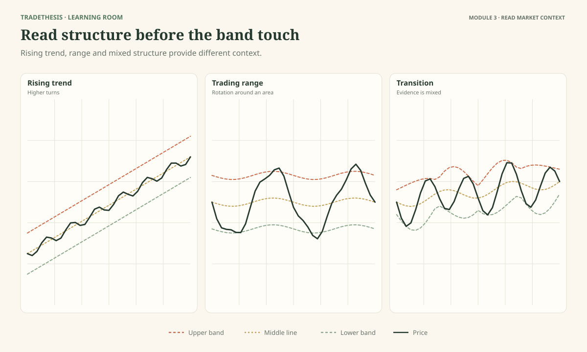
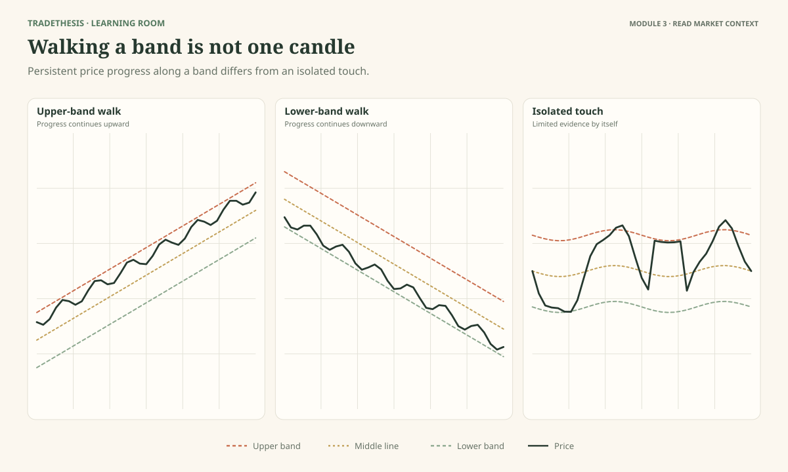
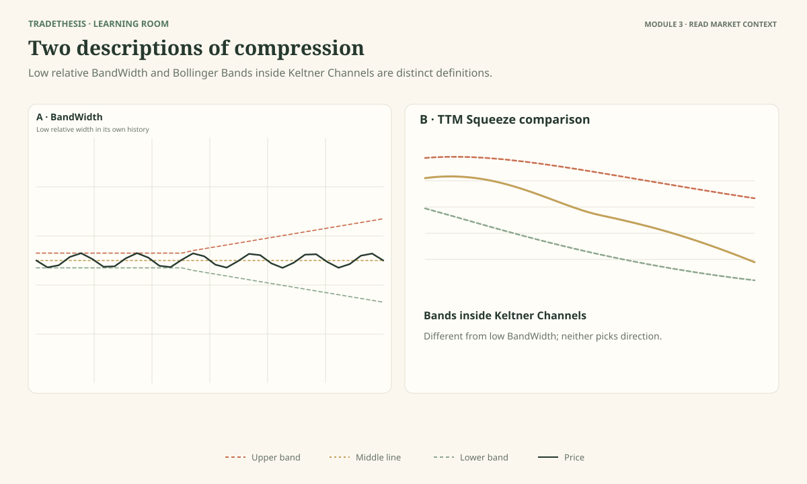
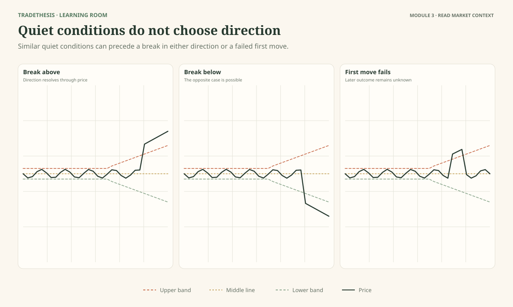

# Module 3 — Read the Market Before Reading the Signal

This module teaches you to identify the kind of market you are looking at before using a band interaction to plan a trade. The bands do not work in isolation. A touch that matters in a sideways market can mean something different in a strong trend.

By the end, you should be able to make a reasonable first classification of trend, range, or unclear conditions; recognise a band walk; distinguish Bollinger's BandWidth-based squeeze concept from the TTM Squeeze; and wait for price evidence before choosing a breakout direction.

---

## Lesson 3.1 — First Decide: Trend or Range?

**Estimated time:** 17 minutes — read 8, inspect the figure 3, task 4, review 2.  
**Figure:** Figure 3.1 — a rising trend, a clear range, and a mixed/transitioning market.

### The question

Why can the same lower-band touch be interesting in one chart and dangerous in another?

Because the bands sit inside a market that already has some structure. Before you interpret the outer band, ask whether price has been making progress in one direction or rotating back and forth between boundaries.

### A practical way to read context

A **trend** is a period in which price generally makes progress in one direction. In an uptrend, swing highs and swing lows tend to rise. In a downtrend, they tend to fall. Price does not have to move in a straight line; pullbacks happen inside trends.

A **range** is a period in which price repeatedly moves between areas where it has turned or stalled. The boundaries may be clear or approximate, and no boundary is guaranteed to hold. A range is more than a short pause. You need enough visible back-and-forth behaviour to justify treating its edges as potential reference areas.

Some charts are **mixed or transitioning**. Price may be leaving a range, losing trend structure, or moving in a way that does not yet support a confident label. Calling a chart “unclear” is not a failure. It is a way to avoid building a trade on a context you have not established.

### Where the middle band helps

The middle band can help you describe whether price is spending more time above it or below it and whether it is generally rising, falling, or flattening. But do not turn this into a mechanical rule such as “above the middle band means buy.” In a range, price crosses the middle band repeatedly. During transitions, it may cross several times without resolving direction.

Read the middle band alongside swing structure. If the middle band is rising and price is making higher swing highs and lows, those observations support an uptrend reading. If the middle band is flat and price keeps returning between boundaries, a range reading may fit better. Neither combination guarantees what happens next.

### Inspect Figure 3.1

Panel A shows a rising trend. Panel B shows price rotating between a high and low area. Panel C is deliberately mixed. Do not force Panel C into a trend or range just because the task asks you to classify it; the “unclear” answer may be the best supported.

### Task

For each panel, choose **trend**, **range**, or **unclear**. Name two visible facts that support your answer.

**Model reasoning:** A series of higher highs and higher lows supports an uptrend. Repeated turns within relatively stable boundaries support a range. Overlapping swings, a recent boundary break without follow-through, or conflicting structure can justify “unclear.” The answer depends on what the figure actually shows, not on guessing the later outcome.

### Try a new case

A market has been moving sideways for several bars, but then one large candle closes above the range high. The bands begin widening. Is the market definitely in an uptrend?

**Model response:** Not yet. This is a breakout attempt. It may develop into an uptrend if price holds and makes further progress, or it may fail and return to the range. I would keep the context provisional until follow-through clarifies it.

### Common mistake

Calling every pause in a rising market a range and then selling the upper band.

### Keep this

> **Decide whether price is trending, ranging, or unclear before you decide what a band touch might mean.**

**Source note:** This is a course context-reading framework built around Bollinger's emphasis on price structure and his rule that bands do not give continuous advice. [Official rules](https://www.bollingerbands.com/bollinger-band-rules).

---

## Lesson 3.2 — When Price Walks Along a Band

**Estimated time:** 15 minutes — read 7, inspect the figure 3, task 3, review 2.  
**Figure:** Figure 3.2 — an upper-band walk, a lower-band walk, and an isolated band touch for comparison.

### The question

Why might selling every upper-band touch in a rising market lead to repeated losses?

In a strong trend, price can travel along the upper band for several bars. Bollinger calls this **walking the bands**. In an uptrend, price may repeatedly touch or close near the upper band while continuing to make progress. In a downtrend, it may repeatedly interact with the lower band.

The phrase sounds unusual until you see the pattern. A band touch does not always mean price has travelled too far. Sometimes it shows that price is moving strongly in one direction.

### Look at the whole sequence

One upper-band touch is just one event. A band walk is a sequence. Look for repeated upper-band interaction while the swing highs and lows keep rising. The middle band may also slope upward. Together, these observations support the idea that the market is trending rather than repeatedly returning to the centre.

The opposite applies during a downtrend. Repeated lower-band interaction, falling swing highs and lows, and a declining middle band may fit continuing downside pressure. Buying every lower-band touch would repeatedly stand against that evidence.

These features are clues, not a perfect trend detector. Price can briefly move along a band and then turn. The key is to avoid declaring a reversal simply because price is at an outer band.

### A useful comparison

Figure 3.2 places an isolated upper-band touch next to a more persistent sequence. In the isolated case, one candle reaches the band but the rest of the chart may not support a trend conclusion. In the band-walk case, repeated interactions occur alongside directional progress.

Ask: **What has price been doing between the touches?** If it keeps advancing, the evidence differs from a market that touches the band and returns to the middle repeatedly.

### What about “overbought” or “oversold”?

These terms can be misleading when used as automatic trade instructions. Price near the upper band is relatively high within the current bands. It does not necessarily mean the market is too high to rise further. Price near the lower band is relatively low; it does not necessarily mean the market is too low to fall further.

If you want to consider a reversal, look for evidence that the prior trend is weakening or that price structure is changing. Do not use the band touch alone as the trigger.

### Task

Compare the isolated touch with the band walk in Figure 3.2. Which panel gives stronger evidence of a persistent directional move? Point to the visible features that support your answer.

**Model reasoning:** The band walk should show repeated interaction with one band while price keeps progressing in the same direction. The isolated touch does not establish that sequence. Neither panel guarantees the next move.

### Try a new case

Price has closed near the lower band for four bars while swing highs and lows continue falling. A learner says, “It is stretched, so I will buy now.”

**Model response:** The chart shows persistent downside movement, not a confirmed reversal. I would avoid buying solely from the lower-band position. I would wait for a change in structure and a defined long trigger, or stand aside.

### Common mistake

Fading a band walk because the market looks extended.

### Keep this

> **A band walk can be a sign of trend strength. Do not trade against it simply because price is near an outer band.**

**Source note:** John Bollinger's discussion of walking the bands and Official Rule 7 in [the official rules](https://www.bollingerbands.com/bollinger-band-rules).

---

## Lesson 3.3 — Two Ways Traders Talk About a “Squeeze”

**Estimated time:** 16 minutes — read 8, inspect the figure 3, task 3, review 2.  
**Figure:** Figure 3.3 — compare low Bollinger BandWidth with Bollinger Bands contracting inside Keltner Channels.

### The question

Do all indicators called a “squeeze” measure the same thing?

No. The term is used for related ideas, but the definitions are not interchangeable. This matters when you read a book, watch a trader, or open a study on a charting platform.

### Bollinger's BandWidth approach

BandWidth measures the gap between the upper and lower Bollinger Bands relative to the middle band. When BandWidth falls to an unusually low level compared with its own past, the bands are narrow. Bollinger discusses using this condition to identify a **Squeeze**—a period of low volatility.

You can picture it as price moving in a more contained way than it did during wider-band periods. That condition may be worth watching because market movement changes over time. But the low width does not give a direction, a precise breakout time, or a guarantee that a large move will follow immediately.

### The TTM Squeeze approach

John Carter's TTM Squeeze uses a different comparison: it looks at the relationship between Bollinger Bands and Keltner Channels. In the common implementation, the Bollinger Bands contracting inside the Keltner Channels marks the squeeze condition. A momentum component is also commonly displayed to help assess direction.

The visual logic is different. Bollinger's BandWidth approach asks, “Are the Bollinger Bands unusually narrow compared with this instrument's history?” The TTM Squeeze asks, “Have the Bollinger Bands contracted inside the Keltner Channels under this indicator's settings?”

They both focus on contraction, but one measures Bollinger Band width relative to the middle band, while the other compares two envelopes. Different platforms may use different settings, so check the study definition rather than assuming every implementation is identical.

### What is common—and what is not

Both approaches draw attention to a quieter period. Neither one removes the need to read price action. A squeeze is context. The breakout direction and whether it holds still need to be assessed from the chart and any clearly defined confirmation rules.

If a trader uses momentum with a squeeze, that is additional information. Do not confuse that information with the squeeze definition itself.

### Inspect Figure 3.3

In Panel A, look at the BandWidth measure relative to its previous values. In Panel B, look at the relative positions of the Bollinger Bands and Keltner Channels. Describe the difference without assuming one method must always be better.

### Task

Complete the following:
- Bollinger BandWidth measures ___.
- The common TTM Squeeze checks whether Bollinger Bands are ___.
- Neither squeeze definition alone tells you ___.

**Model response:** BandWidth measures relative band width; the TTM Squeeze checks whether Bollinger Bands are inside Keltner Channels; neither alone tells you the direction of the next move.

### Common mistake

Using “Bollinger Squeeze” and “TTM Squeeze” as if they are always the same indicator.

### Keep this

> **Know which squeeze you are reading. Both describe contraction, but they define it in different ways.**

**Source note:** John Bollinger's official Rule 19 and the Squeeze chapter of *Bollinger on Bollinger Bands*. John Carter discusses the TTM Squeeze in *Mastering the Trade*. The [thinkorswim TTM Squeeze reference](https://toslc.thinkorswim.com/center/reference/Tech-Indicators/studies-library/T-U/TTM-Squeeze.html) describes the Bollinger Band/Keltner Channel relationship. This lesson distinguishes the concepts rather than attributing Carter's implementation to Bollinger.

---

## Lesson 3.4 — A Squeeze Does Not Choose the Direction

**Estimated time:** 15 minutes — read 7, inspect the figure 3, task 3, review 2.  
**Figure:** Figure 3.4 — similar quiet conditions followed by an upward break, a downward break, and a failed first move.

### The question

What should you conclude when the bands are very narrow but price has not broken a meaningful level?

You have evidence of a quiet period. You do not yet have evidence of a direction. A squeeze can be followed by a sharp upward move, a sharp downward move, a small move that goes nowhere, or an initial break that fails and returns inside the prior range.

The natural temptation is to anticipate the breakout. But if your evidence is only that the bands are narrow, you are guessing the direction before price has shown it.

### Prepare scenarios instead of making a prediction

Before the breakout, identify a nearby price boundary that matters. This could be the high or low of the compression range, or another clear structural level. Then prepare two scenarios.

**Upward scenario:** If price closes above the chosen boundary and meets the confirmation rule in your plan, you will review the long idea. Specify what would invalidate the idea—for example, a return into the range if your method requires the break to hold.

**Downward scenario:** If price closes below the chosen boundary and meets the mirrored conditions, you will review the short idea. Specify what would invalidate that case.

You do not need to place both trades. You are preparing for either outcome so you do not have to invent rules when price starts moving.

### Why the first move can mislead

Price can cross a boundary and then quickly return. The first move may be a failed breakout, sometimes called a **head-fake** in Bollinger's Squeeze discussion. The word describes what happened; it is not a promise that traders can always predict the trap in advance.

The disciplined response is to define what your breakout plan requires and what cancels it. If price fails the requirement, the original idea is no longer valid. A new trade in the opposite direction needs its own trigger and risk plan; it is not automatic.

### Use Figure 3.4

The three panels begin with similar quiet conditions, then follow different paths. Compare what happens after the initial boundary is crossed. The visual is designed to make one important point clear: the narrow bands alone do not distinguish the outcomes.

### Task

For the three outcomes, write:
1. What would support a long scenario?
2. What would support a short scenario?
3. What evidence would make you stop treating the first break as valid?

**Model reasoning:** A long requires the chosen upward trigger and any pre-planned confirmation; a short requires the mirrored downside trigger. A quick return into the range or a failure to meet the stated hold condition can weaken the first-break case. The exact rule depends on the method being tested.

### Try a new case

BandWidth has reached a low reading, but price is in the middle of a broad range with no clear nearby boundary. What is a reasonable decision?

**Model response:** Wait. Low BandWidth draws attention to a quiet period, but without a clear boundary there is no well-defined breakout trigger. I can keep monitoring without making a directional prediction.

### Common mistake

Entering just because the bands are narrow, or because price has made its first move without checking whether it meets the plan.

### Keep this

> **A squeeze tells you to pay attention to changing volatility. Price must still show which scenario, if any, is developing.**

**Source note:** John Bollinger's Official Rules 8 and 19 and *Bollinger on Bollinger Bands*, chapter on the Squeeze. Specific boundary, confirmation and invalidation rules are course frameworks, not claims that Bollinger prescribed one universal entry system. [Official rules](https://www.bollingerbands.com/bollinger-band-rules).

---

## Module 3 source notes

John Bollinger's *Bollinger on Bollinger Bands* has separate discussions of walking the bands and the Squeeze. John Carter's TTM Squeeze is a distinct approach based on Bollinger Bands relative to Keltner Channels with a momentum component. See [Bollinger's official rules](https://www.bollingerbands.com/bollinger-band-rules), the [publisher's book contents](https://www.mheducation.com/highered/mhp/product/bollinger-bollinger-bands), and [the TTM Squeeze reference](https://toslc.thinkorswim.com/center/reference/Tech-Indicators/studies-library/T-U/TTM-Squeeze.html).
