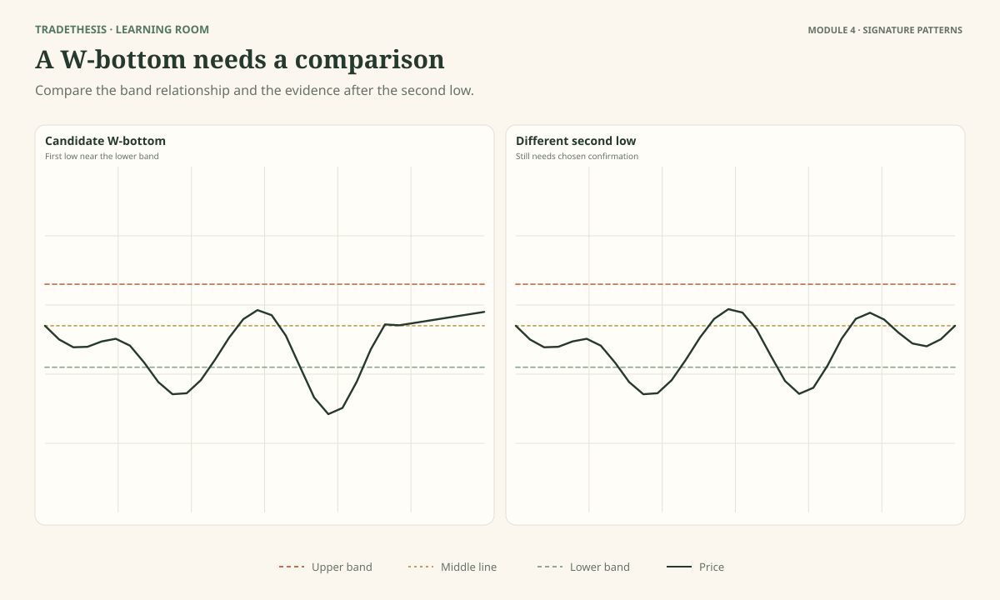
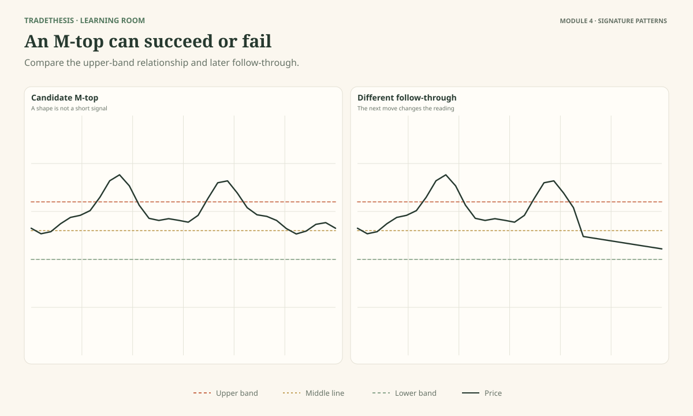
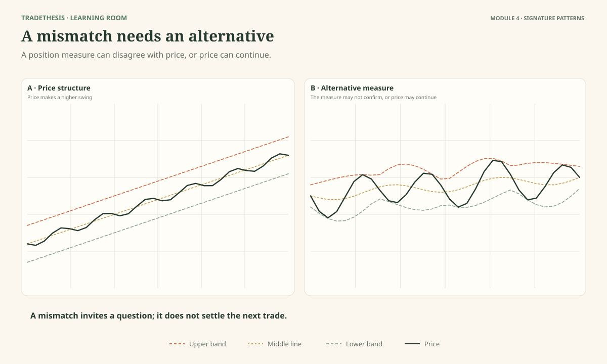
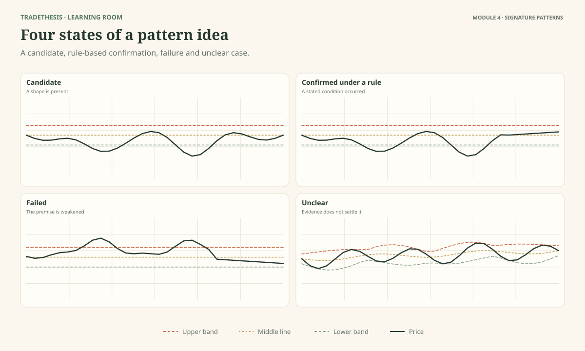

# Module 4 — Read Bollinger's Signature Patterns

This module focuses on two patterns John Bollinger discusses in detail: W-type bottoms and M-type tops. The aim is not to teach you to spot a letter on a chart and trade it automatically. It is to show how the bands can add context to a pattern and why confirmation and invalidation still matter.

By the end, you should be able to explain the logic of a W-bottom and M-top, recognise an incomplete lookalike, use indicator disagreement cautiously, and separate a pattern candidate from a complete trade plan.

As you work through this module, use **Observe → Interpret → Test**: describe what the chart shows, consider what it may mean and what else could explain it, then name the evidence or condition that would strengthen or weaken the reading.

---

## Lesson 4.1 — Reading a W-Bottom

**Estimated study time:** 17 minutes.

As you work through this lesson, refer to **Figure 4.1**.

### The question

When two lows look similar, what could make the second low more informative than the first?

A W-bottom is a two-low pattern that can help organise a possible change from a decline to a recovery. In Bollinger's approach, the bands help you judge the lows in relation to recent price variation. A common example has the first low reach or move below the lower band, while the second low has a different relationship to the band. In some W-type patterns, the second price low can be lower than the first while the band relationship shows less relative weakness.

The idea is not simply “two lows make a W, therefore buy.” The shape and the band's relationship to each low are part of the evidence. Price still needs to show that the downside attempt has failed or that the structure is turning.

### Work through the structure

Look at Figure 4.1 and identify:
1. The first low.
2. The move away from that low.
3. The second low.
4. The intervening swing high that price would need to overcome under the course's example confirmation rule.

The first low may appear at or below the lower band, showing a relatively low position. The second low should be judged in relation to the band and to the first low, rather than by looking at price alone. If price makes a lower low but the second low is no longer outside the lower band, the relative position may be improving even though price has dipped further. That contrast is what makes the pattern worth investigating.

It is still only a candidate. Price can remain weak, make another low, or move sideways without confirming a recovery. It is also possible for a W shape to form in the middle of a broader downtrend without leading to a lasting reversal.

### What confirmation means here

For practice, we will use a clear confirmation rule: price moves above the intervening swing high between the two lows. This gives the setup a condition that can be identified and tested consistently. It is an example rule for this course, not a universal rule that Bollinger prescribed in this exact form.

The trigger does not guarantee success. It simply makes the decision specific: the learner can identify what event must occur, where the idea is invalidated, and how much risk the plan permits.

### Compare the candidate and the lookalike

In the second panel, the two lows look similar but the important relationship or confirming move is missing. The correct answer may be “candidate, but not confirmed” or “unclear,” rather than forcing the W-bottom label.

### Observe and interpret: Compare the two lows

In Figure 4.1, mark the two lows, describe how each sits relative to the lower band, and identify what event would confirm the course's example long plan.

**Model reasoning:** The first low provides the initial reference. The second low's relationship to the lower band may show a change in relative weakness. A break above the intervening swing high is the chosen course trigger. If it never occurs, the plan remains inactive.

### Test: Apply the reading to a new case

A chart forms two lows, but the second low closes below the lower band and price then continues making lower lows. What is the cautious reading?

**Model response:** The shape resembles a double bottom, but the expected change has not appeared. The continuing lows support ongoing weakness. I would not treat the shape alone as a buy signal.

### Worked comparison: The relationship between the two lows matters

Suppose the first decline reaches 94 while the lower band is around 96, then price recovers toward 100. Later, price declines again to 96 but remains inside the bands. The second low is higher in relative band terms, which is consistent with the W-bottom concept: the second push has not reproduced the first low's relationship to the lower band. The structure is still a candidate, not a completed trade.

For a contrasting case, the second decline closes below the lower band again and breaks beneath the first low. That does not support the same reading; downside pressure has not shown the expected weakening. In either case, specify the confirmation you are using—such as a break of the intervening swing high in your course-defined practice rule—and the point that invalidates the idea. Do not buy merely because two lows resemble the letter W.

### Second worked comparison: The second price low can be lower and still improve relative to the bands

Suppose the first low is ₹100 while the lower band is ₹102, placing price beyond the lower band. Price rebounds to ₹106. On the next decline, the market falls to ₹99, which is a slightly lower absolute price, but the lower band has moved down to ₹97. The second low now sits inside the band. The price low is lower, yet its position relative to the current band is stronger than it was at the first low.

That relationship is central to Bollinger's W-bottom reading. It does not mean the market is guaranteed to rise, and it does not mean the lower band itself caused the change. The calculation and price have both moved. Inspect the two lows, the intervening recovery and the current swing structure before giving the candidate a pattern name.

For a course practice rule, you may wait for a break above the intervening swing high or the high of a strong confirmation day. Whichever rule you select, write it before testing examples. Define invalidation below the right-side low and check whether there is enough room to the next obstacle. The pattern can qualify structurally while still failing the separate trade-risk test.

### Common mistake

Buying every pair of lows that looks like the letter W.

### Keep this

> **The W shape starts the question. The relationship to the bands and the later price evidence help you judge whether a reversal plan is justified.**

**Source and further reading:** John Bollinger discusses W-type bottoms in *Bollinger on Bollinger Bands*, Chapter 12, and refers to the use of the bands to clarify common patterns. See the [publisher's contents](https://www.mheducation.com/highered/mhp/product/bollinger-bollinger-bands). The intervening-swing trigger in this lesson is a teaching framework, not presented as a verbatim author rule.

---

## Lesson 4.2 — Reading an M-Top

**Estimated study time:** 17 minutes.

As you work through this lesson, refer to **Figure 4.2**.

### The question

What changes if price makes a second high but the relationship to the upper band is weaker than it was at the first high?

An M-top is a two-high pattern that can help you examine whether an upward move is losing strength. In Bollinger's approach, the bands help assess the highs in relation to recent price behaviour. A common candidate has the first high reach or move beyond the upper band, while the second high remains inside it. The price highs may be similar, or the second price high may be slightly higher while its relative position is weaker.

This is a clue to investigate, not proof of a top. A market can form two highs and then break upward. The pattern needs context and a clear condition for confirmation.

### Read the two highs in sequence

Start with the first high. Price reaching or passing the upper band gives a relative high reading. Then watch the reaction away from that high. Price moves down and forms an intervening low. Later, it returns toward the prior high area.

Now compare the second high with the bands. If the second high cannot reach the same relative position, that difference may suggest the upward movement is not behaving as strongly as before. It may be a warning worth examining, especially if other evidence also suggests the trend is weakening.

But several alternatives remain possible. The market could be consolidating before another push upward. It could form a wider range. The apparent second high may be too incomplete to interpret. The M shape alone does not tell you which explanation will win.

### A confirmation rule for practice

For practice, this course uses a break below the intervening swing low as one possible confirmation trigger for a short scenario. This makes the rule observable and testable. It is a framework used in this course, not a claim that every M-top must be traded this way.

Before a trade, define the point that would show the idea is wrong, such as price reclaiming the high area under your plan. Set the stop around the invalidating structure rather than placing it at an arbitrary band line. Then check whether the available distance to a reasonable target justifies the risk.

### Compare it with a continuing trend

Figure 4.2 shows two similar highs in an uptrend. If price continues making higher lows, holds above the middle band much of the time, and breaks upward again, the bearish interpretation weakens. The second high's relationship to the band may prompt attention, but price behaviour must still be respected.

### Observe and interpret: Compare the two highs

Mark the two highs and the intervening swing low in Figure 4.2. Explain what makes the first panel a possible M-top and what remains missing from the second.

**Model reasoning:** A different relationship between the two highs and the upper band can support a candidate M-top. The chosen confirmation event and invalidation condition decide whether the candidate becomes a testable plan. A similar-looking pair of highs without those conditions is not enough.

### Test: Apply the reading to a new case

The second high is inside the upper band, but price then breaks above both highs and continues rising. What should you conclude?

**Model response:** The possible M-top did not lead to the expected downside move. The breakout above the highs contradicts the short thesis. The pattern should not be defended simply because it was visible earlier.

### Worked comparison: A weaker second push is only one clue

Suppose the first rally reaches 110 while the upper band is near 108. Price then pulls back toward 104 and rallies again to 109, this time staying closer to or inside the upper band. The second push has a different relationship to the bands, which is worth noting. It does not by itself prove that buyers have lost control or that a reversal has begun.

Compare a chart where the second push also makes a new high, closes firmly beyond the upper band and is followed by further upward progress. A shape that looks like an M can still be part of continuation. For practice, choose a clear structural confirmation and invalidation—such as a break of the swing low between the highs—and apply it consistently. That is a course execution rule, not a claim that every M-top has one universally required entry trigger.

### Second worked comparison: A higher second high does not automatically reject an M-top

The first rally reaches ₹210, above an upper band at ₹207. Price then pulls back toward ₹202. On the next rally, it reaches ₹211, a marginally higher absolute high, while the upper band has moved to ₹213. The second push remains inside the band. This is a different relative relationship from the first high and can be a clue that the new extreme is weaker within the adaptive frame.

That difference still needs context. If price breaks above ₹211 and continues to hold, the bearish interpretation is not confirmed just because the second push failed to reach the upper band. If price instead loses the swing low between the two highs, the pattern premise has more price-structure support. For a practice setup, specify whether that break is the chosen confirmation; do not silently change the trigger from one chart to another.

The stop should be placed where the actual short thesis becomes invalid, often above the right-side high or the pullback high used for entry. If the level is too far away, reduce the quantity or pass. Reading the pattern and deciding whether to risk money on it are separate tasks.

### Common mistake

Shorting the second high before price has shown a meaningful change.

### Keep this

> **A possible M-top warns you to examine the second high carefully. It does not give you permission to short without a plan.**

**Source and further reading:** John Bollinger discusses M-type tops in *Bollinger on Bollinger Bands*, Chapter 13. The course's intervening-low trigger is a testable teaching implementation, not an author-attributed universal rule.

---

## Lesson 4.3 — When Price and an Indicator Tell Different Stories

**Estimated study time:** 15 minutes.

As you work through this lesson, refer to **Figure 4.3**.

### The question

If price makes a new high but an indicator does not, should you immediately sell?

No. A difference between price and an indicator can be useful, but it is not a stand-alone entry signal. It tells you that two views of the recent movement are not matching in the same way. You still need to judge what the difference means and what evidence would confirm a change.

### What is a divergence-like mismatch?

Imagine price makes a new swing high. At the same time, %B does not reach the same high reading as it did at the prior swing. The price has reached a new high, but its relative position within the bands is weaker. That mismatch may suggest the move is losing strength.

Notice the careful wording: *may suggest*. There are other explanations. The bands themselves may have widened, changing the relative position. Price may be pausing before another advance. The indicator may be noisy at the chosen timeframe. The trend may continue despite the mismatch.

The chart does not show hidden certainty. It shows evidence that may change how closely you watch the next move.

### Use indicators that add different information

Bollinger's rules encourage combining bands with suitable indicators, but warn against simply adding multiple versions of the same thing. Two momentum indicators may largely repeat each other's message. A momentum measure and a volume-based measure can sometimes contribute different information.

You do not need a crowded chart. One additional measure is enough if you can explain what question it answers. For example, %B helps describe relative band position. A separately chosen momentum indicator might help describe whether momentum is changing. Volume can help describe recorded trading activity in markets where the volume data is meaningful. None can prove a future outcome.

### Read Figure 4.3

In the first panel, identify the new price high and compare the %B reading at the two highs. In the alternative panel, notice that price continues upward after a similar mismatch. The purpose is to show why divergence-like evidence deserves attention but should not be treated as a timer.

### Observe and interpret: Describe the mismatch

Write two possible explanations for the mismatch in Figure 4.3. Then name one future price event that would support a short scenario and one that would weaken it.

**Model reasoning:** Possible explanations include weakening relative movement or a temporary pause within a continuing trend. A break below a meaningful swing low may support the downside case under a defined plan; a fresh high with continued upward structure may weaken it. The precise trigger depends on the chosen method.

### Test: Apply the reading to a new case

You add three momentum indicators to confirm a possible M-top. All three turn down on the same bars. Have you necessarily added three independent pieces of evidence?

**Model response:** No. If the indicators are closely related, they may repeat much of the same information. More indicators do not automatically create stronger confirmation. I should know what distinct question each tool answers and avoid treating a cluster of similar measures as independent proof.

### Worked comparison: A mismatch raises a question, not a verdict

Imagine price falls to a new low while %B does not reach as low a reading as it did on the previous decline. The two measurements do not move in the same way. This may be a clue that the new price low is less extreme relative to the current bands, but the bands themselves have changed, so the relationship needs careful description. It is not direct proof that selling pressure has ended.

On a second chart, price and %B make new lows together and the decline keeps extending. That sequence offers less support for a reversal interpretation. Neither comparison tells you what happens next. Record the exact mismatch, identify another plausible explanation, and wait for the confirmation condition selected for the setup. A divergence-like relationship is useful because it prompts a closer inspection—not because it makes the next candle predictable.

### Second worked comparison: Not every apparent divergence is the same measurement

Imagine price makes a lower low at 94 after previously reaching 95. %B, however, is lower on the earlier low and higher on the latest one. That mismatch may be meaningful, but remember that the upper and lower bands also changed between the two lows. %B expresses the close relative to the current envelope; it is not a direct measurement of volume or the number of traders buying.

Now compare a second chart where the later low is accompanied by a lower %B reading and the bands are widening as downside candles grow. That sequence offers less support for the idea that the decline is weakening. Neither chart proves a reversal. A trader should be able to state exactly which observations disagree before describing the case as divergence.

If the chosen Method III uses Intraday Intensity, MFI or another volume-based measure, check that indicator's actual condition too. A %B mismatch is not a substitute for a rule that specifically requires a volume-indicator threshold. After the alert, wait for the method's stated price confirmation and define invalidation. This keeps a visual clue from quietly becoming a different setup than the one you intended to test.

### Common mistake

Treating divergence as a guaranteed reversal signal.

### Keep this

> **A mismatch is a reason to investigate. Confirmation and invalidation still need to come from a defined plan.**

**Source and further reading:** John Bollinger's Official Rules 3–5 and 16 discuss combining Bollinger Bands with other indicators and using %B for pattern recognition. [Official rules](https://www.bollingerbands.com/bollinger-band-rules).

---

## Lesson 4.4 — Is the Pattern Complete Enough to Trade?

**Estimated study time:** 14 minutes.

As you work through this lesson, refer to **Figure 4.4**.

### The question

At what point does a shape on a chart become a trade plan?

A pattern is a way to organise what you see. It is not complete merely because the past price path resembles a letter. Before a pattern can support a trade, you need to know the context, the specific event that would trigger the trade, where the idea would be wrong, and whether the potential reward justifies the risk.

### Four different states

Figure 4.4 shows four states that can look similar at first glance.

**Candidate:** Some of the expected shape is present, but the key confirmation has not appeared. It is worth watching, not yet a trade.

**Confirmed under the lesson's rule:** The required price event has occurred. “Confirmed” means the stated condition has been met; it does not mean the trade is guaranteed to win.

**Failed:** Price has moved in a way that contradicts the original idea. The correct response is to cancel or review the plan according to its rules, not reinterpret every new candle to keep the idea alive.

**Unclear:** The structure is too messy, a necessary swing is missing, or the evidence conflicts. You do not need to label every chart.

### Keep the decision point visible

One of the hardest traps is hindsight. After price has moved, a neat pattern may seem obvious. But traders have to decide with the information available at the time. When you inspect a historical example, mentally stop the chart at the original decision point. Ask what was visible then and what remained unknown.

A course confirmation rule can help make the exercise testable. For example, this course may use a break of the intervening swing high after a W-bottom candidate or a break of the intervening swing low after an M-top candidate. Those are not guarantees and should not be described as universal rules from Bollinger unless the source verification supports that precise attribution.

### The plan still needs risk logic

Even a pattern that has met its chosen trigger can be a poor trade. The stop may need to be too far away, the next obstacle may be too close, or a major event may create risks the chart does not show. The correct decision may still be no trade.

### Observe and interpret: Classify the pattern

Classify each panel in Figure 4.4 as candidate, confirmed under the stated course rule, failed, or unclear. For each answer, point to one visible reason.

**Model reasoning:** The label must follow the rule given with the figure. A candidate lacks the trigger, a confirmed example has met it, a failed case contradicts the plan, and an unclear case lacks enough reliable structure to decide. If two readings remain reasonable, explain the ambiguity rather than guessing.

### Test: Apply the reading to a new case

A W-bottom candidate has met the course trigger, but the entry is far above the invalidation point and the next resistance area is close. What should you do?

**Model response:** The pattern trigger has occurred, but the trade may have poor reward relative to risk. I can skip it. A valid pattern is not a requirement to trade.

### Worked comparison: Four pattern decisions that look similar at first

**Candidate:** The two lows or highs are visible, but the relative band relationship or confirming price event is missing. Continue observing; do not label it a completed trade.

**Meets the stated rule:** The required relationship and the chosen confirmation are present. The pattern can now be evaluated as a setup, but it still needs a stop, room to the next obstacle and a risk amount that fits the account.

**Failed:** Price crosses the level that invalidates the pattern, or continues in a way that contradicts the premise. Apply the planned invalidation rather than rewriting the pattern after the fact.

**Unclear:** Swings overlap or the evidence can reasonably support more than one interpretation. Keep the case unresolved. A pattern does not become tradable just because a learner can name it; completion, context and execution conditions all matter.

### Second worked comparison: The pattern can be valid while the trade is not

A W-bottom candidate forms after a first low beyond the lower band and a second low inside it. Price then breaks the high between the lows, meeting the confirmation rule selected for the exercise. On structure alone, the candidate may now qualify. But suppose the entry is 101, the logical stop is 96 and the next substantial resistance sits at 103. The potential room is roughly 2 points against 5 points of stop distance, before costs. The setup can be correctly identified and still be unsuitable to trade.

In another case, confirmation occurs at 101, the invalidation is 98 and the next obstacle is 108. There is more room relative to the stop distance, though that alone does not establish that the trade has an edge. You would still assess execution, costs and the broader market context.

Use a four-part decision: candidate, confirmed under the chosen rule, invalidated, or unclear. Then add a separate risk judgement: viable or not viable. These are not the same labels. If the evidence is mixed or the trade-off is poor, record why you passed and what would need to change. The lesson is complete when you can explain the decision, not when you find a reason to enter.

### Common mistake

Assuming that once a pattern is identified, an entry must follow.

### Keep this

> **A pattern is one part of a plan. It does not replace context, a trigger, invalidation, or risk assessment.**

**Source and further reading:** Pattern categories and the W/M treatments are grounded in John Bollinger's *Bollinger on Bollinger Bands*, Chapters 10–13. The state labels and confirmation rules are teaching frameworks used in this course.

---

## References and further reading

Primary reference: John Bollinger, *Bollinger on Bollinger Bands*, Chapters 10–13, especially the W-Type Bottoms and M-Type Tops chapters. The publisher's [table of contents](https://www.mheducation.com/highered/mhp/product/bollinger-bollinger-bands) confirms the book's dedicated treatment of those subjects. The course uses original wording and clearly labels any operational confirmation rule that is not verified as a direct author rule.
