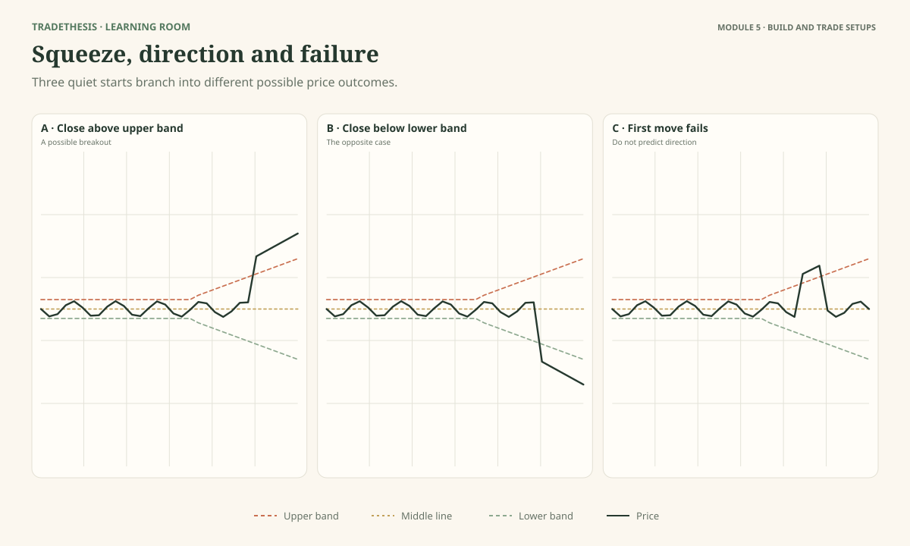
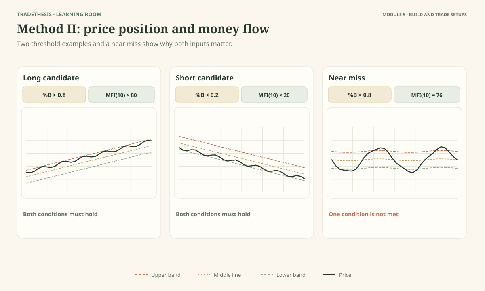
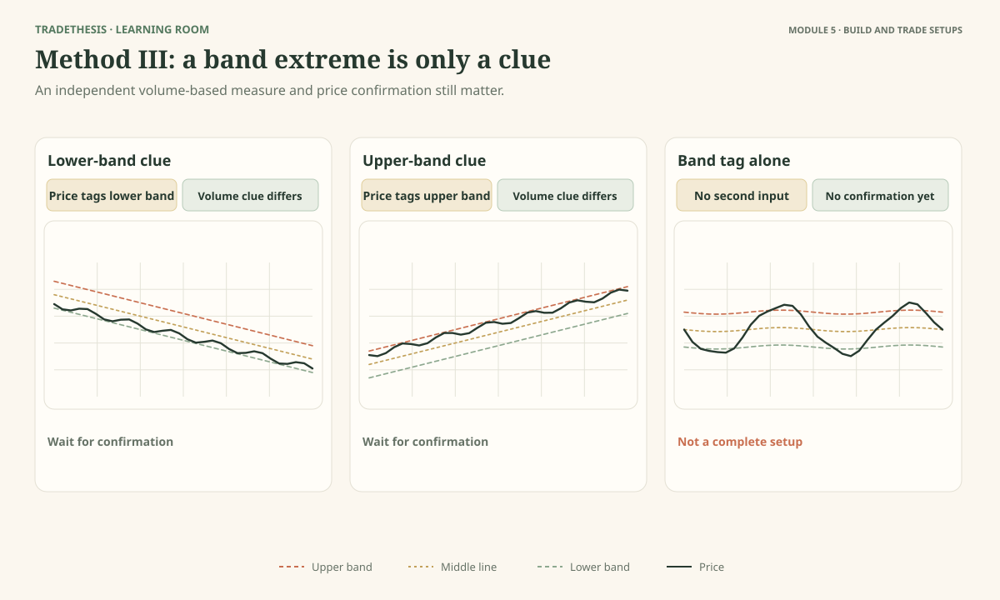
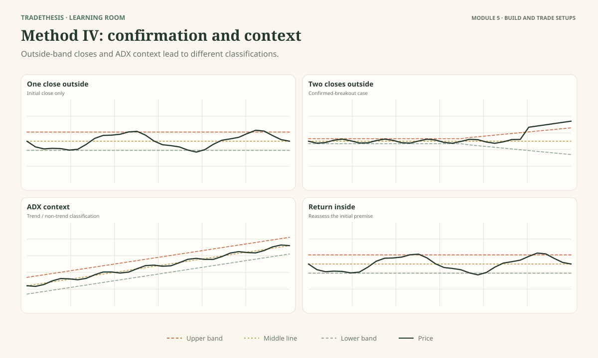
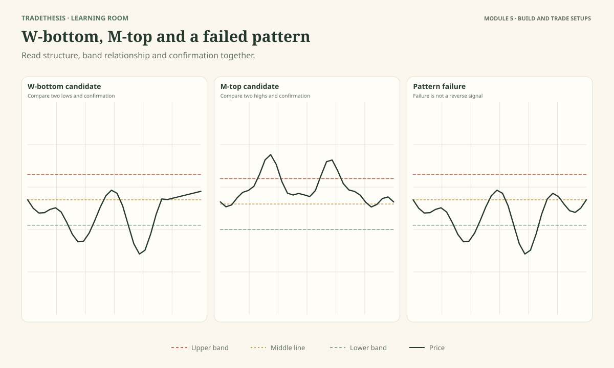
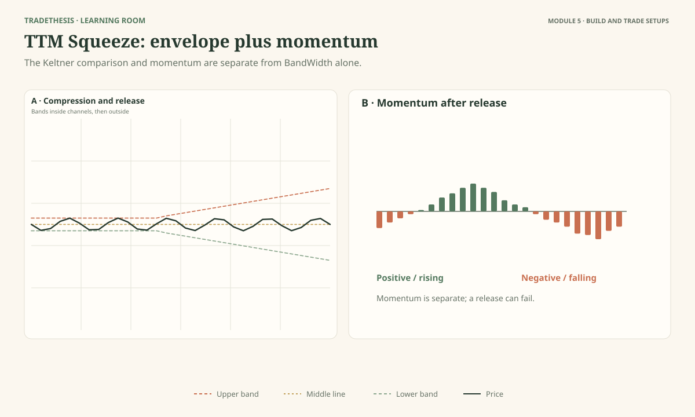

# Module 5 — Use the Setups the Authors Actually Wrote

Bollinger Bands are more than a way to describe volatility. John Bollinger's book includes three named trading methods, each built around a different idea. His later official material adds a fourth, confirmed-breakout method. John Carter's TTM Squeeze is a separate approach that combines Bollinger Bands with Keltner Channels and momentum.

This is the practical centre of the course. You will learn the rules as the authors describe them, see what a long and short case look like, and understand what still needs a decision before you risk money.

One distinction matters throughout: **a published setup is a method to study, not proof that it will be profitable in every market.** We should teach the authors' setups faithfully, then test how they behave on the instruments and timeframes we care about.

Use **Observe → Interpret → Test** with every method: describe the evidence, consider what it means and what else could explain it, then identify the next condition that would support or weaken the trade idea.

## A quick map of the setups

| Setup | Main idea | What activates the setup? |
|---|---|---|
| Bollinger Method I — Volatility Breakout | Look for a breakout after unusually quiet conditions. | A squeeze followed by price breaking beyond a Bollinger Band. |
| Bollinger Method IV — Confirmed Breakout | Require more evidence after the squeeze. | A squeeze followed by two consecutive closes outside the same band; ADX helps classify the move. |
| Bollinger Method II — Trend Following | Join strength when price and money flow agree. | %B and the Money Flow Index meet Bollinger's stated thresholds. |
| Bollinger Method III — Reversals | Look for a band extreme that conflicts with a volume-based indicator. | A band tag with a volume indicator pointing the other way, followed by price confirmation. |
| W-bottom and M-top setups | Use Bollinger Bands to judge the strength of a possible turn. | Relative band position, the pattern's shape, and a confirming move. |
| Carter's TTM Squeeze | Compare two volatility envelopes and use momentum for direction. | Bollinger Bands leave the Keltner Channels and momentum points in a direction. |

These methods do not all answer the same question. The first two focus on volatility breakouts; Method II looks for continuation backed by money flow; Method III looks for potential reversals; W/M patterns use price structure; and the TTM Squeeze is Carter's different way of defining compression.

---

## Lesson 5.1 — Bollinger Method I: Trade the Volatility Breakout

**Estimated study time:** 18 minutes.

As you work through this lesson, refer to **Figure 5.1**.

### The question

Why would a trader buy when price breaks above the upper band instead of selling because price looks high?

Because Bollinger's first method is built around a different idea: very quiet movement may be followed by a period of wider movement. If you wait for the breakout after a squeeze, you are trying to join the expansion—not predict a reversal just because price reaches an outer band.

### First, identify the squeeze

BandWidth measures the gap between the upper and lower Bollinger Bands relative to the middle band. A squeeze is not simply “the bands look a bit narrow.” Bollinger looks for BandWidth to be unusually low compared with its own history. In the book, he describes using a longer lookback—about six months as a default in that discussion—so the squeeze means unusually quiet movement for that instrument rather than a fixed width that must fit every market.

His later official TradeStation Method I package uses a 125-period low in BandWidth as its default squeeze definition. It also allows a recent squeeze to qualify for an alert even if the bands have already started widening. Those details belong to the software implementation; don't mix the package's exact alert settings with the broader book explanation.

### The long setup

1. **Observe:** BandWidth has reached a very low level relative to its history. Price has been contained, and the bands are close together.
2. **Interpret:** The market may be ready to move into a wider-volatility phase. The squeeze does not tell you whether the move will be up or down.
3. **Test:** Wait for price to break above the upper Bollinger Band. Under Method I, that is the long-side volatility-breakout event. Do not enter simply because the bands are narrow.

### The short setup

Use the same logic in the opposite direction. Identify the squeeze first, then wait for price to break below the lower band. That downside break is the short-side volatility-breakout event.

Notice the important difference from a mean-reversion trade: Method I does **not** sell the upper band or buy the lower band. It looks to trade the move beyond the band after a squeeze.

### From squeeze to executable trade: prepare, trigger, enter, protect

The question is fair: **a close-confirmed breakout will usually give you a worse price than buying before the close.** That is the trade-off. Waiting makes the rule easier to reproduce and filters some temporary spikes, but it cannot guarantee that the move has enough room left. Entering early improves the price only if the breakout continues; it also exposes you to more false starts. There is no entry that gives both the earliest price and confirmation.

**Before the breakout, prepare these things:**

1. Find a genuinely low BandWidth reading relative to that instrument’s own recent history. Mark the current range high and low, the nearby swing levels, and obvious resistance/support beyond the range.
2. Decide what counts as the breakout before it happens. For this lesson, the primary, repeatable trigger is a completed bar closing beyond the relevant band after the squeeze condition. A wick through the band that closes back inside is not the same event under this classroom rule.
3. Set alerts around the band/range edge and decide the maximum loss you will accept. The squeeze is the time to plan—not the time to guess long or short.

**Choose and record one entry style before reviewing results:**

- **Close-confirmation entry — the default for this course.** After a squeeze, act only after a completed close beyond the upper band for a long or lower band for a short. The trade is not “too late” by definition, but it can be too extended in a particular chart. Check the stop distance and the next obstacle before accepting the entry.
- **Earlier breakout entry — an aggressive course variant.** Enter as price crosses a pre-marked breakout level while the bar is still forming. This can get a better price, but the bar can return inside the band before closing. You must define which level is monitored and test the rule without looking ahead; do not call it the same thing as a confirmed-close entry.
- **Retest entry — a separate course variant.** Let price break out first, then wait for a pullback/retest that holds near the broken range edge or band, and enter only when price resumes through the pullback’s short-term swing. It may reduce chasing, but some breakouts never retest. Do not treat a retest as a requirement of Bollinger’s basic Method I.

**Place the stop where the trade idea is wrong—not at a convenient arbitrary distance.**

For a long, a tight execution stop might sit below the breakout bar’s low; a wider structural stop might sit below the consolidation/range low or the retest swing low. For a short, use the corresponding high. The wider level is less likely to be hit by ordinary noise but increases the cash risk per unit, so position size must fall. Bollinger discusses a modified Parabolic stop or the opposite-band tag as ways to manage an open Method I position; those are management/exit choices, not a universal initial stop that suits every entry.

Calculate quantity from the cash risk you permit divided by the entry-to-stop distance, allowing for costs and slippage. If the valid structural stop is so far away that the position must be tiny, or the next resistance/support gives too little room, **skip it**. The rule can trigger while the trade is still poor.

**Failure clues:** a breakout that quickly closes back in the old range, a failed push followed by a strong move the other way, or no follow-through after the first expansion. These are warnings to follow your prewritten stop/exit rule; they do not automatically authorise a reverse trade.

> **Temporary reference gallery:** These charts are hot-linked from external sites for private review and will be replaced with course-owned TradingView captures. The source map is kept in the internal asset index.

### Historical chart examples to compare

Treat these as case studies, not a list of guaranteed winners. On each chart, mark where compression ends, the exact qualifying bar, the price you could realistically enter, the structural stop, and the first nearby obstacle. At least one example is included because a first break can fail before price resolves.

**Figure 5.1.1 — Narrow bands and a subsequent upside expansion.**

**Figure 5.1.2 — A historical volatility squeeze followed by a price breakout.**

**Figure 5.1.3 — Compression and breakout behaviour on a different chart.**

**Figure 5.1.4 — A downside head fake followed by a later resolution.**

**Figure 5.1.5 — A breakout-versus-head-fake comparison.**

**Practice prompt:** On each chart, compare a close-confirmation entry with an earlier entry. Which gets a better price? Which would be stopped if the initial move failed? If you cannot point to a stop before entry, the chart is not yet a complete trade plan.

### Read the examples

In Figure 5.1, compare the upward breakout, downward breakout, and failed first move. The squeeze provides the shared starting condition; the direction only becomes visible when price moves.

**Task:** For each panel, identify the squeeze, the first breakout direction, and whether Method I would have a long alert, a short alert, or an unresolved/failed first attempt under the illustrated rule.

**Model reasoning:** A break above the upper band following a squeeze fits the long case; a break below the lower band fits the short case. The failed first move shows why you should plan for failure rather than assume the first move must continue. Whether a particular entry is acceptable still depends on the stop, available reward, and your execution rules.

### Try a new case

BandWidth is at a six-month low, but price remains inside the recent range. Should you buy now?

**Model response:** Not under the basic breakout rule. The squeeze tells me to watch for an expansion; it does not give me an entry or a direction. I would wait for the chosen breakout event.

### Keep this

> **Method I buys an upside breakout or shorts a downside breakout after unusually quiet conditions. It does not try to guess direction during the squeeze.**

**Source and further reading:** John Bollinger, *Bollinger on Bollinger Bands*, Chapter 16, “Method I: Volatility Breakout”; [official Method I manual](https://www.bollingerbands.com/_files/ugd/58be43_f5e967053af44fa083340cacfc5e6226.pdf). Bollinger's book describes the method and its head-fake risk; the official software manual documents one specific 125-period/alert-lookback implementation.

---

## Lesson 5.2 — Bollinger Method II: Follow Strength Confirmed by MFI

**Estimated study time:** 18 minutes.

As you work through this lesson, refer to **Figure 5.2**.

### The question

How can you use the bands to join a move instead of trying to call a top or bottom?

Bollinger's **Method II — Trend Following** combines price strength with strength in a volume-based indicator. The indicator is the Money Flow Index (MFI). Unlike Method I, this method does not require a squeeze first. It looks for price and the indicator to confirm one another.

### The two pieces of evidence

**%B** describes where the latest close sits relative to the Bollinger Bands. A value of 0 is the lower band, 0.5 is the middle, and 1 is the upper band. A value above 0.8 places price in the upper part of the band range.

**MFI** combines price and volume information to estimate buying and selling pressure. It ranges from 0 to 100. Bollinger's Method II example uses MFI with a 10-period length and treats readings above 80 as strong and below 20 as weak.

The point is to require both pieces to agree. A strong price position without strong MFI does not meet the published example rule; nor does a strong MFI reading without the required price position.

### The long setup

Use Bollinger's stated example:

- %B is greater than 0.8.
- MFI(10) is greater than 80.

When both conditions are true, Method II gives a buy signal. The idea is to join a strong move when price strength is confirmed by money-flow strength.

Do not reinterpret this as a mean-reversion entry because price is near the upper band. It is a trend-following setup. The conditions are intentionally looking for strength, not a reason to sell.

### The short setup

The published counterpart is:

- %B is less than 0.2.
- MFI(10) is less than 20.

When both conditions are true, Method II gives a sell/short signal. Price is in the lower part of the bands and MFI confirms weakness.

### From a Method II signal to a trade

**Early clues:** watch for price pushing into the upper part of the bands while MFI(10) strengthens, or for price pressing into the lower part while MFI weakens. These are watch conditions, not separate signals. The stated Method II example does not require a squeeze.

**The trigger:** for the long, a completed bar must have %B above 0.8 and MFI(10) above 80. For the short, %B must be below 0.2 and MFI(10) below 20. Use the same bar-close convention consistently so you do not count a threshold that was briefly crossed mid-bar and then disappeared.

**Entry choices:** the simpler course rule is to act at the close of the qualifying bar, if the remaining reward justifies the stop. A more cautious course variant is to wait for price to break the signal bar’s high for a long or low for a short; this avoids some immediate failures but gives up price and can miss the trade. If price has already travelled far from the recent structure, do not chase solely because both readings remain extreme.

**Stop and size:** Bollinger discusses a modified Parabolic stop or an opposite-band tag as exit approaches; the related published strategy notes also mention Parabolic SAR. For a fixed-risk practice plan, mark the recent swing/pullback that would invalidate the continuation idea, and size the trade from that distance. A stop below the signal candle for a long (above for a short) is a tighter course variant, not a universal author rule. If the stop is wide or a nearby resistance/support leaves poor reward relative to risk, pass.

**What weakens it:** the indicators do not agree, the threshold is only touched intrabar, the move is already extended, or price immediately loses the breakout area. A signal is evidence to consider a trade, not an obligation to enter.

### Historical chart examples to compare

These examples deliberately include different outcomes. Check the %B and MFI panes wherever they are shown. A price thrust without both thresholds is a near-miss, while a correct trigger can still fail.

**Figure 5.2.1 — Price, %B and MFI together during an established uptrend.**

**Figure 5.2.2 — A buy and sell sequence with %B and MFI.**

**Figure 5.2.3 — A historical long and short signal with a mixed outcome.**

**Figure 5.2.4 — A second buy case, including the risk of a failed signal.**

**Figure 5.2.5 — A sell setup that follows price and money-flow weakness.**

**Figure 5.2.6 — A filtered signal where additional confirmation changes the timing.**

**Practice prompt:** For every example, record the first bar where both published thresholds are true, then compare entry-at-close with entry on the signal bar’s break. Did the later confirmation improve the trade, make it too late, or stop a losing signal?

### Read Figure 5.2

Panel A shows the long conditions coming together. Panel B shows the mirrored short conditions. Panel C shows a tempting price move where MFI does not confirm; it is included to make the missing condition visible.

**Task:** Identify which panels meet Method II's stated conditions. For each one that does not qualify, state whether %B or MFI is missing its threshold.

**Model reasoning:** A valid long needs %B above 0.8 and MFI(10) above 80. A valid short needs %B below 0.2 and MFI(10) below 20. If one condition is missing, the documented setup has not fired even if the chart looks attractive.

### Try a new case

%B is 0.93, but MFI(10) is 64. Is this a Method II buy?

**Model response:** No. Price is in the upper part of the bands, but MFI does not meet the stated strength threshold. I can keep watching, but I should not call it a Method II signal.

### Keep this

> **Method II buys strength when %B and MFI both confirm it, and sells weakness when both are weak.**

**Source and further reading:** John Bollinger, *Bollinger on Bollinger Bands*, Chapter 19, “Method II: Trend Following”; [official Method II manual](https://www.bollingerbands.com/_files/ugd/58be43_b120ddf0184540608baf19e2c0ae2019.pdf). The 0.8/80 buy and 0.2/20 sell thresholds are Bollinger's published example conditions.

---

## Lesson 5.3 — Bollinger Method III: Look for Reversal Clues in Volume

**Estimated study time:** 18 minutes.

As you work through this lesson, refer to **Figure 5.3**.

### The question

What if price reaches an outer band, but a volume-based indicator does not confirm the move?

Bollinger's **Method III — Reversals** is designed for this kind of disagreement. It combines price position with a volume indicator to look for signs that buying or selling pressure may be changing. The idea is not to buy every lower-band touch or sell every upper-band touch. It is to look for a band extreme that conflicts with the indicator evidence.

### The basic logic

A tag of the lower band says price is relatively low. If a volume indicator remains positive, the selling move may not be as convincing as the price alone suggests. This can create a **buy alert**.

A tag of the upper band says price is relatively high. If a volume indicator is negative, the move may not be as strong as the price alone suggests. This can create a **sell/short alert**.

The indicator needs to add information. Bollinger's original book discusses tools such as Intraday Intensity, Accumulation/Distribution, MFI and VWMACD in different examples. These tools are not identical, so do not swap them around while claiming the results are the same method.

### A concrete long example from the book

One of Bollinger's systematised examples is to look for %B below 0.05 while the Intraday Intensity measure is above zero. In plain language, price is very near or below the lower band, while the volume-based indicator points in the positive direction.

The next step is important: Bollinger recommends waiting for price to confirm the idea—for example, a strong up day—before acting. The alert points to a possible reversal; price confirmation is the next condition to test.

In another version of Method III, Bollinger describes a W-bottom whose second low has a higher %B reading than the first. The student then checks whether a volume oscillator such as MFI or VWMACD shows a similar improvement. If it does, the book's example is to buy the first strong up day; if it does not, wait.

### A concrete short example

For a short-side reversal, Bollinger gives an example using %B above 0.95 together with a negative Accumulation/Distribution reading. The idea is that price has reached an extreme near the upper band while the independent volume measure is not confirming the strength of that move.

Bollinger's later official software Method III manual uses another specific implementation: lower-band tag plus positive Intraday Intensity creates a buy alert; upper-band tag plus negative Intraday Intensity creates a sell/short alert. It also recommends waiting for a strong up bar after the buy alert or a strong down bar after the short alert. Treat these as documented variations, not as if every indicator combination were identical.

### From reversal alert to executable trade

This is a reversal method, so the main danger is acting while the original trend is still strong.

**Early clues:** price is testing an outer band and the chosen volume-based indicator is not confirming the latest push. Decide which documented indicator variant you are using before looking at the result: for example, the software version using Intraday Intensity, or the book example using the stated %B and volume-indicator conditions. Do not interchange indicator names and keep the same threshold as if nothing changed.

**Long entry sequence:** a lower-band tag plus positive Intraday Intensity creates the documented buy alert in one official implementation. Do not buy solely on the tag. Wait for the specified strong up-bar confirmation. For a repeatable execution plan, choose either entry at the confirmation bar’s close or a course variant that triggers only if price breaks above that bar’s high. If the price continues making lower lows and the confirmation bar never appears, there is no entry.

**Short entry sequence:** an upper-band tag plus negative Intraday Intensity creates the corresponding alert. Wait for a strong down bar, then use its close or a break below its low as the preselected trigger. A weak bar that closes high in its range is not the same confirmation.

**Stop and target:** for a long, define invalidation just below the retest/reversal low; for a short, above the reversal high. A stop beyond the extreme gives the idea room, but that means fewer units for the same cash risk. Bollinger discusses the opposite band as one possible target in examples; first check whether that target gives adequate room. A nearby stop with a distant target is not enough if the signal itself has not confirmed.

**Stand aside when:** the volume indicator agrees with the price move instead of contradicting it, price is persistently walking the band with no sign of failure, the volume feed is unreliable for the instrument, or the confirming bar would force an entry too far from the invalidation level. A divergence-like appearance can last longer than expected.

### Historical chart examples to compare

These charts show reversal clues and indicator disagreement in different markets. Use them to practise locating the extreme, the indicator evidence, the price-confirmation bar and the invalidation point. Not every chart below contains every variable required by the same Method III implementation.

**Figure 5.3.1 — A lower-band reversal case with a positive volume-indicator clue.**

**Figure 5.3.2 — An upper-band reversal case with a weakening volume-indicator clue.**

**Figure 5.3.3 — Bollinger Bands, Intraday Intensity and volume displayed for comparison.**

**Figure 5.3.4 — A reversal-shaped price structure that still needs indicator and price confirmation.**

**Figure 5.3.5 — A lower-band W-shaped turn for comparison with the reversal rules.**

**Practice prompt:** For each case, list what the chart actually proves and what is still missing. A pattern shape alone does not prove the volume condition; a volume clue alone does not prove that price has confirmed the reversal.

### Task

Use Figure 5.3 to identify the band tag, the volume-indicator reading, and the later price-confirmation bar. Which case creates a buy alert, and which creates a sell/short alert under the stated version of Method III?

**Model reasoning:** A lower-band tag with positive Intraday Intensity fits the buy-alert example. An upper-band tag with a negative indicator fits the short-alert example. The later price bar matters because the alert is not an instruction to enter immediately.

### Try a new case

Price touches the lower band, but Intraday Intensity is negative and price continues to make lower lows. Does the positive-volume reversal setup qualify?

**Model response:** No. The required indicator disagreement is missing, and price continues to weaken. I would not turn a band tag into a buy signal.

### Keep this

> **Method III looks for a band extreme that the volume evidence does not confirm, then waits for price to support the reversal idea.**

**Source and further reading:** John Bollinger, *Bollinger on Bollinger Bands*, Chapter 20, “Method III: Reversals”; [official Method III manual](https://www.bollingerbands.com/_files/ugd/58be43_377f4254baa04a19aaadb1735b45b6f0.pdf).

---

## Lesson 5.4 — Bollinger Method IV: Wait for a Confirmed Breakout

**Estimated study time:** 18 minutes.

As you work through this lesson, refer to **Figure 5.4**.

### The question

What if you want more evidence than the first close outside a band?

Bollinger's later Method IV, called **Confirmed Breakouts**, is a variation on Method I. Instead of alerting on the initial outside-band close, it waits for two consecutive closes beyond a band after a squeeze. It also uses the Average Directional Index, or ADX, to help decide whether the move is occurring in a trending or non-trending market.

This method was developed after *Bollinger on Bollinger Bands*. It should be taught as Bollinger's later extension, not as one of the book's original three methods.

### The shared starting condition

First identify a squeeze using BandWidth. The official software manual uses a 125-period low as the default squeeze definition. Then watch for two consecutive closes outside the same band.

- **Upper-band case:** two closes in a row above the upper band.
- **Lower-band case:** two closes in a row below the lower band.

A wick beyond a band followed by a close back inside does not count as two consecutive outside closes. The definition is specific, so avoid quietly changing it when reviewing examples.

### Why ADX changes the reading

ADX is used to estimate how strong a trend is. The Method IV manual uses an ADX threshold to distinguish a trending condition from a non-trending one. The threshold is configurable; the method documentation does not establish one number as universally correct for every market.

This creates a useful but less obvious distinction:

| Confirmed move after a squeeze | ADX above the chosen threshold | ADX below the chosen threshold |
|---|---|---|
| Two closes above the upper band | Treat as a trend-following buy alert. | Treat as a potential reversal alert in the opposite direction. |
| Two closes below the lower band | Treat as a trend-following short alert. | Treat as a potential reversal alert in the opposite direction. |

This is the method's central twist. A confirmed move outside a band is not interpreted the same way in every market condition. In a strong trend it can support continuation; in a non-trending market the same event can be read as a possible reversal setup.

### From confirmed breakout to a trade plan

The two-close requirement answers a specific question—did price hold outside the same band for two closes?—but it can make the entry later. That delay is part of the confirmation design. Do not quietly move the entry earlier and still report it as the same rule.

**Prepare:** identify the squeeze and nearby range boundaries first. Set the ADX threshold as part of the implementation you are studying; it is configurable, not a universal number. Then wait for two consecutive closes outside the same band.

**Continuation case:** with ADX above the chosen threshold, two closes above the upper band create the long-continuation reading; two closes below the lower band create the short-continuation reading. A simple course execution plan is to enter after the second close if price is not extended and room remains. A more cautious variant enters only if the next bar breaks the second candle’s high for a long or low for a short. The latter is an added execution filter and can miss a move that immediately accelerates.

**Potential reversal case:** with ADX below the configured threshold, the later Method IV implementation reads the confirmed outside-band move as a potential reversal alert in the opposite direction. Do not take the continuation trade automatically. For a course execution rule, wait for price to break back through the confirmed move’s short-term swing (for example, below a two-close-up sequence’s local low for a possible short) rather than shorting just because ADX is low. This is an added confirmation choice and should be tested separately from the indicator’s alert.

**Stop:** for continuation longs, a stop below the second breakout bar’s low or below the latest swing/range retest is a structural choice; for continuation shorts use the corresponding high. For reversal entries, place the invalidation beyond the breakout extreme. The stop belongs where that specific interpretation becomes wrong. Size the position from the entry-to-stop distance; if the distance leaves too little reward to the next level, do not enter.

The linked chart examples are for practicing breakout and head-fake reading. They must not automatically be labelled exact Method IV signals unless you can verify the squeeze, two consecutive outside closes, and the ADX state from the chart data.

### Historical chart examples to compare

For every chart, count the outside-band closes yourself. Then ask whether ADX is above or below the threshold used in the method. These examples help train breakout-versus-head-fake reading; they do not all show the complete Method IV indicator set.

**Figure 5.4.1 — A squeeze followed by an upside expansion.**

**Figure 5.4.2 — A historical compression and breakout sequence.**

**Figure 5.4.3 — A breakout sequence to classify bar by bar.**

**Figure 5.4.4 — A head-fake sequence—inspect where the first break fails.**

**Figure 5.4.5 — Another false-start and later-resolution comparison.**

**Practice prompt:** A chart with one close outside the band is not yet a two-close Method IV confirmation. Mark the second qualifying close, read ADX using the chosen threshold, then write a stop and entry before exposing yourself to the following bars.

### Inspect Figure 5.4

Compare a single close outside a band with two consecutive closes. Then compare the ADX contexts. Figure 5.4 is designed to show that “confirmed breakout” describes a specific condition and that the method's interpretation also depends on the regime filter.

**Task:** In each panel, identify whether the confirmed-breakout condition occurred and whether the method classifies it as trend-following or reversal under the ADX state shown.

**Model reasoning:** Two consecutive outside closes after a squeeze meet the confirmation condition. ADX then determines whether the official Method IV interpretation is continuation or the opposite-direction reversal alert. If the two-close condition is missing, do not label it a confirmed breakout under this method.

### Common mistake

Treating Method IV as “wait for any two large candles.” The rule concerns two consecutive closes outside the same Bollinger Band after a squeeze, with ADX used in the method's interpretation.

### Keep this

> **Method IV asks for two outside closes after a squeeze, then uses ADX to decide whether to read the move as continuation or a potential reversal.**

**Source and further reading:** [Bollinger Bands Confirmed Breakouts (Method IV) Manual](https://www.bollingerbands.com/_files/ugd/58be43_d09c50b6e8ea4afd9af0523ef94de876.pdf). This is Bollinger's later method, published after the first edition of his book.

---

## Lesson 5.5 — Trade the W-Bottom and M-Top, Not Just the Shape

**Estimated study time:** 18 minutes.

As you work through this lesson, refer to **Figure 5.5**.

### The question

When does a W-bottom or M-top become more than a shape you can label after the event?

John Bollinger devotes separate chapters to W-type bottoms and M-type tops. His distinctive contribution is to read the pattern's highs and lows relative to the bands, rather than judging only whether the second low or high is numerically higher or lower than the first.

### The W-bottom long setup

Bollinger's classic W-bottom often begins with a decline that puts the first low at or below the lower band. Price then rallies and later retests the low area. The important detail is that the second low should occur inside the lower band, meaning it is a higher low on a **relative** basis. The second price low can still be lower in absolute price terms.

Volume can add another clue: in Bollinger's example, the first decline has stronger volume than the second, and volume expands again as price lifts away from the pattern.

The book gives a concrete entry idea: after a W that fits the rules, **buy strength**. Wait for a rally day whose range and volume are both above their recent averages. That day acts as confirmation rather than buying simply because the second low has appeared.

For risk, Bollinger describes placing the stop below the most recent low on the right side of the W, then raising it as the trade develops. He discusses either a Parabolic-style approach or moving the stop below later consolidations and pullbacks. The target still needs to be considered before entry; do not assume every W must reach the upper band.

### The M-top short setup

Tops often take longer to form than bottoms. Bollinger describes a common pattern in which an early push moves outside the upper band, a later push reaches the band again, and a subsequent push fails to reach the upper band even if price makes a marginal new high. Volume may also fade across the pushes.

Do not short the first upper-band tag. Look for the pattern to develop and wait for a sign of weakness. Bollinger suggests looking for a down day with above-average range and volume. In a larger topping formation, a break below a meaningful swing low or neckline can be followed by a pullback that provides a clearer short entry; the risk can then be placed just above the pullback high.

The sell-side pattern is not an exact mirror of the W-bottom. Tops often take more time and can involve three or more pushes. A pair of highs alone does not meet the full idea.

### When the setup fails

For the long W, a second low that falls outside the lower band or makes a new relative low does not meet the classic band-based W description. A further decline can still follow. Do not rescue the pattern by changing the definition after the fact.

For the short M-type top, repeated pushes that continue to reach the upper band with strong price and volume progress do not yet show the weakening the setup looks for. If price breaks higher and holds, the short idea should be cancelled or reassessed under the plan.

### From pattern to entry, stop and target

**W-bottom long:** the first low usually reaches or crosses the lower band. After a bounce, the second low should sit at a better relative position against the lower band, even if its absolute price is marginally lower. A weaker second decline can support the reading, but the entry is not simply “buy low two.” Bollinger’s example is to buy strength—such as the first strong up day with range and volume above recent averages. A course variant can wait for a break above that confirmation bar’s high.

Place invalidation below the right-side low. If the low is too distant, the correct response is to reduce size or skip, not to move the stop into ordinary price noise. Look toward the intervening high or upper part of the range as a possible obstacle/target, but accept the trade only if reward relative to risk is sufficient.

**M-top short:** the first push may reach or exceed the upper band; after a pullback, a later push may make a marginal new price high but fail to reach the upper band. Wait for a sign of weakness, such as a down day with above-average range and volume. A more conservative course variant waits for a break under the intervening swing low, then uses a pullback that fails as a short trigger. Put invalidation above the pullback high or top extreme, matching the exact entry you chose.

**Do not force symmetry:** tops may take more pushes and can remain strong for longer than a bottoming formation. If the later push still reaches the upper band with strong upward progress, the evidence for a weakening M-top is incomplete. If support does not break, do not invent a short confirmation.

**No-trade filter:** no strong confirmation, a clear trend continuing in the original direction, an entry too far from the stop, or too little space before the next barrier are valid reasons to pass.

### Historical chart examples to compare

Look first at the position of each swing relative to the bands. Then mark the confirmation and invalidation levels; do not judge the pattern by the W/M shape alone.

**Figure 5.5.1 — A W-bottom with a second low that improves relative to the lower band.**

**Figure 5.5.2 — A second W-bottom for comparison.**

**Figure 5.5.3 — An M-type top with a later weakening relationship to the upper band.**

**Figure 5.5.4 — Another M-type top to study for the confirmation point.**

**Figure 5.5.5 — A W-bottom-shaped reversal and its later move.**

**Figure 5.5.6 — A bearish reversal-shaped pattern.**

**Practice prompt:** For each panel, circle the swing that changes the interpretation, mark the trigger and stop as if you were trading live, and identify the moment at which the setup is still incomplete.

### Task

In Figure 5.5, identify the relative second low in the W-bottom and the weakening final push in the M-top. Mark the confirmation day for the long and the evidence of weakness for the short. Then identify one example that does **not** qualify.

**Model reasoning:** The W-bottom requires improving relative position on the retest, ideally with weaker volume on the second decline, followed by a strong up day with above-average range and volume. The M-top needs the later push to show weaker relative price action and then a sign of weakness. A shape with no confirmation—or one that continues to make strong progress in the original direction—does not qualify.

### Try a new case

The second low in a possible W-bottom is lower than the first in price, but it is now inside the lower band rather than outside it. Volume on the retest is also lower. Is the pattern automatically invalid because the price low is lower?

**Model response:** No. Bollinger's approach compares the lows relative to the bands. The second low can be lower in absolute price while still being a higher low relative to the bands. The setup still needs the planned confirmation and risk assessment.

### Keep this

> **For a W or M pattern, read each swing relative to the bands, then wait for the price behaviour that confirms the trade idea.**

**Source and further reading:** John Bollinger, *Bollinger on Bollinger Bands*, Chapters 12 and 13; [book and chapter list from McGraw Hill](https://www.mheducation.com/highered/mhp/product/bollinger-bollinger-bands).

---

## Lesson 5.6 — John Carter's TTM Squeeze: Use Momentum for Direction

**Estimated study time:** 17 minutes.

As you work through this lesson, refer to **Figure 5.6**.

### The question

How is John Carter's TTM Squeeze different from Bollinger's own Squeeze setup?

Both focus on quiet conditions that may be followed by a wider move, but they define the squeeze differently.

Bollinger's BandWidth approach compares the current width of Bollinger Bands with their own history. Carter's TTM Squeeze compares Bollinger Bands with Keltner Channels. In the common TTM implementation, a squeeze is “on” when the Bollinger Bands fit inside the Keltner Channels. It “fires” when the Bollinger Bands expand back outside them.

A momentum histogram is then used to help assess direction. This is a different method from simply waiting for price to close outside a Bollinger Band.

### The long setup

A common implementation uses 20-period Bollinger Bands with two standard deviations and 20-period Keltner Channels with an ATR multiplier of 1.5. These are conventional settings, not laws. Check the definition used by the charting platform because implementations can differ.

1. **Observe:** The Bollinger Bands are inside the Keltner Channels for a period. Volatility is compressed under this definition.
2. **Interpret:** The market may be preparing for a wider move, but compression alone says nothing about whether it will be upward or downward.
3. **Test:** Wait for the squeeze to fire. For a long setup under the common implementation, the momentum histogram is above zero and rising, indicating strengthening upward momentum. A trader may also require price to clear a nearby range boundary, but that extra condition must be identified as an added filter rather than part of the squeeze definition itself.

### The short setup

The short-side reading is the mirror: the squeeze fires and the momentum histogram is below zero and falling, indicating strengthening downward momentum. Again, the compression alone is not the direction signal; the momentum reading and price behaviour supply that part of the decision.

### From squeeze release to entry and risk

**Before the release:** the TTM squeeze is on while the Bollinger Bands remain inside the Keltner Channels. That is a prepare/watch condition, not an entry by itself. Mark the compression range and recent swing levels while the squeeze is on. A trader who enters before the release is anticipating the setup; label and test that as a separate strategy.

**Trigger and entry:** under the common implementation, wait for the squeeze to fire as the bands expand back outside the Keltner Channels. For a long, the momentum histogram should be above zero and rising; for a short, below zero and falling. A repeatable course execution rule enters on the first completed fire bar that also meets the chosen momentum condition. A more cautious variant waits for the next bar to break the fire bar’s high/low. It can miss sharp moves, but the rule is clear and testable.

**Stop:** use the compression boundary or the swing low/high that invalidates the breakout thesis. A long stop below the lower edge of the compressed range gives the idea more room than a stop just below the trigger candle, but it needs a smaller position. For a short, mirror the level. If price has already travelled so far that the stop or next barrier makes the trade unattractive, let the move go.

**Exit:** a common TTM implementation reduces or exits when histogram momentum begins to fade toward zero; some implementations use two consecutive bars of weakening colour. Treat this as a defined management variant, not a promise or a mandatory rule across every platform. Do not change exit logic midway through a losing trade.

**Failure clues:** the fire occurs but price returns to the compression range, momentum fails to expand in the chosen direction, or the first move immediately reverses. Follow the stop/exit you selected before entry. A release gives no guarantee that a durable trend will follow.

### Historical chart examples to compare

Read the squeeze state and the momentum histogram together. A green/fire state by itself is not a direction signal; mark whether the histogram is above zero and increasing or below zero and decreasing.

**Figure 5.6.1 — A bullish TTM squeeze release with the momentum pane.**

**Figure 5.6.2 — A squeeze chart with price and momentum for a second case.**

**Figure 5.6.3 — A more recent squeeze-release chart to classify.**

**Figure 5.6.4 — A bearish squeeze case with the channel relationship and momentum.**

**Figure 5.6.5 — A TTM-style chart showing squeeze state and upward momentum.**

**Practice prompt:** For every example, record the first fire bar, histogram sign and direction, candidate entry, stop boundary, and first obstacle. Also look for a release that fails; do not count compression as a trade.

### Do not mix up the two squeeze approaches

Bollinger BandWidth Squeeze: narrow Bollinger Bands relative to their own past, then look for a price breakout.

TTM Squeeze: Bollinger Bands inside Keltner Channels, then watch for the release and use the momentum component to help judge direction.

Both may be useful setups to study. They are not the same calculation, and a result from one should not be presented as evidence that the other works identically.

### Task

Use Figure 5.6 to mark (a) when the TTM squeeze is on, (b) when it fires, and (c) which panel gives a long or short momentum reading. Identify a failed release if one is shown.

**Model reasoning:** The squeeze is on while the Bollinger Bands remain inside the Keltner Channels. The fire occurs when they expand back outside. A rising positive histogram fits the long example; a falling negative histogram fits the short example. If price immediately fails the breakout or momentum weakens, the original plan needs to be reassessed.

### Try a new case

The TTM squeeze fires, but the histogram is below zero and rising toward zero. Should you enter long just because the squeeze released?

**Model response:** Not on that evidence alone. The histogram is below zero and rising, so downward momentum may be easing, but it has not shown the common positive-and-rising long condition. I would wait for the direction and price trigger required by the chosen method or skip the trade.

### Keep this

> **Carter's TTM Squeeze uses the relationship between two volatility envelopes, then uses momentum to help choose direction. The release is not a guarantee.**

**Source and further reading:** John F. Carter, *Mastering the Trade*, Third Edition; [Windsor Books publisher page](https://windsorpublishing.com/product/mastering-the-tradethird-edition/). For the common calculation and momentum-reading convention, see [StockCharts' TTM Squeeze reference](https://chartschool.stockcharts.com/table-of-contents/technical-indicators-and-overlays/technical-indicators/ttm-squeeze).

---

## Source note for this module

John Bollinger's three book methods are documented in Chapters 16, 19 and 20 of *Bollinger on Bollinger Bands*. Method IV is a later official extension, documented in Bollinger's own TradeStation manual. Carter's TTM Squeeze is a separate method. The setup conditions above are attributed to the relevant method; where the course adds a boundary, risk filter or execution choice, it must be treated as an additional rule to test rather than part of the author's original setup.