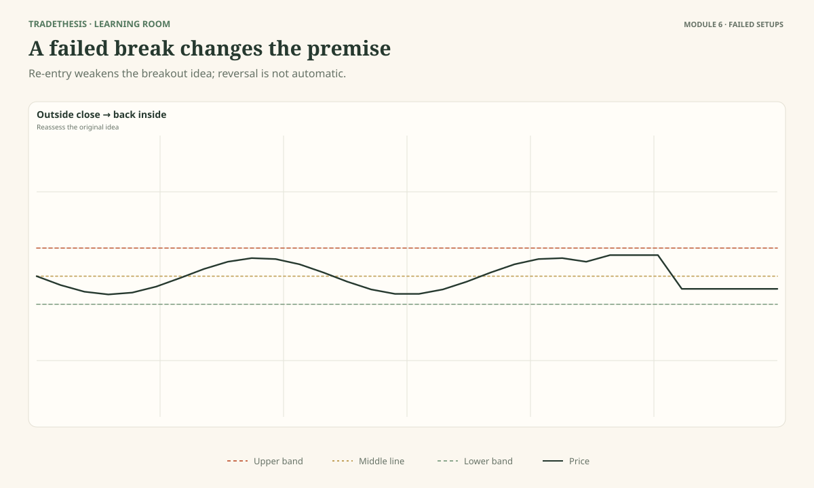
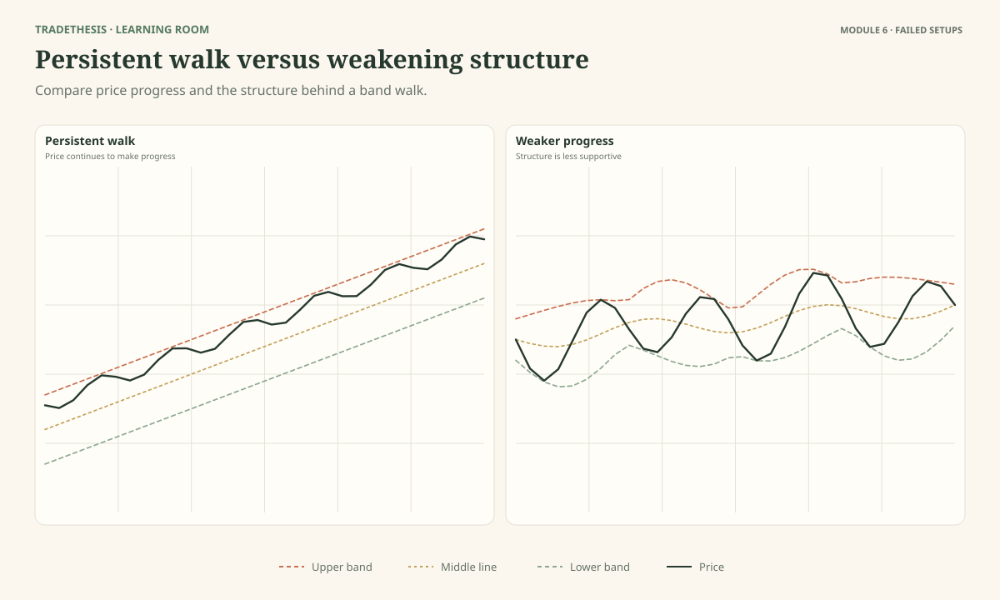
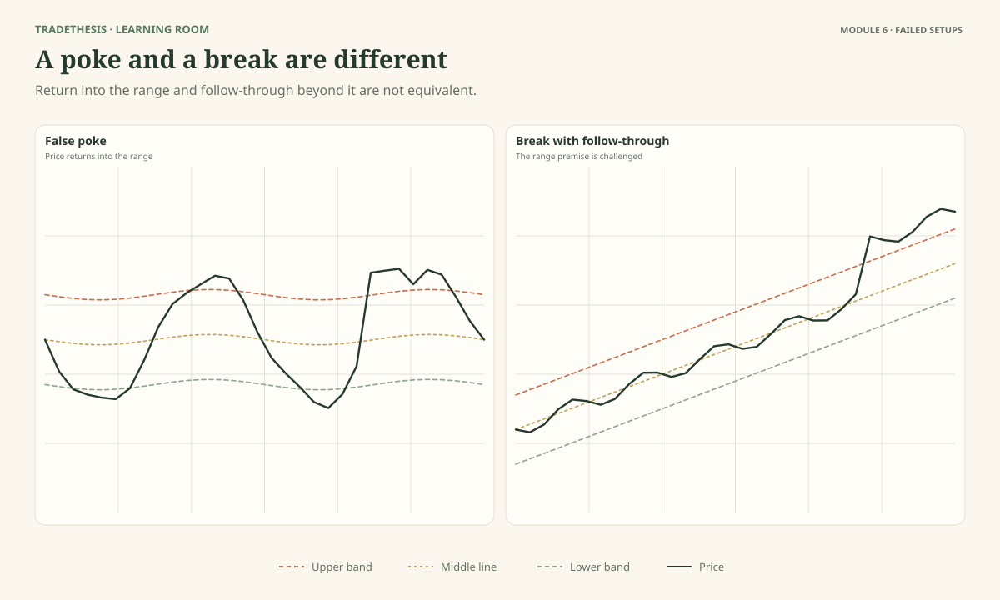
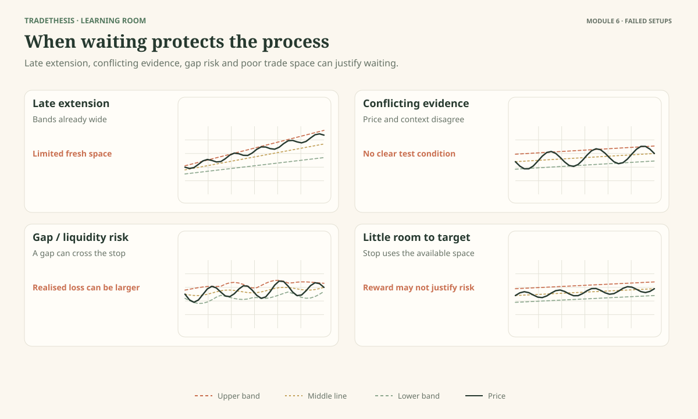

# Module 6 — Recognise Failed Setups and Know When to Wait

A trading idea can be reasonable and still fail. The goal is not to predict every failure before it happens. The goal is to know what would weaken the idea, what would invalidate it, and when to stop acting as if the original plan is still valid.

By the end, you should be able to recognise failed starts after a squeeze, avoid fading persistent band walks, identify when a range-fade premise has broken, and skip trades with poor location, conflicting evidence, or unsuitable conditions.

As you work through this module, use **Observe → Interpret → Test**: describe what the chart shows, consider what it may mean and what else could explain it, then name the evidence or condition that would strengthen or weaken the reading.

---

## Lesson 6.1 — The False Start After a Squeeze

**Estimated study time:** 16 minutes.

As you work through this lesson, refer to **Figure 6.1**.

### The question

What if price breaks upward after a squeeze, then quickly falls back into the prior range?

A quiet period can be followed by a stronger move, but not every first move lasts. Bollinger discusses the possibility of **head-fakes** around squeezes: an initial move in one direction can fail before price develops a clearer move. The term names a type of failure; it does not mean it can always be forecast in advance.

### The danger of treating the first break as proof

Imagine price has been moving in a narrow consolidation. Your plan says a completed close above the range high is the trigger for a potential long. Price closes above it. This is evidence that the trigger occurred. It is not proof that the breakout will continue.

The next bar returns inside the prior range and price cannot regain the boundary under your chosen confirmation rule. Now the evidence has changed. If your plan required a hold above the boundary, the condition has failed. The correct response is to cancel or manage the original idea according to the plan, not keep insisting that price must recover.

A failed upside break does not automatically become a short. The original long condition has weakened, but a short needs its own context, trigger, invalidation, stop, and target. If the downside move has not produced those conditions, waiting is still reasonable.

### Plan the failure before the entry

For each squeeze-breakout idea, write down:

- What boundary must price cross?
- What counts as the trigger?
- Does the method require a hold or another confirmation?
- What event invalidates the breakout idea?
- If it fails, what evidence would be needed before considering the opposite direction?

Defining failure in advance helps you avoid changing the rules to fit the latest candle.

### Inspect Figure 6.1

Find the first close beyond the range. Then locate the return inside. The key question is not “Was the breakout fake from the start?” That answer is usually unknowable. Ask instead: “At what point did the price behaviour fail the conditions of the plan?”

### Test: Locate the failure point

Mark the initial trigger, the evidence that weakens the continuation idea, and the point at which the chosen rule says to stop treating it as valid.

**Model reasoning:** The first close beyond the boundary meets the trigger chosen for this example. The quick return inside and failure to hold weaken the continuation case. If the plan specified that this behaviour invalidates the setup, the original plan should be cancelled. No reverse trade should be assumed without a separate trigger.

### Test: Apply the reading to a new case

Price breaks down after a squeeze, then quickly recovers above the lower boundary of the prior range. What is the mirror-image lesson?

**Model response:** The downside breakout may have failed. The original short condition should be reviewed against its invalidation rule. A long requires its own evidence; it is not automatic simply because the short idea weakened.

### Worked comparison: Define what counts as failure before the breakout

Price compresses between 100 and 104, then closes at 105. A plan that requires a second close above the upper band may not be active yet; a plan that enters on the first completed close may be active but must already have an invalidation rule. The following candle falls below 104 and returns to 102. Depending on the written plan, this may invalidate the breakout or trigger a managed exit.

Now compare a chart where price closes above 104, holds above the boundary and continues making higher highs. The first candle alone did not distinguish the cases. The difference emerges in what happens next and in the conditions the plan required. After a failed break, do not immediately sell. A separate short setup needs its own price trigger and risk plan; otherwise the failure simply means the original long idea is no longer supported.

### Second worked comparison: A gap can make the planned breakout entry different from the chart signal

Suppose a market compresses between 100 and 104. Under a first-close rule, a candle closes at 105 and creates a possible long trigger. Before a normal entry can be considered, the trader checks where the chosen invalidation sits and how much room remains to the next obstacle. The next session opens at 109, already close to a resistance area near 111. The original trigger has occurred, but the realistic entry price is now much worse and a structural stop may be far away.

A disciplined plan can define a maximum acceptable distance from the trigger or a rule not to chase a gap. If price remains beyond the breakout boundary, the trader can wait for a retest that meets a separately defined condition. If no retest arrives, no trade is a valid result. Do not rewrite the original rule by widening the acceptable entry after seeing the move.

This example also shows why signal validity and execution quality are separate. The chart may confirm the event you were waiting for; it does not guarantee that the next available price offers a sensible trade. Costs, spread and slippage matter most when price moves quickly. Decide in advance how the method handles them.

### Common mistake

Reversing position immediately after a failed breakout without waiting for a new plan.

### Keep this

> **A failed breakout is evidence that the original idea may no longer fit—not an automatic signal to trade the other way.**

**Source and further reading:** The squeeze and head-fake concept is associated with John Bollinger's *Bollinger on Bollinger Bands*, particularly the Squeeze discussion. The invalidation rule used here is an example chosen for teaching. See [Bollinger's official rules](https://www.bollingerbands.com/bollinger-band-rules).

---

## Lesson 6.2 — When a Band Walk Traps Reversal Traders

**Estimated study time:** 15 minutes.

As you work through this lesson, refer to **Figure 6.2**.

### The question

What evidence warns you that price may keep moving along the band instead of reversing?

A common failure is to decide that price has moved “too far” simply because it touches the upper band repeatedly. In a strong uptrend, price can walk the upper band and keep moving higher. In a strong downtrend, it can walk the lower band and keep moving lower.

### Read the progress, not just the location

Compare three things:

**Band interaction:** Is price touching the same band once, or repeatedly over a sequence?

**Swing structure:** Are highs and lows still progressing in the trend direction, or are the swings starting to fail?

**Middle band:** Does it continue to slope in the trend direction, or has it flattened or changed? This is supporting context, not a stand-alone signal.

A persistent upper-band walk alongside rising swing highs and lows is different from a chart where price repeatedly touches the upper band but fails to make further progress. The second situation may deserve closer examination for a change in behaviour, but it still does not guarantee reversal.

### Why mean reversion can fail

A mean-reversion idea assumes that price may return toward the middle or move away from an extreme. That idea can struggle when a strong trend continues. If you keep selling the upper band during an uptrend, the trade may be stopped repeatedly while price walks higher. If you keep buying the lower band during a downtrend, the same problem can occur in reverse.

Before taking a reversal, identify what would show that the current trend is weakening or structure is changing. That could involve a break of a meaningful swing, a failure to make further progress, or a clearly defined pattern confirmation. Choose the rule before the outcome, and keep it consistent while testing.

### Inspect Figure 6.2

Panel A shows persistent directional progress alongside repeated band interaction. Panel B shows a walk where the structure begins to weaken. Notice that “beginning to weaken” is not the same as “reversal confirmed.” You still need the chosen trigger.

### Test: Decide whether to fade the band walk

Which panel is less suitable for fading the trend immediately? Point to two facts that support your decision.

**Model reasoning:** The panel with ongoing directional progress and intact swing structure is less suitable for a countertrend trade. Repeated band interaction is part of the trend context, not proof of overextension. The weakening panel may be worth watching but still requires a clear trigger.

### Test: Apply the reading to a new case

In a downtrend, price has closed near the lower band for five bars and made a fresh low. Is the fifth touch a long signal?

**Model response:** No. The chart still shows directional progress down. The trader needs evidence of a change in behaviour and a planned trigger before considering a long.

### Worked comparison: A lower-band touch inside a downtrend

Price falls from 120 to 114, rebounds to 116 and then moves to 110. Several closes cluster near the lower band, while each rebound fails below the prior swing high. The lower-band location may look stretched, but the sequence still shows downside progress. Buying because “it cannot go lower” would ignore the evidence in the swings.

In a second chart, price tags the lower band, fails to make another meaningful low, reclaims a prior swing level and begins forming higher lows. That is a different set of facts and may justify evaluating a reversal setup if it meets the plan's conditions. It still does not guarantee a sustained recovery. The useful distinction is the change in structure, not merely the number of times price touched the band. If no change appears, waiting is more defensible than fading the trend.

### Second worked comparison: One strong candle may not be enough to declare the walk over

Price has been moving down beside the lower band, with falling swing highs and lows. A large green candle then closes near its high and moves price back toward the middle band. It is tempting to call this the reversal. However, the earlier sequence may still be intact: the recent swing high remains above the current price, and the new candle has not yet broken that level. The candle shows a recovery attempt; it does not yet establish a new uptrend.

If a later candle takes out the intervening swing high and a pullback holds above the recent low, the evidence for a structural change improves. If price stalls below that high and returns to a new low, the large green candle becomes a rebound inside the decline. The exact trigger depends on the reversal method being tested, but it should be specified before entering.

Do not require every chart to confirm in the same number of candles. Instead, identify the level that must break for the prior sequence to weaken and the level that would invalidate the reversal idea. This turns “price looks stretched” into a testable question. If the change in structure never appears, remaining out of the trade is consistent with the evidence.

### Common mistake

Confusing “price is far from the average” with “price must reverse now.”

### Keep this

> **Before fading a band walk, look for a real change in price behaviour. A feeling that price is stretched is not enough.**

**Source and further reading:** John Bollinger's discussion of walking the bands and Official Rule 7. [Official rules](https://www.bollingerbands.com/bollinger-band-rules).

---

## Lesson 6.3 — When a Range Trade Stops Being a Range Trade

**Estimated study time:** 15 minutes.

As you work through this lesson, refer to **Figure 6.3**.

### The question

If price crosses a range boundary and continues moving away, what happens to a plan that expected a bounce?

A range-fade trade depends on the range continuing to hold. If price begins to stay beyond the boundary and make directional progress, the original premise may no longer fit.

The challenge is that a brief move outside the range can happen before price returns inside. That is why a single wick beyond the boundary and a sustained break should not automatically be treated as the same event.

### Separate a false poke from a changing market

In the first panel of Figure 6.3, price moves beyond the boundary but returns into the range. If your plan required a close or hold outside the boundary to invalidate the range, the first move may not have met that condition. You still need to follow the exact rule you selected.

In the second panel, price moves beyond the boundary, remains there under the stated example rule, and begins progressing away. If the range-fade plan said that acceptance outside the boundary invalidates the idea, the original trade is no longer valid once the condition occurs.

You do not have to label the event perfectly in real time. The purpose of a rule is to define what you will do when the observed behaviour no longer supports your premise.

### Do not defend the old plan

A frequent mistake is to average into a losing range trade because price “should come back.” But the range was an assumption based on past behaviour. It is not a promise. When price violates the invalidation condition, your plan needs to change—usually by closing or managing the trade according to the rules, then reassessing from a neutral position.

A new breakout trade may become possible, but it is a separate decision. It needs a new trigger and a sensible risk/reward. Do not turn a failed fade into an impulsive breakout entry just to recover the loss.

### Inspect Figure 6.3

Mark the prior range high/low, the first excursion beyond the boundary, and the later behaviour. Ask what the original plan required and where that condition was met or failed.

### Test: Check whether the range premise still holds

For each panel, explain whether the range-fade premise remains intact under the example rule. State one thing you would do if the premise is invalidated.

**Model reasoning:** In the false-poke example, price returns into the prior range and may not have met the stated invalidation condition. In the sustained-break example, price remains outside and progresses, so the range premise is weakened or invalidated under the rule. The trader should stop treating the old fade as valid and avoid adding risk to defend it.

### Test: Apply the reading to a new case

You are short at the top of a range. Price closes above the range high twice and then pulls back toward it. What should happen next?

**Model response:** If the plan defined the sustained closes above the boundary as invalidation, the short premise has failed. The pullback may later offer a breakout-retest setup, but that requires a separate plan; it should not be used to justify holding the old short.

### Worked comparison: When the old range thesis no longer fits

A range has repeatedly turned near 104, and a trader is watching an upper-band tag for a possible short back toward the middle. Price instead closes above 104 with a broad candle and the next period holds above the former ceiling. The old range-reversal premise has been challenged. Continuing to expect the same bounce because it worked before is not evidence; it is attachment to the prior idea.

Contrast that with a brief wick above 104 that closes back inside and is followed by a return toward the middle of the range. That behaviour may fit a failed probe, although the short still needs its own trigger. The two cases should not be classified just by the first excursion. Decide which close/hold condition your method uses, then apply it consistently. When the boundary has changed role or the range premise has failed, reassess instead of defending the old target.

### Second worked comparison: A boundary that held before may have changed role

A range has turned near 104 several times. Price then closes above 104 and holds around 105 on a pullback. A trader who was waiting to short the upper range boundary may still be expecting the old rotation back toward 100. But if the old ceiling now acts as support and price advances again, the range premise has been challenged. A rule based on repeated rejection at 104 no longer applies in the same way without fresh evidence.

Compare a brief wick to 105 that closes back at 103, followed by renewed movement inside the range. That first poke may fit a failed breakout rather than a sustained change. The distinguishing information comes from the close, the next response and the structure around the boundary—not the fact that price touched 105.

Before trading a range edge, write what would make you stop treating it as a range. That can be a closing/holding condition or another clearly stated structural rule. Apply it without hindsight. When the old condition fails, cancel or reassess the plan instead of moving the target farther away and hoping the range returns. A fresh continuation idea needs its own trigger, invalidation and risk calculation.

### Common mistake

Treating a trading range as permanent because it has held several times before.

### Keep this

> **When the condition that justified your range trade no longer holds, stop managing the trade as if it still does.**

**Source and further reading:** Bollinger's rules warn against treating band tags as signals and emphasise setup-based use. The range-break and acceptance examples are general market-structure rules used here, not a Bollinger-specific named system.

---

## Lesson 6.4 — Late Entries, Conflicting Evidence, and No-Trade Conditions

**Estimated study time:** 16 minutes.

As you work through this lesson, refer to **Figure 6.4**.

### The question

What if the breakout is real, but most of the move has already happened?

Being right about direction does not guarantee that a trade at the current price makes sense. If price has already travelled far from the original boundary, the stop may need to be wide and the next target may be close. The remaining opportunity can be poor even if the overall trend continues.

### Four reasons to wait

**1. The move is late.** The bands have already widened and price has moved far beyond the original setup area. Chasing may create a poor entry relative to the logical invalidation point. You do not have to participate in every move.

**2. The evidence conflicts.** Price may be testing a boundary while the swing structure remains unclear, or the selected confirmation may disagree with the price action. Conflicting evidence does not always mean the market will reverse. It may mean you do not yet have a clear trade.

**3. The instrument or conditions are unsuitable.** Thin liquidity, large spreads, gaps, sudden event-driven movement, or unreliable data can make the chart-based stop and the actual fill behave differently. Bollinger Bands do not account for these risks. A chart alone may not show the full execution problem.

**4. There is too little room to target.** If the next major price area is close while invalidation is far away, the trade may offer too little potential reward for its planned loss. Do not squeeze the stop into an arbitrary position just to make the ratio look better.

### No-trade is a decision, not a lack of skill

A useful no-trade statement says why the setup does not qualify. For example: “The breakout has already expanded too far from the boundary; the nearest resistance leaves too little room before the planned target.” That is more useful than “I don't like it.”

A no-trade condition should be concrete enough to apply consistently. Examples include: the required trigger has not occurred; price structure is mixed; the original premise is invalidated; execution conditions are poor; or the stop and target do not produce acceptable planned risk.

No single checklist can make every situation safe. The point is to avoid taking a trade when the conditions you said you required are missing.

### Inspect Figure 6.4

Each panel is a reason to pause, but for a different reason. Identify whether the problem is location, disagreement, execution risk, or insufficient room to target.

### Observe and interpret: Identify reasons to wait

Choose which cases should be skipped and write the specific reason. Do not use only “it looks risky”; identify the visible condition.

**Model reasoning:** A late move may have poor entry location; conflicting evidence may leave the thesis unresolved; gaps or poor liquidity may make execution risk hard to control; and insufficient room to target can make the planned reward unattractive. Any one may justify waiting under the trader's rules.

### Test: Apply the reading to a new case

The bands are wide and price is moving strongly upward. The breakout itself is clear, but price is far from the original boundary and just below a prior high. Do you have to buy?

**Model response:** No. The trend may be strong, but the entry may be late and the nearby high may limit the available target. I can wait for a better setup or skip it.

### Worked comparison: A real move can still be a poor entry

Price breaks above 104 and travels quickly to 110 while the bands widen. If a trader waits until 109 to enter, places the invalidation at 105 and sees a potential resistance area near 111, the setup has only about 2 points of nearby room for roughly 4 points of stop distance before costs. The breakout may be real, but the trade-off is unattractive.

A different setup breaks above 104, holds near 105 and has clear room toward 111 while its structural invalidation sits near 102. That case may deserve assessment because entry, risk and available room have not deteriorated in the same way. Neither example proves profitability. It shows why “direction correct” and “entry worthwhile” are different questions. Waiting for a better location or skipping the trade are decisions, not missed obligations.

### Second worked comparison: Calculate the room before deciding whether to chase

A breakout moves from 104 to 110 while the bands widen. You notice the move late and consider entering at 109. The structural invalidation would be at 105, creating 4 points of price risk before costs. A clear resistance area sits near 111, leaving only about 2 points of immediate room. Even if the market continues briefly, the location offers less room than the stop distance and can be a poor trade-off.

Now compare an earlier close above 104 at 105, with the same invalidation at 102 and the next obstacle near 111. The risk distance and potential room are different. This does not prove that the earlier trade will win; it shows that entry location changes the quality of the plan even when the direction is the same.

Use this simple check only after you have a valid setup and a structurally meaningful stop. Do not force the stop closer merely to make the calculation attractive. Include realistic costs and slippage, especially on a fast expansion candle. A chart can be moving exactly as expected while the right decision is to wait for a pullback or pass entirely.

### Common mistake

Believing that missing a move is worse than entering a low-quality trade.

### Keep this

> **A good setup is not just a direction. It also needs a suitable entry, a clear point of failure, manageable risk, and enough room to make sense.**

**Source and further reading:** Bollinger's Official Rule 22 says bands identify setups rather than provide continuous advice. The execution and reward-to-risk filters here are general course risk principles. [Official rules](https://www.bollingerbands.com/bollinger-band-rules).

---

## References and further reading

Primary source: John Bollinger, *Bollinger on Bollinger Bands*, particularly the Squeeze and Walking the Bands chapters, plus Official Rules 7, 8 and 22. Failure labels in the lessons are descriptive explanations of possible outcomes; they are not claimed to be perfectly predictable signals.
