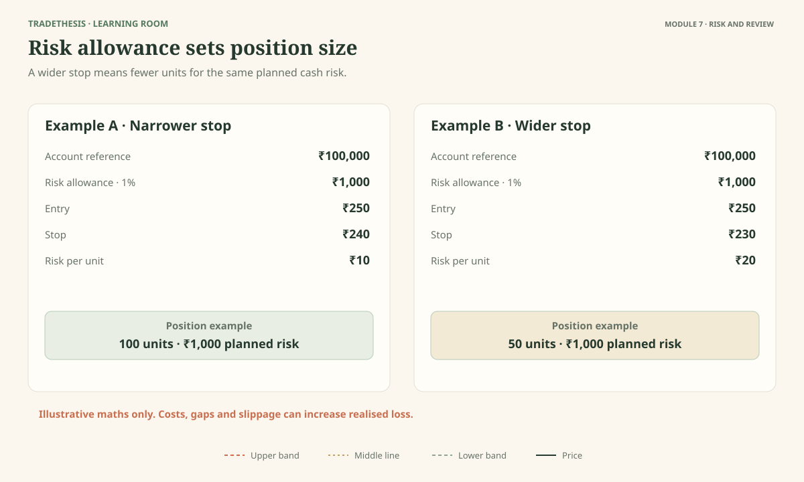
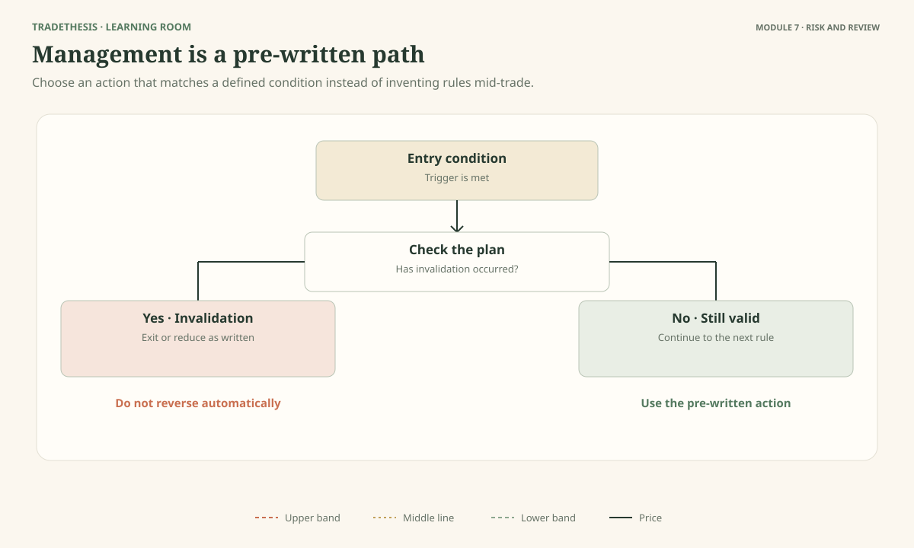
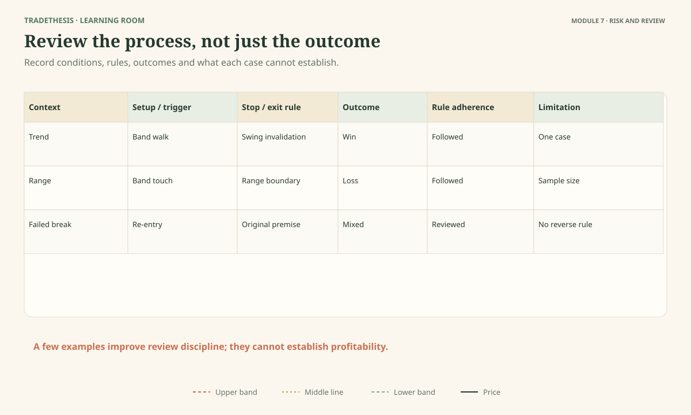
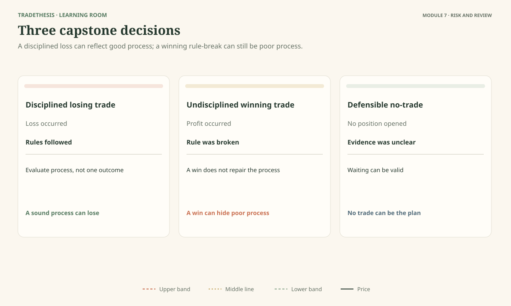

# Module 7 — Manage Risk and Review the Process

This final module connects chart interpretation with a disciplined trading process. You will practise sizing a position from the planned loss, deciding how to manage a trade before entry, reviewing a setup consistently, and judging decisions by the information available at the time—not only by the eventual outcome.

The module also serves as the course capstone. The goal is not to predict every chart correctly. It is to build a clear, conditional plan and know when no trade is the better decision.

---

## Lesson 7.1 — Size the Trade From the Point Where the Idea Fails

**Estimated time:** 16 minutes — read 8, inspect the figure 2, task 4, review 2.  
**Figure:** Figure 7.1 — a worked size example with two different stop distances and the same planned cash risk.

### The question

Why should the stop be decided before you work out the position size?

Your stop should represent the point where the trade idea no longer fits your plan. The distance from entry to that stop helps determine how many units, shares, contracts, or lots you can trade while keeping the planned loss within a chosen limit.

This is different from picking a convenient position size first and then placing the stop where the number looks comfortable.

### A simple calculation

For a straightforward instrument where the profit/loss per price unit is known:

**Position size = allowed cash risk ÷ planned loss per unit**

The planned loss per unit is usually based on the distance between entry and stop, multiplied by the instrument's value per price unit. Real instruments may require additional contract multipliers, currency conversions, lot specifications, fees, and other adjustments. Use the correct contract details for the market you trade.

For example, suppose a trader decides that a planned loss of ₹1,000 is the maximum for a particular idea. If the entry-to-stop distance would lose ₹10 per unit, the position size would be 100 units before costs and execution adjustments. If a different setup needs a stop that would lose ₹20 per unit, the same cash-risk limit would allow 50 units. The wider stop means a smaller position if planned cash risk stays the same.

These numbers are a calculation example, not a recommendation for how much any trader should risk.

### The stop is not a guarantee

A stop order does not guarantee an exit at the exact stop price. A gap, fast market, slippage, poor liquidity, or trading halt can produce a worse result. In markets with contract sizes or leveraged exposure, a small price move may have a larger cash effect than expected. Check the instrument's mechanics before applying the simple formula.

The Bollinger Bands do not decide your risk allowance. The bands can help you read the market condition, but your invalidation point comes from the trade idea and price structure. The position size follows from the risk you choose to accept.

### Read Figure 7.1

Compare the two examples. They use the same allowed cash risk but different entry-to-stop distances. Notice how the wider stop corresponds to a smaller position under the simplified calculation.

### Task

In Figure 7.1, calculate the position size for each example using the given allowed cash risk and per-unit loss. Then state one reason the realised loss may differ from the planned amount.

**Model reasoning:** Divide the permitted cash loss by the planned loss per unit. The wider stop allows fewer units for the same planned risk. Actual loss may be higher because of gaps, slippage, fees, or incorrect assumptions about the instrument's value.

### Try a new case

Two traders have the same account and same planned cash risk. One has a stop twice as far away as the other. If all other instrument details are the same, what happens to the position size?

**Model response:** The trader using the wider stop should generally use about half the size to keep the same planned cash risk, before costs and execution differences.

### Common mistake

Using the same position size on every setup even when the stop distance changes.

### Keep this

> **First decide where the idea fails. Then calculate a position size that fits the loss you are prepared to risk.**

**Source note:** This is general risk-management teaching, not a position-sizing rule prescribed by John Bollinger. Adapt the arithmetic to the instrument's contract specifications, costs, and account currency.

---

## Lesson 7.2 — Decide How You Will Manage the Trade Before Entry

**Estimated time:** 15 minutes — read 7, inspect the figure 3, task 3, review 2.  
**Figure:** Figure 7.2 — target, invalidation, and unresolved-price paths linked to prewritten actions.

### The question

If price moves in your favour, how will you know whether to hold, reduce, or exit?

A plan should explain not only when to enter but how you will manage what happens next. Without a rule, each new candle can tempt you to improvise. You may exit too early because a candle looks worrying, or stay too long because you hope the move will continue.

There is no single exit that suits every Bollinger Bands setup. A breakout plan and a range-fade plan are based on different ideas, so their exits may be different too.

### Match the exit to the reason for entry

**Target-based exit:** Before entry, identify a price area where the move may meet an obstacle or where your method expects to take profit. The target should be plausible relative to the stop distance. A target is a plan, not a promise that price will get there.

**Structure-based management:** If your approach follows a trend, you may choose to manage the trade using later swing structure. For example, an advance may remain intact while price forms higher lows. A break of the structure used by the plan may be a reason to exit. The exact rule needs to be stated and tested.

**Rule-based exit from a weakening premise:** You might decide in advance that a breakout plan is no longer valid if price returns into the prior range under the method's conditions. This is not the same as changing your mind because a candle feels uncomfortable. It follows a defined condition.

**Time or no-progress exit:** Some strategies are based on a move occurring within a reasonable period. If the move does not develop as expected, a prewritten time or no-progress rule may be appropriate. This is another rule to test, not something all traders should apply.

### Why the middle band is not a universal exit

A crossing of the middle band can be informative in a particular method, but it is not automatically a universal exit or entry. In a range, price may cross it often. In a trend, it may act as a rough reference for pullbacks, but the outcome remains uncertain. If you want to use a middle-band cross, define exactly how and test it with the setup where it belongs.

### Plan the paths before they occur

Figure 7.2 shows three possible paths after entry: price reaches the planned target, price reaches the invalidation condition, or price moves without resolving the idea. Each path should lead to an action that was selected before the outcome. That helps keep the management process consistent.

### Task

For each path in Figure 7.2, state the action prescribed by the sample plan. Identify which action would change if you were testing a different setup.

**Model reasoning:** A target path leads to the planned exit; an invalidation path leads to exit or predefined risk reduction; an unresolved path follows the rule for managing no progress. Another setup may have a different target or management rule, but it should still be decided in advance.

### Try a new case

You planned a range trade to exit near the middle of the range, but price is still far from the target. You feel tempted to move the target farther away because the candle looks strong. What should you check?

**Model response:** I should follow the rules I chose before entry, unless my plan explicitly allows a defined adjustment. A strong candle does not automatically justify changing the target. If I want to test a different management rule, I should evaluate it separately.

### Common mistake

Deciding exits from emotion after entry rather than from the trade's original reason.

### Keep this

> **Choose management rules that fit the setup, and write them before price tests your discipline.**

**Source note:** The idea of treating bands as setup tools rather than continuous advice follows Bollinger's Official Rule 22. The exit examples in this lesson are course-designed and should be tested. [Official rules](https://www.bollingerbands.com/bollinger-band-rules).

---

## Lesson 7.3 — Test the Idea Without Fitting It to the Past

**Estimated time:** 16 minutes — read 7, inspect the figure 3, task 4, review 2.  
**Figure:** Figure 7.3 — a mixed review table across trend, range, failed-breakout and unclear conditions.

### The question

Does a setup work because it looks convincing on one chart?

No. One good-looking example can explain an idea, but it cannot establish that the idea is reliable. You need to review how a clearly defined method behaves across different examples and conditions.

You do not need a complex software system to begin. A small, consistent review table can help you discover whether you follow your own rules and where the idea appears to struggle.

### Keep the rules stable during the review

Before reviewing examples, write down the method:
- Which market context qualifies?
- What event triggers the entry?
- What confirms or cancels the idea?
- Where is the invalidation point?
- How is size calculated?
- What exit rule is used?

Then evaluate each case using those same rules. Record a winner, a loser, a no-trade, or an ambiguous case honestly. Do not change the rules halfway through because a particular chart did not behave as you hoped.

If you decide to test a new period length, band multiplier, confirmation or exit, call it a new version of the method. Review it separately under similar conditions. Repeatedly adjusting several settings until the past looks perfect is a form of overfitting. It can make a method look more reliable in the examples used to design it than it will be in new data.

### Include different kinds of market conditions

A squeeze-breakout idea should not be evaluated only on strong breakouts. Include failed breaks, ranges, trends, and cases that never met the trigger. A range strategy should include cases where the range held and cases where it broke. An honest review includes no-trade cases, because those rules are part of the method.

The results should not be reduced to win rate alone. Review whether the entry was late, whether the stop made sense, whether the planned reward justified risk, and whether the rules were followed. A high win rate can still hide poor losses, and a sound method can have losing trades.

### Read Figure 7.3

The table includes several contexts. Look for the difference between reviewing many varied cases and selecting only the cases that make a setup look attractive. The second approach leaves important failure modes unseen.

### Task

Name two reasons the cherry-picked sample may give a misleading impression. Then state one change you would make to improve the review.

**Model reasoning:** The sample excludes difficult cases and may over-represent the exact conditions where the method looked best. A better review uses a consistent rule set and includes varied contexts, failures, and no-trade cases. The sample may still be too small to support a strong conclusion, and that limitation should be stated.

### Try a new case

A modified band setting produces better results on the examples you just reviewed but performs worse on a different period. What should you do?

**Model response:** I should not declare the modification superior from the first sample. I need a consistent comparison and additional cases not used to tune the settings. I should also consider whether the rules are too fitted to a particular market condition.

### Common mistake

Changing the method after every losing example until the history looks clean.

### Keep this

> **A useful test includes the trades that failed, the cases you skipped, and the conditions that were difficult—not just the wins.**

**Source note:** Bollinger's Official Rules 9 and 11 caution against treating defaults or parameter choices as universal. The review process here is a course-designed method for testing consistency, not a promise of future performance. [Official rules](https://www.bollingerbands.com/bollinger-band-rules).

---

## Lesson 7.4 — Review the Decision, Not Just the Result

**Estimated time:** 18 minutes — read 7, inspect the figure 4, task 5, review 2.  
**Figure:** Figure 7.4 — a disciplined losing trade, an undisciplined winning trade, and a defensible no-trade decision.

### The question

Can a losing trade follow a sound process, and can a winning trade be poorly planned?

Yes. The result tells you what happened to that position. It does not, by itself, tell you whether the original decision was well reasoned.

A trader can follow a defined plan, accept a planned loss, and still lose because the market did not develop as expected. Another trader can break the rules, take an impulsive entry, and make money by chance. If you judge only by profit and loss, the second trader may appear to have made the better decision. That is not a reliable way to improve.

### Review what was knowable at the time

For each trade or no-trade decision, record:

**Context:** Was the market trending, ranging, compressed, or unclear? What visible evidence supported that reading?

**Setup:** Which framework did you choose, and why did it fit the context?

**Trigger:** Did the required event actually occur before entry?

**Alternative:** What else could the chart have meant? What evidence would have weakened your preferred explanation?

**Invalidation and risk:** Where was the idea wrong, how was the stop chosen, and was position size consistent with planned risk?

**Management and result:** Did you follow the planned exit rules? What happened afterward? Did the actual price path reveal a limitation in the plan?

**Process note:** Was the decision consistent with the rule set at the time, or did you change the plan under pressure?

### Three types of review

In Figure 7.4, the disciplined losing trade has a clear setup, trigger, invalidation and controlled loss. The loss does not automatically prove the process was wrong. The undisciplined winning trade ignores a required condition but happens to profit. The no-trade case lacks a required piece of evidence, so waiting is consistent with the method.

The examples are not a lesson in excusing every loss. If the trader made a calculation error, ignored a condition, or used an untested rule as if it were proven, that needs to be recorded. The point is to find the cause rather than use the outcome as the only verdict.

### The final assignment

Use the supplied cases to write:
1. One complete long plan.
2. One complete short plan.
3. One no-trade decision.

For each, state the context, visible evidence, interpretation, alternative explanation, trigger, invalidation, stop/size logic, and exit rule. If the chart does not offer enough evidence, say what is missing. Do not invent a trade merely to complete the assignment.

### Assessment standard

A strong answer:
- points to evidence in the figure;
- separates facts from interpretation;
- names a plausible alternative;
- describes what would strengthen or weaken the idea;
- defines invalidation and risk before the outcome;
- follows the chosen plan or explains why the plan has been cancelled;
- accepts “no trade” when the required conditions are absent.

The assignment is not graded by whether you guessed the next price direction. It is about whether you made a defensible decision from the information available.

### Common mistake

Calling the analysis good because a trade won, or bad simply because it lost.

### Keep this

> **Judge the process by the evidence and rules available at the decision point. The outcome is important feedback, but it is not the whole review.**

**Source note:** This lesson synthesises the course's evidence-first approach. It is a TradeThesis assessment framework, not a Bollinger-prescribed grading system.

---

## Module 7 source notes

This module's position-sizing, trade-management, testing and review guidance is general educational risk practice. It is intentionally not attributed to Bollinger as a specific trading system. Bollinger's own rules remind readers that the bands identify setups rather than provide continuous advice, and that parameters should not be treated as universal laws. [Official rules](https://www.bollingerbands.com/bollinger-band-rules).
