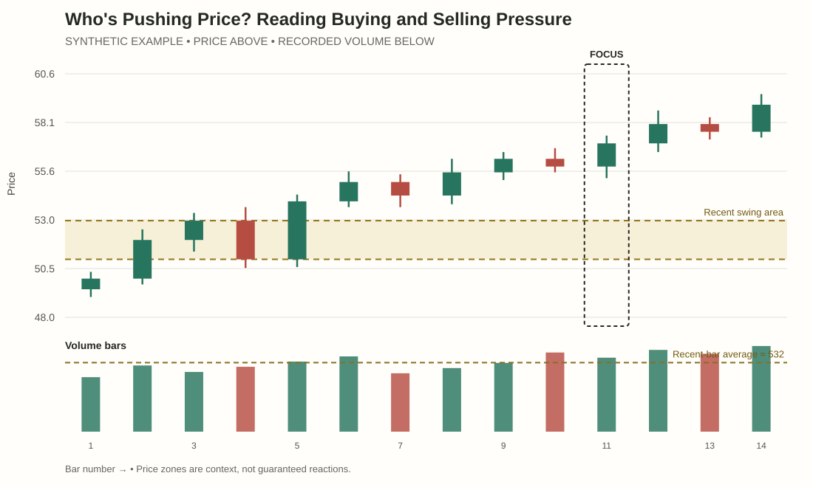
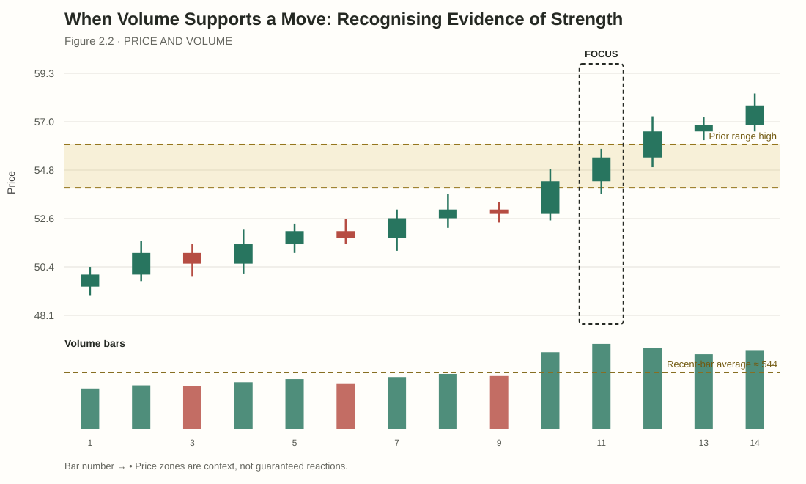
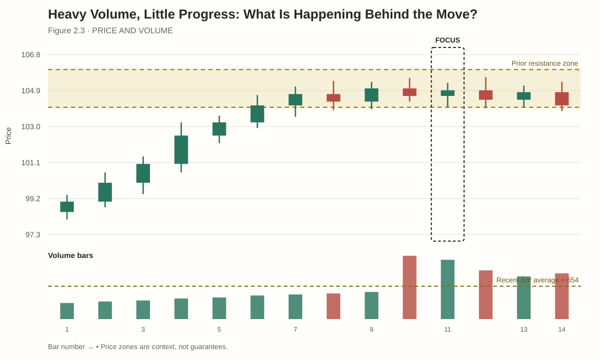
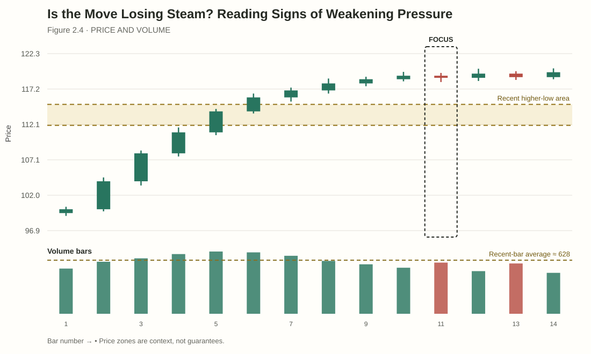
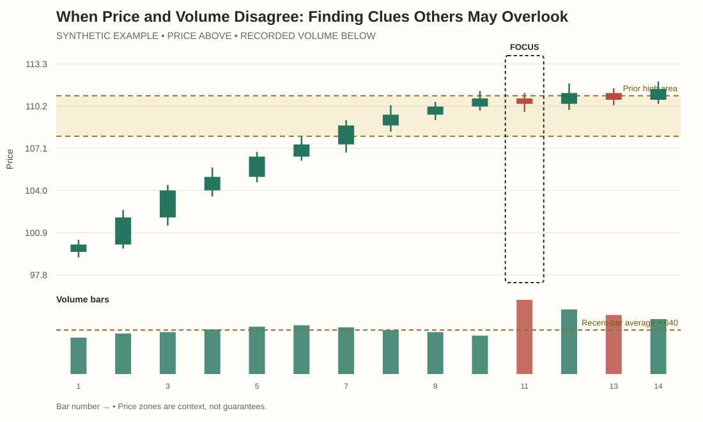

# Module 2 — Spot Buying and Selling Pressure
## Student lessons

Module 1 taught you to separate price outcome from recorded activity. This module asks the next question: **which direction appears to be making progress, and how confidently can you describe that progress?**

“Buying pressure” and “selling pressure” are shorthand for the direction in which price appears to be progressing more easily. They do not reveal the identity or private intentions of the people trading. The aim is to read evidence across a sequence, not turn a single bar into a story about hidden participants.

---

## Lesson 2.1 — Who's Pushing Price? Reading Buying and Selling Pressure

**Interactive practice:** [Open the Notice → Compare → Apply ChartLab](../assets/chartlabs/vpa-m02-l01-reading-pressure.html)  
**Source and accessible description:** [Synthetic OHLCV / profile data](../assets/student-assets/data/vpa-m02-l01-reading-pressure.csv) · [Chart description and limitations](../assets/student-assets/alt-text/vpa-m02-l01-reading-pressure.md)

### Start with progress, not a story

Every completed transaction has both a buyer and a seller. So when chart readers say “buyers are in control”, they are not saying that buyers exist and sellers do not. They are describing an apparent imbalance in the result: price is advancing, holding gains and making progress upward, or it is declining and retaining downside progress.

That distinction keeps your analysis grounded in observable behaviour.

### Three questions for a bar sequence

1. **Direction:** Are closes and swing points generally progressing up, down or sideways?
2. **Retention:** After price moves, does it keep the progress or give it back?
3. **Effort and result:** How much recorded activity accompanied the move, and how much distance did price achieve?

A single strong bar may be important, but the sequence helps you judge whether it is part of sustained progress or an isolated event.

### Compare the sequences

The following are simplified, **synthetic examples**.

| Sequence | Price behaviour | Recorded activity | Initial reading |
|---|---|---|---|
| A | Higher closes; pullbacks remain shallow; prior swing highs are exceeded | Moderate to elevated during advances | Upward progress is being retained so far. |
| B | Price briefly rises but repeatedly closes back in the range | Elevated on some bars | Activity is present, but upward progress is not being retained consistently. |
| C | Lower closes; rallies fail below prior swing highs | Mixed | Downward progress is clearer than upward progress over this sequence. |

None of these rows proves who is trading or what will happen next. Each summarises the balance of visible progress.

### Worked example

Price rises from 40 to 46, pulls back to 44, then advances to 47. The pullback does not break the prior meaningful swing low, and price later exceeds the recent high. The visible structure is making upward progress. If the advance also holds gains rather than immediately returning to 44, the continuation reading gains support.

Now imagine the bar at 47 records unusually high volume but closes near its low, and subsequent bars return to 44. The earlier upward structure remains part of the chart, but the latest attempt has not held. A good reader updates the assessment rather than insisting that all evidence must support the first idea.

### Worked comparison — progress has to be retained

Consider closes of 50, 52, 53, 51, 54 and 55. Despite the pullback to 51, the sequence makes progress and later moves beyond the earlier high. Now consider 50, 52, 49, 52, 48, 51. It contains upward candles too, but the sequence repeatedly loses ground and makes lower lows. A green candle alone cannot describe pressure; the path and retained progress give it meaning.

### Level 1 — Notice (easy)

**Task:** A four-bar sequence makes higher closes but gives back most of each advance on the next bar. Describe progress without assigning motives.

**Feedback:** Price makes upward excursions but does not consistently retain them. Avoid saying that a particular participant is in control.

### Level 2 — Compare (guided)

**Task:** Compare it with higher highs, higher closes and shallow pullbacks. What differs?

**Feedback:** The second sequence retains more upward progress and shows clearer structure; this is evidence about price outcome, not participant identity.

### Level 3 — Apply (independent)

**Task:** A sequence makes lower highs/lower closes, then has a high-volume rally that closes mid-range. Give the strongest reading and one uncertainty.

**Model response:** Downward progress remains clearer so far; the rally did not retain much upward progress. Later bars may still reclaim structure.
### Common mistake

**Mistake:** Using “buyers” and “sellers” as though the chart reveals actual participants' identities.

**Correction:** Describe what price achieved and how well it held that progress. Treat pressure labels as shorthand for the observed result.

### Keep this

> Pressure is a description of progress, not a headcount of buyers and sellers.

---

## Lesson 2.2 — When Volume Supports a Move: Recognising Evidence of Strength

**Interactive practice:** [Open the Notice → Compare → Apply ChartLab](../assets/chartlabs/vpa-m02-l02-volume-supports-move-lab.html)  
**Source and accessible description:** [Synthetic OHLCV / profile data](../assets/student-assets/data/vpa-m02-l02-volume-supports-move.csv) · [Chart description and limitations](../assets/student-assets/alt-text/vpa-m02-l02-volume-supports-move.md)

Volume is most useful when it helps you ask whether the activity and the price result fit together. A move that makes meaningful progress while activity rises may deserve attention. But “supports” does not mean “guarantees”.

### What would coherent evidence look like?

Imagine price breaks above a previously observed range high. The candle closes well beyond the area, its range is wide compared with recent bars, and volume is above a reasonable baseline. In the next few bars, price remains outside the range and does not immediately give the move back.

There are several pieces of evidence:
- the boundary was marked before the move;
- the breakout bar made an upward price result;
- activity was elevated relative to the stated baseline;
- subsequent bars retained at least some progress.

Together, they support a continuation interpretation more than the first candle alone. Yet the trade can still fail. A later move back inside the range changes the evidence.

### Strong result versus large activity

High volume is not automatically supportive. Compare:

| Event | Price result | What to investigate |
|---|---|---|
| 1 | Elevated activity; wide up bar; close near high; later bars hold above a boundary | Is price accepting the new area and maintaining progress? |
| 2 | Elevated activity; price trades above the boundary but closes back inside | Why was little progress retained beyond the boundary? What happens on the next test? |
| 3 | Low activity; price advances easily through a thin region | Is the move travelling through an area with little recent trade, and does it hold once activity returns? |

Event 1 gives a more coherent continuation case than Event 2, but none of the patterns should be memorised as automatic signals.

### Worked example

A resistance zone sits around 72–73. Price closes at 74.2 after a wide bar, with volume at 1.7× its 20-bar average. Two subsequent bars remain above 73, and a pullback to 73.3 holds without breaking the latest short-term swing low.

A careful summary is: “Price has moved beyond the prior zone on elevated recorded activity and has so far held above it. This supports a continuation scenario. A sustained return below the zone would weaken that reading.” It is not necessary to claim that “smart money” entered or that the move cannot fail.

### Worked comparison — volume is not the trigger

One breakout records 2× relative volume and holds above the old range high. Another records 2× relative volume but closes back in the range and fails to reclaim the boundary. The same multiple appears in both. What matters for the continuation thesis is not the multiple by itself but whether price retains progress outside the range. Volume can make an event worth examining; it cannot replace a price condition.

### Level 1 — Notice (easy)

**Task:** A breakout closes above a boundary on 1.7× relative volume. What does that ratio establish?

**Feedback:** Recorded activity was 70% above its chosen baseline; it does not prove a successful breakout or identify traders.

### Level 2 — Compare (guided)

**Task:** Compare it with an equally active bar that closes back inside and fails to reclaim the boundary.

**Feedback:** Follow-through distinguishes the cases. The second attempt did not retain its outside progress.

### Level 3 — Apply (independent)

**Task:** Price clears resistance on modest volume, then holds above the zone for three bars and retests it successfully. Explain why the case still deserves attention.

**Model response:** Price moved beyond the boundary and retained progress. Modest volume is context, not an automatic disqualifier; the scenario remains conditional.
### Common mistake

**Mistake:** Equating high volume with confirmation.

**Correction:** Ask what price accomplished, where it happened and whether later bars kept the result.

### Keep this

> Volume adds context to a move. Follow-through shows whether price can retain its progress.

---

## Lesson 2.3 — Heavy Volume, Little Progress: What Is Happening Behind the Move?

**Interactive practice:** [Open the Notice → Compare → Apply ChartLab](../assets/chartlabs/vpa-m02-l03-heavy-volume-little-progress-lab.html)  
**Source and accessible description:** [Synthetic OHLCV / profile data](../assets/student-assets/data/vpa-m02-l03-heavy-volume-little-progress.csv) · [Chart description and limitations](../assets/student-assets/alt-text/vpa-m02-l03-heavy-volume-little-progress.md)

Sometimes a market records substantial activity but travels very little. This is an effort/result mismatch: much activity was recorded, yet the price result was limited. The mismatch is a useful question to investigate, not proof of a specific mechanism.

### What could explain it?

Suppose price approaches a prior high. Volume rises, but the candle range is narrow and the close remains near the middle. One possible explanation is that opposing interest is meeting the attempted move. Traders often use the term **absorption** for a situation where substantial trading occurs but price struggles to progress in one direction.

However, one candle cannot establish absorption. Other explanations may fit:
- price is temporarily balanced while both sides trade;
- activity increased because of scheduled news or a session transition;
- the market is pausing before a later move;
- the data feed recorded an unusual burst that is not directly comparable with its baseline.

Use the term only as a hypothesis and look for subsequent evidence.

### The three-part test

1. **Effort:** Was activity unusually high against a defined baseline?
2. **Result:** How much price progress occurred? Did the candle close near its extreme or return toward its starting area?
3. **Location and follow-through:** Did the event occur at a meaningful boundary? What did price do after it?

A high-volume, narrow-range bar in the middle of a range may simply show two-sided trade. The same event at a repeatedly tested boundary can be more important, but it still needs follow-through.

### Worked example

Price approaches the range high at 105. The next candle trades from 104.2 to 105.8 but closes at 104.9, back inside the range. Volume is 2.4× the recent average. The observation is clear: elevated activity accompanied an attempt above 105, but the close did not hold above the boundary.

One possible reading is that the range high is still resisting upward progress. An alternative is that the market is temporarily balanced before another attempt. If a later bar closes above 105.8 and price holds there, the second explanation gains support. If price keeps failing near 105 and then breaks a nearby swing low, the failure-to-progress interpretation gains support.

Notice that the next test is observable. “Institutions are selling” is not.

### Worked comparison — limited progress at two locations

A narrow high-volume bar halfway through a range may reflect two-sided trade without a clear directional test. The same bar at the upper boundary asks a more specific question: why did the attempt to move beyond the edge retain so little progress? The second location may make the event more relevant, but still does not prove absorption or a reversal. Later holds, failures and structural changes must distinguish the possible explanations.

### Level 1 — Notice (easy)

**Task:** A bar has 2.4× volume, a narrow range and a midpoint close. Write one observation without using “absorption”.

**Feedback:** Activity was high relative to baseline, but price made limited net progress and closed near the centre of its range.

### Level 2 — Compare (guided)

**Task:** Compare that event halfway through a range with one at a repeatedly tested range high.

**Feedback:** The boundary location makes the latter more relevant to a test of the range edge, but neither event proves a cause. The middle-of-range case may simply be two-sided activity.

### Level 3 — Apply (independent)

**Task:** Create two possible endings for the high-activity bar at resistance and a condition favouring each.

**Model response:** Failure to hold the boundary followed by a nearby swing-low break supports a failed-upside attempt. A later close above resistance and successful retest supports continuation.
### Common mistake

**Mistake:** Using the word “absorption” as if it were directly visible.

**Correction:** First describe the activity and limited price result. Then state that absorption is one possible explanation, and identify what follow-through would matter.

### Keep this

> When effort is high but result is small, ask why—do not assume you already know.

---

## Lesson 2.4 — Is the Move Losing Steam? Reading Signs of Weakening Pressure

**Interactive practice:** [Open the Notice → Compare → Apply ChartLab](../assets/chartlabs/vpa-m02-l04-weakening-pressure-lab.html)  
**Source and accessible description:** [Synthetic OHLCV / profile data](../assets/student-assets/data/vpa-m02-l04-weakening-pressure.csv) · [Chart description and limitations](../assets/student-assets/alt-text/vpa-m02-l04-weakening-pressure.md)

A trend does not usually announce its end with certainty. Momentum can fade, pause, resume or fail. The aim here is to notice when progress becomes less convincing without calling every slowdown a reversal.

### Look for a change, not a magic pattern

Evidence of weakening progress may include:
- successive advances cover less distance;
- candles close farther from their highs during an upward move;
- price repeatedly fails to hold above recent highs;
- pullbacks become deeper or begin to break the structure that previously held;
- effort rises while the price result becomes smaller.

No single item is a reversal signal. A strong trend may pause and then resume; a weak-looking advance can suddenly accelerate.

### Compare progress with the earlier move

Suppose a market advances from 100 to 108 in four bars, then from 108 to 110 over the next five bars. The later leg travelled less distance over more bars. That may suggest the pace of progress has slowed. Now add context: did it reach a meaningful resistance zone? Are closes moving away from the highs? Has a prior higher low broken? These observations help distinguish a pause from a structural change.

Do not compare only raw bar volume. Activity varies with session, timeframe and feed. A decrease in volume could accompany an orderly pause, an unimportant quiet period or a market moving easily through an area. Interpret it alongside result and structure.

### Worked example: two paths

A market climbs towards a resistance zone around 150.

**Path A:** Each new bar makes a small advance, closes in its upper half and remains above the latest swing low. Activity is declining. The move is slowing, but structure has not broken. Waiting for a fresh test may be reasonable.

**Path B:** Price repeatedly pokes above 150 but closes back below it on elevated activity, then breaks below the latest meaningful higher low and fails to reclaim it. This is more substantial evidence that the prior upward structure has weakened.

Path B has a change in structure and failed reclaim, not merely a smaller candle. The conclusion remains conditional: it weakens the continuation thesis; it does not guarantee a sustained decline.

### Worked comparison — a pause is not a reversal

An uptrend's pushes cover 8, 5 and 3 points. Progress is slowing. If pullbacks remain shallow and prior higher lows hold, the trend may simply be pausing. If a later advance fails at the same high, price breaks the latest meaningful higher low and a reclaim attempt fails, the structure has changed more clearly. Record the early slowdown as a warning; reserve stronger language for stronger evidence.

### Level 1 — Notice (easy)

**Task:** Successive advances cover 6, 4 and 2 points. What changed?

**Feedback:** Upward price progress is slowing. That alone does not confirm a reversal.

### Level 2 — Compare (guided)

**Task:** Compare smaller candles that close near their highs with smaller candles that fail at resistance, leave upper wicks and then break a meaningful higher low.

**Feedback:** The latter includes failed progress and a structural break. The former may simply be a pause.

### Level 3 — Apply (independent)

**Task:** A market makes a slightly lower high but remains above its last higher low. Write a cautious update and your next observation.

**Model response:** The latest advance failed to exceed the prior high, but the structure has not clearly broken. Monitor the higher low and whether price can reclaim the recent high.
### Common mistake

**Mistake:** Calling every smaller candle or lower-volume advance “exhaustion”.

**Correction:** Require more than a change in bar size. Check retained progress, location, failed attempts and meaningful structure.

### Keep this

> A slowdown is a reason to reassess. A structural change gives you stronger evidence to reassess.

---

## Lesson 2.5 — When Price and Volume Disagree: Finding Clues Others May Overlook

**Interactive practice:** [Open the Notice → Compare → Apply ChartLab](../assets/chartlabs/vpa-m02-l05-price-volume-disagreement-lab.html)  
**Source and accessible description:** [Synthetic OHLCV / profile data](../assets/student-assets/data/vpa-m02-l05-price-volume-disagreement.csv) · [Chart description and limitations](../assets/student-assets/alt-text/vpa-m02-l05-price-volume-disagreement.md)

Price and volume will not always tell a neat, matching story. A disagreement is not automatically an opportunity; it is a prompt to investigate what is unclear.

### Three common mismatches

**High activity, little progress.** This may reflect two-sided trade, opposition at a boundary, a temporary pause or unusual conditions. Ask where it happened and what followed.

**Low activity, substantial progress.** Price may be moving through an area with little trading activity, or the market may be quiet for ordinary session reasons. Check whether the progress is retained when the market becomes more active.

**Price makes a new extreme, but activity does not expand.** This may suggest a weaker extension, but it could also indicate that price is moving through a thin area with little opposition. Do not assume either explanation without looking at the level and follow-through.

### Use a hypothesis and a discriminator

For every mismatch, write:
1. **Observation:** what price did and how activity compared with its baseline.
2. **Primary interpretation:** one possible explanation.
3. **Alternative:** another explanation consistent with the same facts.
4. **Discriminator:** an observable event that would favour one explanation over the other.

The discriminator might be a close back inside a range, a successful retest, a break of a swing low or a failure to reclaim a boundary. It should not be something invisible such as “big players changed their mind”.

### Worked example

Price makes a marginal new high at 210. Volume is lower than on the previous advance, and the candle closes near its midpoint. The prior swing structure remains upward.

One interpretation is that upward progress is weakening. An alternative is that price travelled above the old high through an area with little opposing activity and may still hold the extension. A hold above 210 followed by another advance would support the second reading; a quick return below the old high and failure to reclaim it would support the first.

The initial observation remains correct whichever path follows. Good analysis can change as new evidence arrives without rewriting what was visible earlier.

### Worked comparison — two mismatches, two questions

A marginal new high on low relative volume raises the question of whether price can hold the extension or is moving through a thin area. High activity with a narrow bar near resistance raises a different question: why did much recorded activity produce so little upside progress at this location? These readings are not interchangeable. For each, write the observable mismatch first, then two explanations that fit it and a future event that would help distinguish them.

### Level 1 — Notice (easy)

**Task:** Price makes a marginal new high on lower relative volume. State the mismatch.

**Feedback:** Price extended while activity was lower against the stated comparison. This is a question to investigate, not a directional signal.

### Level 2 — Compare (guided)

**Task:** Compare this with high volume and little progress near resistance. What distinct question does each raise?

**Feedback:** The first asks whether price can hold the extension or moved through a thin area; the second asks why substantial activity produced limited progress at that location.

### Level 3 — Apply (independent)

**Task:** Price falls on elevated volume into a prior demand area, then stops making lower closes. Give two explanations and a discriminator.

**Model response:** Price may be meeting opposition or pausing before another decline. A sustained reclaim of a nearby lower high supports recovery; renewed downside progress and a break below the area supports continuation down.
### Common mistake

**Mistake:** Treating any disagreement between price and volume as a predictive divergence.

**Correction:** Describe the mismatch, explain at least two plausible readings, then define what you would watch next. Sometimes the right decision is to wait.

### Module 2 review

You have now practised describing progress, judging whether activity and price outcome fit together, spotting effort/result mismatches, recognising slowing moves and handling conflicting evidence. Keep the reasoning observable: **facts first, possible meaning second, alternative third, next test last.**

### Quick check

**1. Does high volume prove buying pressure?**  
No. It measures recorded activity under the feed's rules. The price result and context help interpret that activity.

**2. What does high activity with limited progress tell you?**  
There was a mismatch between activity and price result. The cause remains uncertain until further evidence helps distinguish explanations.

**3. What makes a weakening-trend reading more persuasive?**  
A combination of reduced progress, failed attempts, important location and a meaningful structural change is stronger than one smaller candle or one lower-volume bar.

**Transfer task:** Find a sequence with at least three bars. Record the direction of progress, whether the progress was retained, the relative activity and one alternative explanation. End with a condition that would make you revise the reading.
