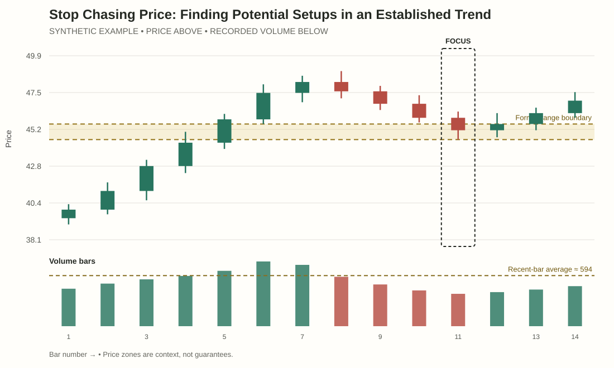
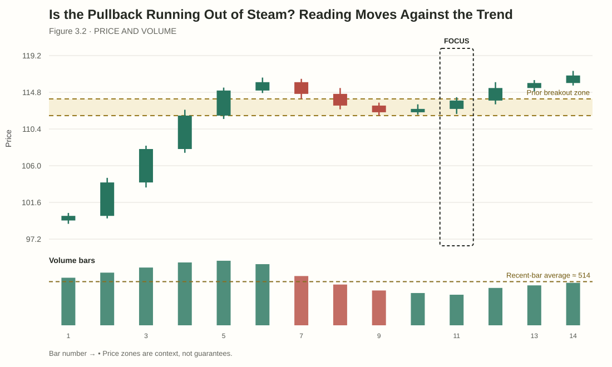
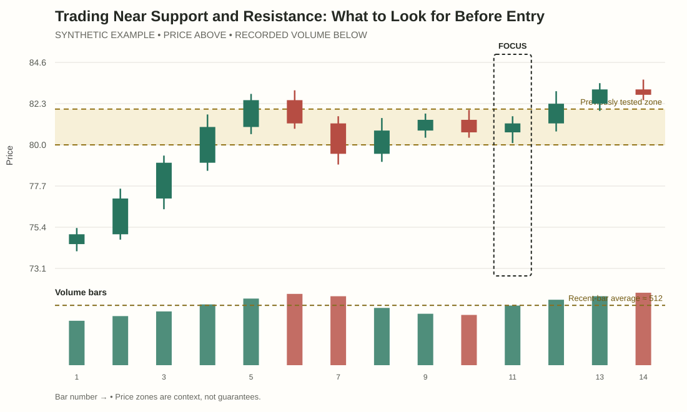
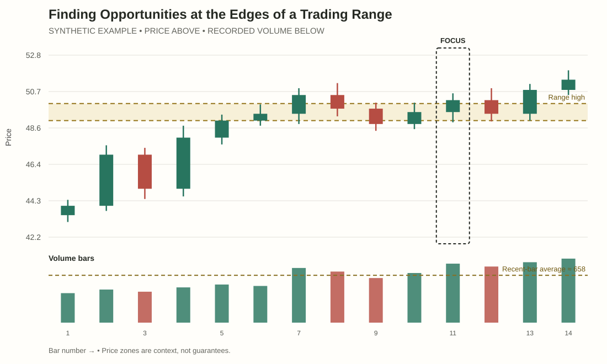
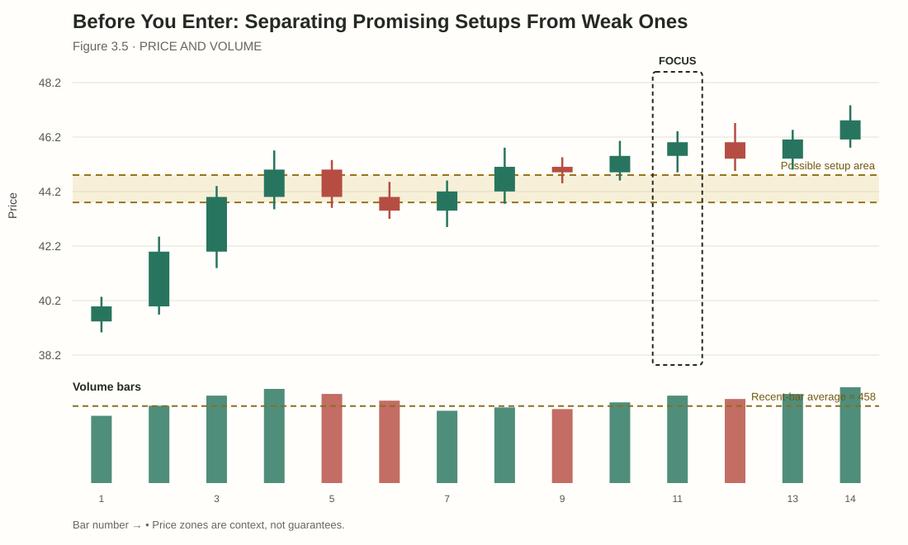

# Module 3 — Find Trade Setups at the Levels That Matter
## Student lessons

A potential setup is not an instruction to enter. It is a chart situation worth investigating because the market's structure, location and recent behaviour create a clear question. This module teaches you to locate that question, define what would count as evidence, and reject ideas that cannot be tested or risk-managed.

You will practise keeping three things separate: **the setup area, the trigger, and the point where the idea no longer makes sense.**

---

## Lesson 3.1 — Stop Chasing Price: Finding Potential Setups in an Established Trend

As you work through this lesson, refer to **Figure 3.1** for the chart example.

**Interactive practice:** [Open the Notice → Compare → Apply ChartLab](../assets/chartlabs/vpa-m03-l01-trend-continuation-setup-lab.html)  
**Source and accessible description:** [Synthetic OHLCV / profile data](../assets/student-assets/data/vpa-m03-l01-trend-continuation-setup.csv) · [Chart description and limitations](../assets/student-assets/alt-text/vpa-m03-l01-trend-continuation-setup.md)

### Why chasing creates a problem

Imagine a market has risen sharply for several bars. The move is obvious, the candles are green and activity has increased. Buying immediately may feel safer because the chart appears to confirm the direction. Yet the distance from the latest price to a sensible invalidation point may now be large. If the price pauses or pulls back, the trade may have poor risk-to-potential-reward even if the broad trend remains upward.

A better process is to identify the trend structure, then wait for a location where the idea can be evaluated without assuming that the move must continue.

### Recognise structure before the setup

An uptrend is commonly described by higher swing highs and higher swing lows. A downtrend is commonly described by lower swing highs and lower swing lows. A range has clearer upper and lower boundaries, with price rotating between them. These labels depend on timeframe and swing-selection method; when structure is mixed, call it mixed rather than forcing a label.

In a rising market, price may alternate between:
- **Impulse:** a move that makes progress in the direction of the trend.
- **Pause or pullback:** a period where price stalls or moves against that trend.
- **Possible continuation:** a later attempt to resume progress.

The pattern describes what may be worth watching. It does not tell you how far the next move will travel.

### Separate three parts of a trade idea

| Part | Question it answers | Example |
|---|---|---|
| Setup area | Where would the idea be worth evaluating? | The former range high around 50–51. |
| Trigger | What observable event would show renewed evidence? | Price tests the area, holds above it and closes above a short-term swing high. |
| Invalidation | What would make the idea no longer fit the chart? | Price returns into the old range and breaks the relevant pullback low. |

These are not universal rules. Choose conditions that make sense for the specific chart and timeframe. A zone by itself is not a trigger, and reaching a zone is not proof that it will hold.

### Worked example

A market has moved from 40 to 48 and has made a higher high and a higher low. A prior range boundary sits near 44. The most recent advance is extended, so instead of chasing at 48, you mark 44–45 as a possible area to watch if price pulls back.

Price later retraces to 45. It pauses, but has not yet resumed upward progress. At this point, the area is being tested; the trade is not confirmed. A possible trigger might be a close above the latest short-term swing high after price holds the zone. If price instead breaks below the relevant pullback low and returns into the earlier range, the original continuation idea weakens.

The key is that you made the plan before the trigger occurred. You are not drawing a convenient level around the candles after the outcome is known.

### Worked comparison — the distance to invalidation matters

Price rallies from 40 to 48 with no nearby structure. Buying at 48 may leave the next sensible invalidation point far away. If price later pulls back toward the old range boundary at 44–45, you can evaluate whether the area holds and whether a trigger forms. The second location does not guarantee a better trade; it gives a more structured place to ask the question. A setup is defined by evidence and risk logic, not by being earlier or later alone.

### Look closely at the evidence

**Task:** On an uptrend chart, identify the latest meaningful higher low and describe how extended price is from it.

**Feedback:** Point to the swing that defines structure and note the distance to current price. The purpose is to notice whether risk is harder to define after a late entry.

### Compare the cases

**Task:** Compare chasing a long impulse with waiting for a pullback to a marked area and a later trigger.

**Feedback:** A setup area says where to pay attention; a trigger is the event required before considering entry; invalidation explains what contradicts the thesis.

### Try a new case

**Task:** A market rises from 40 to 48 and the old range boundary is 44–45. State a condition that supports continuation and one that weakens it.

**Model response:** Holding the zone followed by a close above a short-term swing high may support continuation. A break below the pullback low and failed reclaim weakens the idea.
### Common mistake

**Mistake:** Calling any pullback in an uptrend a buying opportunity.

**Correction:** Check the location, the structure, what the pullback is achieving and what observable event would support the continuation scenario.

### Keep this

> The area tells you where to pay attention. The trigger tells you what evidence you need. Invalidation tells you when the idea has failed.

---

## Lesson 3.2 — Is the Pullback Running Out of Steam? Reading Moves Against the Trend

As you work through this lesson, refer to **Figure 3.2** for the chart example.

**Interactive practice:** [Open the Notice → Compare → Apply ChartLab](../assets/chartlabs/vpa-m03-l02-pullback-pressure-lab.html)  
**Source and accessible description:** [Synthetic OHLCV / profile data](../assets/student-assets/data/vpa-m03-l02-pullback-pressure.csv) · [Chart description and limitations](../assets/student-assets/alt-text/vpa-m03-l02-pullback-pressure.md)

A pullback is a move against the recent directional structure. Traders often look for signs that the pullback is weakening before considering a continuation. The danger is that a few quiet candles can be mistaken for proof that the trend is ready to resume.

### Compare the pullback with the prior impulse

Use the same measurements for both legs:
- distance travelled;
- number and size of bars;
- where candles close within their ranges;
- activity relative to comparable bars;
- whether meaningful swing structure has been broken;
- location relative to prior zones.

For example, an uptrend makes an impulse from 100 to 110 over four bars. The pullback takes six bars to move from 110 to 107.5, using smaller ranges and lower recorded activity. That is different from a three-bar decline from 110 to 103 on expanding activity that breaks the latest higher low. The first may be a controlled pause; the second challenges the trend structure more directly.

Neither reading is guaranteed. A slow pullback can continue, and a sharp pullback can recover.

### Read the evidence in sequence

A helpful progression is:
1. **Initial pullback:** price starts moving against the trend. Do not label it weak or strong yet.
2. **Approach to a relevant area:** compare the pullback with the prior impulse and note what structure remains intact.
3. **Test:** look for observable behaviour—holding the area, failing to make further progress, reclaiming a short-term swing, or breaking structure.
4. **Decision:** decide whether the original continuation idea has more evidence, less evidence or remains unresolved.

Reduced volume may be relevant, but it is only one part of this sequence. A pullback with low volume is not automatically finished.

### Worked comparison

Both examples begin with an uptrend from 200 to 220 and a prior breakout area around 214–215.

**Case A:** Price pulls back to 215 in several narrow candles. Activity declines relative to the impulse. The last meaningful higher low remains intact. Price then closes above a nearby short-term swing high. This provides additional evidence for a possible continuation.

**Case B:** Price falls through 215 on wide candles, activity rises and the market breaks the last meaningful higher low at 212. Price attempts to reclaim 215 but closes back below it. This weakens the original continuation reading more than a quiet pause would.

The useful distinction is not simply “low volume good, high volume bad”. It is how the price result, activity, location and structure fit together.

### Worked comparison — pullback activity needs structure

In Case A, price retreats from 120 to 117 on smaller ranges, activity declines and the prior higher low at 115 remains intact. In Case B, price falls from 120 to 112 on expanding ranges and breaks 115, then cannot reclaim it. The first case may be a pause worth watching. The second challenges continuation. Volume contributes context, but the difference in achieved price progress and structure is decisive.

### Look closely at the evidence

**Task:** An impulse advances 10 points and the pullback retreats 2 points on smaller ranges. What else should you record?

**Feedback:** Relative activity, location and whether meaningful swing structure remains intact are relevant; distance alone is not enough.

### Compare the cases

**Task:** Compare a low-activity pullback that holds an old breakout zone with a higher-activity pullback that breaks the latest higher low and fails to reclaim it.

**Feedback:** The second case more directly challenges continuation because price structure has changed. Low volume does not prove that the first pullback is finished.

### Try a new case

**Task:** The pullback reaches a zone but overlaps without a trigger. Write what you will wait for and what would abandon the idea.

**Model response:** Wait for the pre-defined trigger, such as a reclaim of a nearby swing high after the zone holds. A decisive break below the pullback low and failed reclaim weakens the thesis.
### Common mistake

**Mistake:** Entering because a pullback “looks tired.”

**Correction:** Turn that impression into observable conditions. Which high or low must be reclaimed or held? What would invalidate the idea?

### Keep this

> A pullback is not finished because you want it to be finished. Look for the market to show a change in behaviour.

---

## Lesson 3.3 — Trading Near Support and Resistance: What to Look for Before Entry

As you work through this lesson, refer to **Figure 3.3** for the chart example.

**Interactive practice:** [Open the Notice → Compare → Apply ChartLab](../assets/chartlabs/vpa-m03-l03-support-resistance-zones-lab.html)  
**Source and accessible description:** [Synthetic OHLCV / profile data](../assets/student-assets/data/vpa-m03-l03-support-resistance-zones.csv) · [Chart description and limitations](../assets/student-assets/alt-text/vpa-m03-l03-support-resistance-zones.md)

Support and resistance are often drawn as precise lines. Markets rarely respect a line to the last decimal. It is more useful to treat these areas as **zones where price previously changed behaviour**.

### What earns a zone on the chart?

A zone may be relevant because price repeatedly stalled there, turned away, broke through and later retested it, or built a visible area of balance. The reason matters more than the number of lines you draw.

A zone should answer two questions:
- What earlier price behaviour makes this area relevant?
- What could price do here that would support or challenge my current idea?

If you cannot answer those questions, the line may add clutter rather than information.

### Support and resistance are roles, not guarantees

A support area is a place where downside progress has previously slowed or reversed. A resistance area is a place where upside progress has previously slowed or reversed. A former resistance zone can later act as support, and vice versa, but that role change is a hypothesis until the market tests it.

The zone may fail. That failure does not make the original analysis useless if it was based on observable evidence and included a clear condition for revision.

### Three types of behaviour to watch

**Approach:** How did price arrive? Was the move fast, slow, broad, narrow or accompanied by unusual activity?

**Interaction:** Did price stall, close through the zone, form a wick, or repeatedly overlap around it?

**Follow-through:** Did price move away and retain that progress, return through the zone, or remain trapped in overlap?

This gives more information than assigning a trade merely because price touched a support line.

### Worked example

A price zone from 80 to 82 is based on several earlier turns. Price approaches it after falling from 90. One candle trades to 81.2 and closes at 82.4, above the zone. That is an observable response, not yet evidence of a durable reversal.

If the next bars make higher lows and reclaim a nearby short-term swing high, a recovery scenario gains evidence. If price returns below 80 and cannot reclaim it, the zone has not held in the way the recovery scenario required. If bars keep overlapping from 80 to 83, the event remains unresolved.

### Worked comparison — a zone has evidence behind it

An analyst marks 80–82 because price previously turned away there twice. On a later test, price trades to 81 and closes at 83, then holds above the area. The old resistance may be changing role, but that claim needs the hold and follow-through. If price instead closes back below 80 and fails to reclaim the zone, the idea that it has become support is weakened. The mark is useful because it sets up a test, not because it predicts the answer.

### Look closely at the evidence

**Task:** A support zone was marked because price turned there twice. What justifies the zone and what can it not guarantee?

**Feedback:** Prior turns justify attention to the area. They do not guarantee another bounce or exact-price respect.

### Compare the cases

**Task:** Compare price turning away, closing beyond and holding, or overlapping at the zone.

**Feedback:** Turning away is a response; holding beyond may indicate the old role is changing; overlap is unresolved. The zone alone does not choose an outcome.

### Try a new case

**Task:** Price approaches a zone from below with expanding ranges and elevated activity. What should you inspect next?

**Model response:** Check whether it closes beyond and holds, trades above but returns inside, or stalls. Those responses distinguish possible readings.
### Common mistake

**Mistake:** Drawing zones after a move has occurred so that they conveniently explain the outcome.

**Correction:** Mark the basis for a zone before evaluating the test. Be prepared to revise or discard it when the evidence changes.

### Keep this

> A level is an area to ask a question—not a price that must hold.

---

## Lesson 3.4 — Finding Opportunities at the Edges of a Trading Range

As you work through this lesson, refer to **Figure 3.4** for the chart example.

**Interactive practice:** [Open the Notice → Compare → Apply ChartLab](../assets/chartlabs/vpa-m03-l04-range-edge-setups-lab.html)  
**Source and accessible description:** [Synthetic OHLCV / profile data](../assets/student-assets/data/vpa-m03-l04-range-edge-setups.csv) · [Chart description and limitations](../assets/student-assets/alt-text/vpa-m03-l04-range-edge-setups.md)

A range is a period where price repeatedly rotates between an upper and lower boundary without sustained directional progress. It can create different questions at its edges than in its middle.

### Why location changes the question

Near the middle of a range, price may have room to move in either direction without reaching a boundary. A trade idea can be harder to define because there may be no nearby structural point that clearly tests the thesis.

Near the upper edge, ask whether price will return inside or hold outside. Near the lower edge, ask whether price will return into the range or remain below it. The edge provides context, but not an automatic reversal point. Strong ranges can break; failed breaks can also return inside.

### Keep rotation and breakout scenarios separate

Suppose a range extends from 40 to 50.

- **Rotation scenario:** price tests 50, fails to remain above it and returns inside. A move towards the middle or lower area becomes possible, but it needs evidence.
- **Breakout scenario:** price closes above 50, later holds above the zone and continues making progress. The range may be giving way to a new structure.
- **Unresolved scenario:** price repeatedly trades around 49–51 without retaining progress in either direction.

The first event alone may not distinguish these possibilities. It is often better to define what you will watch next than to force a quick label.

### Worked example

Price has rotated between 40–41 and 49–50 for several sessions. It approaches 50 on elevated volume and closes at 50.3. The next candle closes at 49.6, back inside the range. This weakens the idea that the first close established sustained acceptance above the range. It does not, by itself, prove a downward move. Price may test the boundary again.

If a later attempt closes above 50 and holds on a retest, the breakout scenario gains evidence. If price fails at 50 and then breaks a meaningful short-term low, a rotation back through the range becomes more plausible. If it continues overlapping near 50, waiting may be the clearest decision.

### Worked comparison — edge versus middle

Inside a 40–50 range, a bar at 45 may be visually dramatic but is far from either boundary. A similar bar at 50 directly tests the area where price previously stopped. At 50, the questions “hold outside or return inside?” are easier to frame. At 45, there may be no nearby structural discriminator. Strong activity in the middle is still evidence; it simply may not create a well-defined range-edge setup.

### Look closely at the evidence

**Task:** In a 40–50 range, identify the upper edge, lower edge and middle. Why are these locations different?

**Feedback:** The edges test prior boundaries; the middle may not offer a nearby structural point to distinguish rotation from breakout.

### Compare the cases

**Task:** Compare a brief break above 50 that returns inside with a close above 50 followed by a successful retest.

**Feedback:** Return inside and failed reclaim support range return; sustained trade above and a successful retest support breakout continuation.

### Try a new case

**Task:** Price is in the middle of the range and prints a wide high-volume candle. What is missing for an edge-based setup?

**Model response:** The event has not tested a meaningful boundary, so its relevance to an edge rotation or breakout is unclear. Wait for clearer structure or context.
### Common mistake

**Mistake:** Buying every test of the lower edge or selling every test of the upper edge.

**Correction:** The edge creates a useful question. Observe how price interacts with it and whether the resulting move holds.

### Keep this

> At a range edge, decide which behaviour would count as returning inside and which would count as holding outside.

---

## Lesson 3.5 — Before You Enter: Separating Promising Setups From Weak Ones

As you work through this lesson, refer to **Figure 3.5** for the chart example.

**Interactive practice:** [Open the Notice → Compare → Apply ChartLab](../assets/chartlabs/vpa-m03-l05-setup-quality-filter-lab.html)  
**Source and accessible description:** [Synthetic OHLCV / profile data](../assets/student-assets/data/vpa-m03-l05-setup-quality-filter.csv) · [Chart description and limitations](../assets/student-assets/alt-text/vpa-m03-l05-setup-quality-filter.md)

A setup can look compelling and still be unsuitable for a trade. This lesson brings the earlier skills together into a simple readiness check. It is an educational framework, not a recommendation to take any particular position.

### The five-question setup check

**1. Context:** Can you explain whether the market is trending, ranging or transitioning, and which structure matters?

**2. Location:** Is the setup near a meaningful area, and can you explain why the area matters?

**3. Evidence:** What has price done there? What does relative activity add to the reading? Have you separated observations from interpretations?

**4. Trigger:** What observable event would be required before the idea becomes actionable under your own plan? “It looks ready” is not a trigger.

**5. Invalidation and practical risk:** What price behaviour would show the idea is wrong? Is the distance to that point and the potential objective compatible with your risk rules, costs and instrument?

If one of these cannot be answered, the setup may need more work—or it may be one to pass on.

### Promising is not the same as tradable

Imagine an uptrend pulls back to a former range high. Volume has declined during the pullback and the area is holding so far. This may be a promising location to watch. But if price has not produced a trigger, you do not yet have the planned entry condition.

Now suppose price moves above a nearby swing high, but the invalidation point is far away and the next resistance area is very close. The chart might still support the direction, while the trade's risk profile is unattractive. Analysis of direction and a decision to trade are different tasks.

### Two brief cases

**Case A:** A meaningful zone, a clear trigger, an invalidation level tied to structure, and enough room to a plausible objective. The thesis includes a condition that would weaken it. This is a well-defined candidate—not a guaranteed winner.

**Case B:** Several indicators point up, but the entry is far from a meaningful level, the stop is chosen only to fit a preferred position size, and no clear invalidation condition exists. This is weakly constructed even if price later rises.

### Worked comparison — direction and trade quality are separate

Setup A has a valid continuation trigger, an invalidation linked to a clear swing and enough room before the next relevant opposing area. Setup B has a similarly bullish-looking candle, but the stop is arbitrary and a nearby resistance zone leaves little room for the proposed target. The direction might be plausible in both, yet only A is clearly constructed under the stated plan. A chart view and a decision to trade are separate judgements.

### Look closely at the evidence

**Task:** For one candidate setup, write the market state, a relevant zone and one fact that supports watching it.

**Feedback:** A useful note explains why the location matters; “it looks bullish” or “there is a line” is not enough.

### Compare the cases

**Task:** Compare a defined pullback near a level, a candle pattern in the range middle and an extended breakout near opposing resistance using context, location, evidence, trigger, invalidation and risk.

**Feedback:** The pullback may be worth preparing if the trigger/risk are clear; the middle-range pattern has weak location; the extended breakout may leave little room. None is automatically tradable.

### Try a new case

**Task:** A breakout closes beyond resistance, returns inside on the next bar and the proposed entry is near the centre of the old range. Decide prepare/wait/reject and explain.

**Model response:** Wait or reject the present entry: the move has not held outside and the entry lacks a useful location. Reassess only if a fresh trigger develops.
### Common mistake

**Mistake:** Using more confirming indicators to justify an idea that lacks a testable trigger or invalidation.

**Correction:** Improve the structure of the plan before adding more inputs. One clear, testable thesis is more useful than a stack of unexplained labels.

### Module 3 review

You have learned to locate a possible trend continuation, assess a pullback, mark zones with a reason, evaluate range edges and filter incomplete setups.

### Quick check

**1. What is the difference between setup area and trigger?**  
The setup area is where the idea deserves attention; the trigger is the observable behaviour your plan requires before considering entry.

**2. Does support guarantee a bounce?**  
No. Support describes prior behaviour in an area. The current test may hold, fail or remain unresolved.

**3. Can a directionally plausible idea still be a poor trade?**  
Yes. If invalidation is unclear, risk is too large, or there is little room relative to the risk, the plan may be unsuitable.

**Transfer task:** Find one possible setup in a chart. Record the context, the location and its reason, the trigger, the invalidation condition and one reason you might decide not to take it. Do not enter simply because you completed the worksheet.
